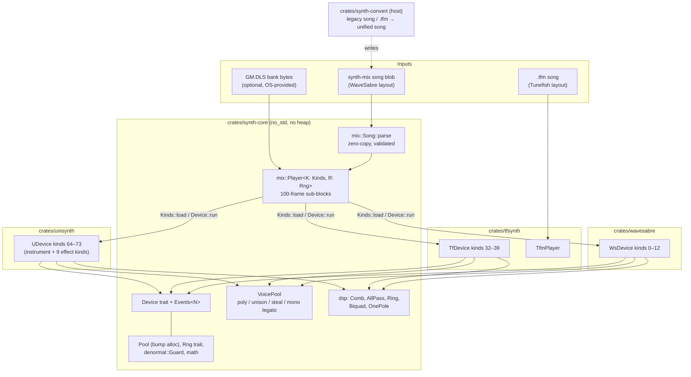

# Synth architecture

The intro's music runs on two synth engines that sit on one shared core, and a third, the unified synth, is built to replace both. Each engine has its own document:

| Doc | Covers |
|---|---|
| [`synth-core.md`](synth-core.md) | Shared layer: `Device` contract, event slots, `VoicePool`, DSP primitives, the `synth-mix` song blob and `Player`, memory, determinism, mixed-engine songs |
| [`wavesabre.md`](wavesabre.md) | `crates/wavesabre`: Rust port of the 13 WaveSabre devices (5 instruments, 8 effects) |
| [`tunefish4.md`](tunefish4.md) | `crates/tfsynth`: MIT Tunefish 4-compatible engine (spectral wavetable synth, mod matrix, 10-slot effect chain, `.tfm` player) |
| [`unisynth.md`](unisynth.md) | `crates/unisynth` + `crates/synth-convert`: the unified synth that will replace both engines (change `add-unified-synth`): slot-based instrument, parameter laws, chunk format, the nine effect kinds, the converter, the parity, speed and size report |

Higher-level context lives in `docs/architecture.md` (section "Audio"). Measurements (parity, speed, size) are in
`research/softsynth-research.md`. The specs are `openspec/specs/{synth-core,synth-mix,ws-synth,tf-synth,tf-song}`.

## Layers at a glance

Rules that hold for every engine:

- **`no_std`, f32, no heap.** The caller passes one byte slice; everything (voices, delay lines, decoded samples, track
  buffers) is carved from it by a bump `Pool`. `required_pool` sizes it exactly.
- **One device contract.** Instruments and effects are both `Device`s with four channels (main L/R, sidechain L/R).
- **A primitive is shared only when ≥ 2 engines use the same algorithm** (design D2). Engine-specific numerics
  (WaveSabre FastSin table and `2^(dB/6)` law, Tunefish IFFT and ladder) stay in the engine crate.
- **Every device kind is a cargo feature** (`ws-<name>`, `tf-fx-<kind>`), so a release build only links the devices a
  song uses. A song that uses a disabled kind fails at load (`UnsupportedKind`).
- **Deterministic.** One random source per song; seek restores the post-load snapshot.

## Engine comparison

| | WaveSabre (`wavesabre`) | Tunefish 4 (`tfsynth`) |
|---|---|---|
| Origin | Port of logicomacorp/WaveSabre @ 9245fb8 (MIT, notice kept) | Own MIT implementation from `research/tunefish4-functional-spec.md` |
| Synthesis | Per-device: 2-op PM (Falcon), BLIT subtractive (Slaughter), samplers (Specimen, Adultery, Thunder) | One instrument type: spectral partials → IFFT → 512-sample wavetable |
| Control rate | Per sample (envelopes, filter cutoff) | Per 512-frame block (ADSR, LFO, mod matrix, filter coefficients) |
| Voices | 256 per instrument, no stealing, unison via `VoicePool` | 16 per instrument, oldest stolen, unison inside the voice (1–10 layers) |
| Modulation | Fixed routes (pitch env, mod env → cutoff, vibrato) | Multiplicative mod matrix, 8 live slots, 5 sources, 31 targets |
| Effects | 8 standalone devices on the track chain | 10 serial insert slots inside the instrument (7 kinds), also standalone kinds 33–39 |
| Params | 0–42 per device, normalized 0..1 | 112 per instrument, normalized 0..1 |
| Sample rate | Song rate (`Ctx::rate`) | Fixed 44 100 Hz |
| Song formats | `synth-mix` blob | `synth-mix` blob (kind 32) or `.tfm` |
| Size (i686, squishy) | 27.6 KB all devices, 14.3 KB Slaughter only | 18.9 KB all effects, 14.8 KB no effects |

## The unified synth next to them

`unisynth` is one instrument (three oscillator slots: phase-mod, band-limited saw/pulse, spectral wavetable, sampler; noise;
four filter slots; four envelopes; two LFOs; a 12-slot matrix) and one effect set (nine kinds, 15 modes) that play the
songs of both legacy engines after `synth-convert`. The legacy crates stay until `tools/unisynth-parity/report.md` says
**READY** (every device and reference song within tolerance, and the A/B listening signed off); then the change
`retire-legacy-synths` removes them.

Farbrausch V2 songs (`.v2m`, format versions 0–6) import too (`synth-convert v2m`, change add-v2-import). The V2 voice,
channel stage, Ronan speech and global effects are `unisynth` modules (`us-v2`). There is no legacy V2 crate: the
reference is the external v2redux player, and `tools/unisynth-parity/v2-report.md` holds the parity of the 15
acceptance songs. The channel stage's reverb, delay and aux sends travel on extra output pairs. A receive's channel
field selects the sending and the receiving pair (`synth-core` feature `pairs`; old blobs are unchanged). See
[unisynth.md](unisynth.md#v2-voice-change-add-v2-import) and [synth-core.md](synth-core.md#channels).

| | Legacy engines | Unified (`unisynth`) |
|---|---|---|
| Kinds | 0–12 (WaveSabre), 32–39 (Tunefish) | 64 (instrument), 65–73 (effects, a mode per legacy effect) |
| Control rate | per sample / per 512-frame block | 32-frame grid on absolute frames (8 for 256 frames after a note edge) |
| Modules | one cargo feature per device | one cargo feature per module (`us-osc-wt`, `us-flt-ladder`, `us-fx-reverb-compact` …), listed per song by `synth-convert features` |
| Size (i686, squishy) | 27.6 KB WaveSabre all devices + 18.9 KB Tunefish all effects | see the size table of the report (all-modules and per-song builds) |
| Speed | Elysian 5.6×, no_remorse 12.9× real time (size profile) | Elysian and no_remorse above the same bars on the speed profile; figures in the report |

