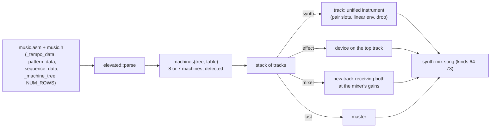

# Elevated / Atrium: Mentor's 4k synth in the unified synth

Change `add-elevated-import`. Songs of Mentor's (TBC) 4k synthesizer import into `unisynth`:
- **Elevated** (RGBA & TBC, Breakpoint 2009), from its public source release;
- **Atrium** (TBC & Loonies, Breakpoint 2008);
- **Receptor** (TBC, NVScene 2008 4k), carved from its exe: no source was released (change add-receptor-import).

There is no legacy engine crate. The original code is the reference, assembled and run under Wine by
`tools/elevated-parity`. The behavioural reading of the engine, provenance and measurements are in
`research/elevated-synth.md`.

## Song file

A generated NASM data file with four labels:
- `_tempo_data`: samples per step, a row byte, −1
- `_pattern_data`: 16 note bytes per pattern
- `_sequence_data`: `NUM_ROWS` pattern indices per synth machine
- `_machine_tree`

The synth strides the sequence by `NUM_ROWS` from **`music.h`**, which the converter reads from the same directory.
The row byte in `_tempo_data` can differ: Elevated has 113 there and 114 in `music.h`.

The machine tree is a byte program. The first record is a synth without an opcode, then come `opcode, record` pairs,
ended by a negative byte. **The opcode table depends on the build:** Atrium's synth has 8 machines, Elevated's 7
(atan left out, so 6 is the allpass). The converter walks the tree with both tables and takes the one that ends
exactly on the terminator with one stack entry. A tree that reads the same under both is not ambiguous; otherwise
`--table 7|8` decides.

| machine | record | unified device |
|---|---:|---|
| synth | 72 B | instrument (kind 64) on a new track |
| delay | 12 B | delay `ping-pong` |
| filter | 32 B | EQ `svf-lfo` |
| compressor | 12 B | distortion `knee` |
| mixer | 8 B | a new track receiving the top (`g₀`) and the one below (`g₁`) |
| sine distortion | 8 B | distortion `sine` |
| atan distortion | 8 B | distortion `atan` (8-machine table only) |
| allpass | 12 B | delay `allpass` |

## Notes

Synth `k` reads rows `k·NUM_ROWS…`. Step `s` of row `r` is at frame `(16r + s)·step`.
- Note byte n is MIDI note n.
- Notes 0 and `0x80` hold whatever sounds.
- **`0x7F` and `0xFF` cut.** The converter sends a note-off, and a linear envelope ends at once.
- **Glide (`0x80 | n`, Receptor's build).** Note n slides linearly in frequency towards the next non-empty byte of
  its own 16-step pattern, searched cyclically, at the rate that reaches it on that step. The slide runs on until the
  next non-empty step or the envelope's end. The converter writes a pitch-bend lane on the track: byte 128 (exactly
  no bend) outside glides, a step to the slide's start at the note, then ramp points within 0.05 semitones of the
  curve. The instrument's bend range is the largest offset the synth needs. An end further than 24 semitones shifts
  the played note by whole semitones so both ends fit. The player reads automation once per sub-block, so the step
  back to 128 reaches the next note up to one sub-block (2.3 ms at 100 frames) late.
- The original *overwrites* its buffer per note, so every channel is monophonic with a hard cut. The instrument has
  capacity 1 with steal oldest.

## Instrument

| original | unified |
|---|---|
| 3 oscillator pairs (wave, op, phase shift, detune) | 3 `pair` slots: wave, shift, `d`; op 2 add, 3 add with polarity −1, 4 multiply (combine), 1 slot off |
| attack, decay, sustain, release (frames), levels 0 → 1 → ½ → ½ → 0 | envelope 1 `linear`, attack/decay/`hold`/release from the frames, sustain ½ |
| `base_freq` (cycles/sample), `freq_exp` | `drop.base` = base·44 100 Hz, `drop.rate` from `k = freq_exp` (off at 1) |
| noise mix | noise level, width 0 (the same noise on both channels) |
| volume, stereo: `L = vol·x`, `R = vol·stereo·x` | voice pan `st²/(1 + st²)` (equal power), master `vol·√(1 + st²)` |

Warnings, not errors: a negative stereo factor or volume (its magnitude is used), a gain above 16, a detune outside
0..2, a segment longer than 5 s. Errors (nothing is written):
- a missing section or `NUM_ROWS`
- a truncated machine
- an unknown opcode (with its byte offset)
- a stack that underflows or ends with more than one track
- a pattern index outside the patterns
- a note byte above 127
- a zero-length envelope segment (the original divides by it)

## Effects

The mode laws are in [`unisynth.md`](unisynth.md), section Effects. Two points matter for conversion:
- **The filter.** It is the shared state-variable step (`flt::run`, input form: `high = q·(x − band) − low`) once per
  sample. It is the same step as the V2 and WaveSabre filters, run once instead of twice.
- **The LFOs.** The original's coupled-form LFOs are computed in closed form from the absolute song frame, so a render
  can start anywhere.

## Receptor: a song without a source

Receptor's synth is Atrium's build with a new synth machine: the glide flag, and a cut that zeroes a gate instead of
the envelope (same output). `tools/elevated-parity` takes it from the released exe:
1. `crinkler-unpack.py` emulates Crinkler's decompressor (unicorn) and dumps the unpacked image (base 0x410000).
2. `carve.py receptor` writes `music.asm`/`music.h` from the dump at the build's addresses (tree 0x422154, sequence
   0x4218C8, patterns 0x422B10; 4010 frames per step, 133 rows, 16 synths), checked against its code.
3. `dump-ref.c` runs the intro's own `generateMusic` on the dump under Wine. The dump sits in the harness's own
   `.bss` (image base 0x400000), so the loader reserves its addresses before Wine's heaps. The x87 runs at 24 bits:
   the intro renders right after `IDirect3D9::CreateDevice` without `D3DCREATE_FPU_PRESERVE`.

## Parity

`tools/elevated-parity`:
- `build-ref.sh` renders the original (`SOLO=1` per synth);
- `parity.ts` compares with the song-parity tolerances of `tools/unisynth-parity`;
- `capture.ts` checks against the YouTube captures.

Both songs pass, against the original and against their captures, and 20 of 22 solo renders pass. The two slow pads
fail only the onset alignment: they have no transients. The table is in `research/elevated-synth.md` §10.
Receptor passes against its own code and its capture, and 12 of 16 solos pass. The four failures are slow pads
that fail only onset alignment (§12 there).

The DAW and the songs page carry both as `project/music/released/{atrium,elevated}.song.json`
(`tools/elevated-parity/make-demos.py`: credits from pouet and the nfos, track names from instrument and notes;
licence and permission in `project/music/NOTICE.md`).

The compo build is 18 944 bytes (Atrium) and 19 456 bytes (Elevated) after squishy, with the song baked as Rust
(§11 there).
