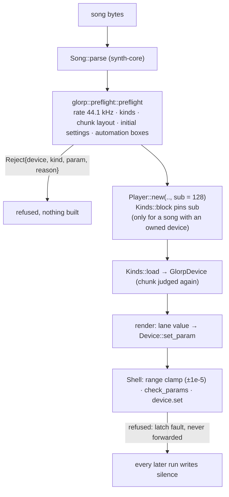

# Glorp devices on the player (`crates/glorp`)

MIT, `no_std`, independent behavioural implementations of fourteen device kinds of the proprietary "Glorp" song, wired into
`synth-core`'s `Player` through `GlorpDevice` (`Device` + `Kinds`). Written from observed behaviour
([`research/glorp-devices.md`](../../research/glorp-devices.md)); no original binary, code, song or recorded tap is in
git. **With id 30 every id of the song is implemented and the real song is accepted and plays** through `GlorpPlayer`
(see [Whole song](#whole-song-through-the-player)).

| Kind | Device | Note |
|---|---|---|
| 3 | stereo waveshaper / saturator | all 11 parameters, whole `[0, 1]` range |
| 7 | look-ahead compressor / limiter | internal or side-chain detector (P0), bit-exact on the song window |
| 14 | noise-excited modal resonator bank (instrument) | 16 voices, **poly and mono** (P23 = 1.0: the original's note stack, legato retargets without a new voice), up to 256 band-pass modes per voice, 26 parameters (P1–P4, P7–P9, P11, P15, P19, P20, P25 latched at note-on, the rest live; P5 / P6 / P12 / P24 inert), shared harmonic-selection generator, whole `[0, 1]^26` accepted, tolerance parity: device 3 92.13 % bit-exact on the whole song, worst 2.9e-5 of peak; 97 vectors ≤ 3.3e-4 of peak |
| 20 | negative-feedback comb resonator (instrument) | 16 voices, poly only, 16 parameters latched at note-on, **velocity sensitive: a note-on above velocity 213 is refused** (the noise envelope would grow without bound), bit-exact on 53 vectors, 98.8 % bit-exact on the whole song (worst 2.4e-5 of peak) |
| 21 | additive recursive sine bank (instrument) | 16 voices, poly only, ≤ 512 partials per voice (the original allows 10,201), tolerance parity; see the lane gap below |
| 22 | circle oscillator through an iterated 3D trig map (instrument) | 16 voices, poly only, **P2 / P4 weight guard** (a small P2 with a large P4 overflows to NaN in the original), 99.9997 % bit-exact on the whole song |
| 25 | percussion synth | 16 voices, poly only, tolerance parity |
| 27 | comb-resonator percussion synth | 16 voices, poly only, tolerance parity |
| 28 | unison oscillator bank through a 4-pole ladder (instrument) | 16 voices, poly only, 26 parameters (P0–P14, P16, P18–P21 latched at note-on, P15 / P17 / P22–P25 live), up to 32 unison oscillators, **velocity scales the oscillator by `velocity/127`**, whole `[0, 1]^26` accepted (tested vectors render finite), 99.29–99.93 % bit-exact on the four song instances, worst 2.4e-7 |
| 30 | granular delay + comb/all-pass reverb + filters + shifter in the feedback path + all-pass cascade (effect) | 24 parameters, whole `[0, 1]^24` accepted **except** the cascade on (`P16 > 0.001`) with a first- or second-order topology (`trunc(2.999·P20) ≠ 0`: refused, cross-parameter), borrows ≈ 4.06 MB of pool per device, bit-exact on five of the seven song instances, 2.5e-13 / 1.4e-4 on the other two, 79 of 82 vectors bit-exact (3 refused by design) |
| 32 | chorus / all-pass-feedback ensemble | both modes; mode A delay limited to the 2200-sample line |
| 34 | frequency shifter | all 4 parameters (P0–P2 inert) |
| 35 | all-pass cascade | second-order topology only (P5 ≥ 0.6669) |
| 38 | multimode filter | low/high-pass, one stage, post distortion 0–2, neutral envelope amount only |

## Why a gate, not just a `Device` impl

`Device::set_param` returns `()`: it cannot say "this setting is not modelled". The standalone devices do say it
(`Err`), so a lane that interpolates through an unmodelled setting would be applied by the player as a silent no-op
and the song would render wrong without a sound of protest. The integration therefore judges the **whole song before
anything is built** and keeps a last line of defence in the device.

Two doors lead to the same checks: `glorp::player::GlorpPlayer::new` (owned API, full `Reject` diagnostics) and
`Player::<GlorpDevice, _>::new` directly (the owned-kinds `preflight_owned` runs inside `load_devices`, and `Kinds::need`
refuses a kind this crate does not implement with `LoadError::UnsupportedKind`; the answer is the coarser `LoadError`).
Going around the owned API is not a bypass.

The `Kinds::preflight` hook judges **only owned kinds** (the trait contract): devices of other kinds, lanes on them, and
the rate / device cap of a song without owned devices are skipped, so `Either<GlorpDevice, Other>` (either order)
loads a mixed song with the Glorp part fully judged. The strict `preflight` (standalone `GlorpPlayer`) additionally
refuses any foreign kind with its device index. `Either` picks the first registry that does not answer
`UnsupportedKind`, so registries with **overlapping kind numbers cannot be mixed** (Glorp 3/7 vs WaveSabre 0–12,
Glorp 32/34/35/38 vs Tunefish 32–39: the first registry takes them); only disjoint kind sets are supported. The 128
pin is **per song**: `GlorpDevice::block` answers `Some(128)` only when the song holds an owned device, so a
foreign-only song in `Either<Foreign, GlorpDevice>` (either order) plays at the foreign engine's sub-block, while any
song with a Glorp device (alone or mixed) needs 128. `Either` combines both registries' answers; if the foreign
registry pins a different size and the song holds devices of both, the song is refused (`Malformed`). Direct
`Player::<GlorpDevice, _>::new` cannot bypass the pin (an owned device at another `sub` is `Malformed`; a foreign-only
song is still refused by `need`).

Notes: a lane event is a note-on (byte ≤ 127 + velocity) or a note-off (bit 7, note = low 7 bits), so the song format
cannot carry a note above 127, the one note the instruments refuse. Velocity is ignored by every instrument **except
ID 20**, which scales its excitation by it and refuses a note-on above 213: the preflight scans the note lane of every
track that carries an ID 20 and refuses the song (`Setting`, names the ID 20 device) when it holds one; a hand-written
`note_on` above it latches. A full
256-slot queue drops the event as the original does (no fault). A `Device::note_on(>127)` by hand latches.

### What the preflight refuses

| Check | Refusal |
|---|---|
| song or `Env` rate ≠ 44100 | `Rate` |
| device kind not in the table above (incl. 30, the one id of the song not implemented) | `UnsupportedKind`, names device + kind |
| chunk ≠ `4 + 4n` bytes, or its trailing size field ≠ its length | `ChunkLength` / `ChunkSize` |
| a parameter not finite or outside `[0, 1]` | `Range`, names the parameter |
| an unmodelled setting in the chunk (ID 38 mode / stages / pre- or post-distortion / envelope amount, ID 35 topology, ID 32 delay beyond the line) | `Setting(text)` |
| > 256 devices, > 64 distinct automated devices | `TooManyDevices` / `TooManyAutomated` (an untrusted song cannot size the allocation) |
| an automation lane that can leave the supported settings | `Automation(text)`, names device + parameter |
| sub-block ≠ 128 | `Malformed` from `Player::new` (`Kinds::block`, for songs with an owned device) |

**Mono/legato and unison** exist in the original's shared synth but are not among any device's parameters and the song
format has no field for them: a chunk that carried one would be longer than `4 + 4n` and is refused by the length check.
Whether the original could be put in such a mode some other way is not established.

### Automation boxes

A lane writes `byte/255` values interpolated linearly between points, once per 128-frame block, in whatever order the
lanes are listed. So per device and parameter the preflight takes the **range of everything that can ever be written**
(the chunk value and every lane point), widens it by `1e-5` for the interpolation's rounding, and requires every
vector in the resulting box to be supported. No order of writes and no interpolation can then leave the supported set.

- IDs 3, 7, 20, 25, 27, 34 support every value: any lane passes (ID 22 on every parameter except P2 / P4, below).
- ID 35 (topology) and ID 38 (mode, stages, distortion, envelope amount): each unmodelled setting is an interval of one
  parameter, so each automated parameter is probed at both ends with the device's own `check`. ID 38's envelope amount
  must be exactly 0.5, a value no `byte/255` lane holds and interpolation does not keep: **any lane on P12 is refused**.
- ID 21's partial count `(trunc(100·P4)+1)·(trunc(100·P6)+1)` is bounded by the fixed voice memory (512): judged on the corner
  with P4 and P6 at their top, so two lanes that are fine alone but exceed it together are refused.
- ID 22's 3D map weights the iterations by `a^k` with `a = 10·P2 + 0.002` and accumulates `W ← (W + 1)/a` in f32: a small
  P2 with a large P4 overflows (`a = 0.002` gives `500^n`; **n = 15 and 16 return NaN in the original**, measured on the
  Wine instance). The guard is `W ≤ f32::MAX / 4` computed the way the voice does, monotone in P2 (falling) and P4
  (rising), so the box is judged on the corner with P2 at its bottom and P4 at its top: two lanes that are fine alone
  but overflow together are refused, and so is a lane that only touches the corner in the middle. A `set_param` by
  hand judges the whole resulting vector (lower P4 before P2); a hand write that would overflow latches a fault
  instead of rendering NaN.
- ID 32 couples P2, P4 and P7. The box is judged on the corner with the longest delay (P2 and P4 at their top), so two
  lanes that are fine alone but reach the limit together are refused; a lane may not cross the mode A / B boundary (the
  base-delay glide would be stale after a B → A switch).

### Fault latch

What the preflight cannot see (a `GlorpDevice` driven by hand with a bad write, `run` with another length or rate) is
caught in the device: the first unsupported call is recorded (`GlorpDevice::fault()`, `GlorpPlayer::fault()`), not
forwarded, and every later `run` writes silence to the main pair; `GlorpPlayer::render_f32` returns `Err(fault)` with a
zeroed buffer. The latch survives `reset`.

## Behaviour

- Instruments overwrite main L/R, effects process it in place; ID 7 reads the side-chain pair when its P0 selects it.
- Notes reach instruments only (effects ignore them: observed inert; ID 38's envelope would react, hence the neutral
  envelope amount rule). A full 256-event queue loses the event exactly as the original does (not a fault).
- `reset` rebuilds a device from its **current** parameters: bit-identical to a fresh device (tested for every kind), so
  `seek` equals the straight render.
- `all_notes_off` on an instrument (all seven, ID 14 included) is that same rebuild: sounding voices and queued note events are
  gone, the parameters stay; effects ignore it. ID 14's P23 write that changes the voice mode (`trunc(v) = 1` is mono) cuts
  every voice and empties the queue and note stack, on a hand `set_param` and on a lane crossing alike.
- Block size 128 and 44.1 kHz are the reference engine's; automation and events are applied at block granularity.

## Verification

| Evidence | Where |
|---|---|
| Rejection tables for every door, lane boxes, latch, reset equality | `crates/glorp/src/tests_kinds.rs` (synthetic) |
| Four-device chain and a three-track graph with receives and side-chain are **bit-identical** to the standalone devices driven by hand; seek; a random-song soundness check (accepted ⇒ every written vector is supported, no fault) | `crates/glorp/src/tests_player.rs` (synthetic) |
| Hook, per-song `block`, `Either` combination (foreign-only / owned / mixed / conflicting) in the core | `crates/synth-core/src/tests.rs` `hook_tests` |
| Original reference (env-gated, `GLORP_REF_ROOT`, Wine harness output, local only; unset = documented skip, set + fixture missing = failure) | `crates/glorp/tests/reference_player.rs`, `reference30.rs` (ID 30: seven whole-song taps + 82 vectors + negative controls), `reference22.rs` (ID 22 whole song + 56 vectors + the original's NaN outside the weight guard), `reference20.rs` (ID 20 whole song + 55 vectors, the velocity ceiling, the level-follower kills) |

Reference results (release, 78,292 blocks = the whole song): the one-device songs rebuilt from the real chunk, note lane
and automation lanes of device 7 (ID 22: 20,042,696 of 20,042,752 samples bit-exact, max 1.19e-7 at peak 1.92, 469,752
lane writes; lanes removed / notes one frame late are caught), 4 (ID 20: 98.80 % exact, max 1.12e-4 at peak 4.73), 8 (ID 25), 9 and 10 (ID 27) through `GlorpPlayer` give the same errors as the standalone
replays of the recorded writes (device 8: 93.13 % exact, max 6.9e-4 at peak 5.3; device 9: 85.13 %, 5.8e-4; device 10:
69.53 %, 4.6e-4), so the core player's lane interpolation (`Delta`, per device) and event timing agree with the original **for those lanes**.
The adapter on the recorded buffers: ID 3, 7, 34, 38, 35, 32 devices match as the standalone suites (ID 7 / ID 34 dev 25 /
ID 38 dev 28, 29 bit-exact). Negative controls (flipped bit, lanes removed, notes one frame late, ID 35 writes dropped)
are caught.
ID 14 (devices 2 and 3 through `GlorpPlayer`, whole song, 16 notes, 234,876 lane writes on device 3): device 2 silent and exact, device 3 92.13 % bit-exact, worst 1.25e-5 at peak 0.426 (bound 1e-4 of peak; the `expf` ulp rung by Q = 1000 resonators); lanes removed and notes one frame late are caught (`reference_player.rs`, `reference14.rs`).
ID 28 (devices 11..14 through `GlorpPlayer`, whole song, 55 / 172 / 352 / 65 notes, up to 156,584 lane writes): 99.29 / 99.68 / 99.29 / 99.93 % bit-exact, worst 2.4e-7 at peaks 0.35–1.47; lanes removed and notes one frame late are caught (`reference_player.rs`, `reference28.rs`).

## Whole song through the player

`whole_song_is_accepted_by_the_preflight` (the real song has no unsupported id; an ID 30 chunk with the cascade on over a
first-order topology is refused naming device and parameter) and `whole_song_through_the_player_matches_the_original_render`
(`reference_player.rs`, release, ≈ 4 min): `GlorpPlayer` renders the 10,021,344 frames of `389811-2.bin`, scaled to 16 bit
(round, clip) and compared with the original's own render (`fullA.wav`, whole 128-frame blocks): **23.8 % of samples
exact, 49.5 % one step off, worst 137 steps (0.42 % of full scale) at 183.2 s**, no device fault. This is tolerance parity
of the mix, not bit parity: the residual comes from the upstream instruments and effects that are tolerance-parity only
(ID 25 / 27 / 21 / 20 / 14 at 1e-4 … 1e-3 of peak, 24,395 float samples are at or beyond full scale), which the ID 30
devices pass on (they reproduce the original exactly **given the original's recorded input**). The attribution is by
reasoning, not by isolating each device; `GLORP_SONG_WAV=<path>` makes the test write our render (16-bit WAV, outside
git) for listening. The pinned bound is 160 steps.

## ID 21 and the lane interpolation (fixed: per-device `Device::lane_lerp`)

Standalone ID 21 replays the original's recorded writes: song device 5 (167 notes, three automated lanes) 99.45 % of 20.04 M samples
exact, max error 9.4e-4 at peak 3.64 (bound 4e-4 of peak); device 6 99.9998 % exact, 1.2e-7; 40 synthetic vectors ≤ 7.5e-8 of
peak except one extreme (512 partials at 6e-2 relative: one-ulp pow rounding amplified by high partials).

The original writes a lane as `a + (b-a)·t` (0 mismatches of 6,028,484 recorded writes against that form, 402,709 against the
core's `a·(1-t) + b·t`), and ID 21 hashes the **bits** of P7, so a one-ulp lane value plays other partials: before the fix
device 5 through `GlorpPlayer` was off by 0.33 on a peak of 0.58 at its first note (block 62,728). The fix is a hook in
`synth-core`, per **device** because kinds of different engines coexist in one song (`Either`): `Device::lane_lerp() ->
LaneLerp` (`Mix` default, so WaveSabre / Tunefish / unisynth are unchanged; `Delta`), read once per lane at `Player::new`
from the loaded target device ([`synth-core.md`](synth-core.md)). `GlorpDevice` answers `Delta` for every kind; `Either`
forwards it. Nothing is refused for it: any mix of forms is representable.

Evidence (release, `GLORP_REF_ROOT`, whole song = 78,292 blocks = 20,042,752 samples, `reference_player.rs`): device 5 through
`GlorpPlayer` = **19,931,754 exact (99.446 %), max error 9.389e-4 at peak 3.6386**, the same figures as the standalone
replay (pinned: ≥ 99.44 % exact, max < 9.5e-4, bound 4e-4 of peak). Device 6: 100.000 % exact, 1.19e-7 (bound 1e-6).
Sensitivity: the same song through a wrapper that answers the default form leaves the bound (max 0.327 at peak 1.77 over the
first 64,500 blocks). Synthetic (no fixtures): every kind answers `Delta`; an ID 21 song with a ramping P7 lane renders
bit-equal alone and inside `Either<Foreign, Glorp>` / `Either<Glorp, Foreign>` and differs from the default form;
`synth-core` records the writes of two engines' devices in one song and checks each lane bit for bit against its own
device's form. The preflight box (`MARGIN` 1e-5) holds both forms with ≥ 100× room.

## Not claimed

- The real song plays with tolerance (not bit) parity of the mix (see above); ID 30's cascade topologies 1 / 2, unison, other rates and block sizes are not modelled. Mono (ID 14 only) follows the original's note stack; the song never overlaps two notes, so the legato rules are verified on synthetic vectors only.
- Lane interpolation of a lane the song does not have (and the live `synth-wasm` host, whose own lane walk is `Mix` only), and effects chained behind unsupported devices, are not compared
  with the original (an effect has no input path in a song except from another device).
- `required_pool` of a hostile song can still be large (≈ 300 KB per ID 32 / ID 27 device, ≈ 4.06 MB per ID 30 device, ≤ 256 devices ≈ 1 GB): cap it.
- `Either<A, GlorpDevice>` is not meant: kinds 3 and 7 collide with WaveSabre's.
