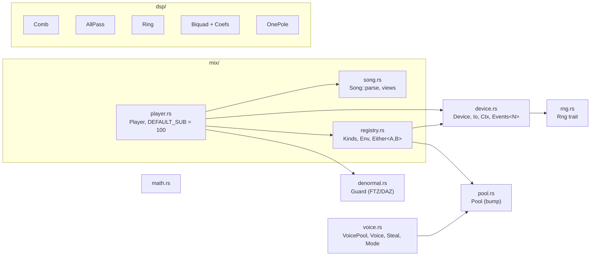
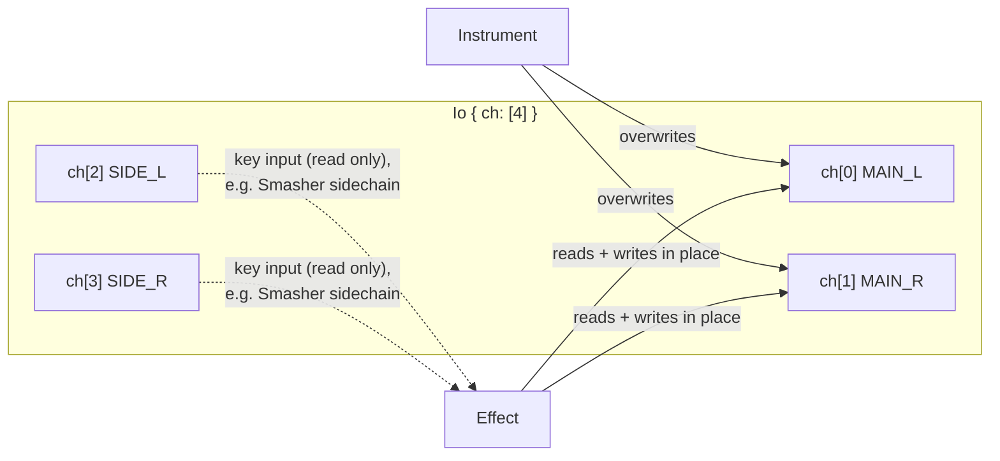
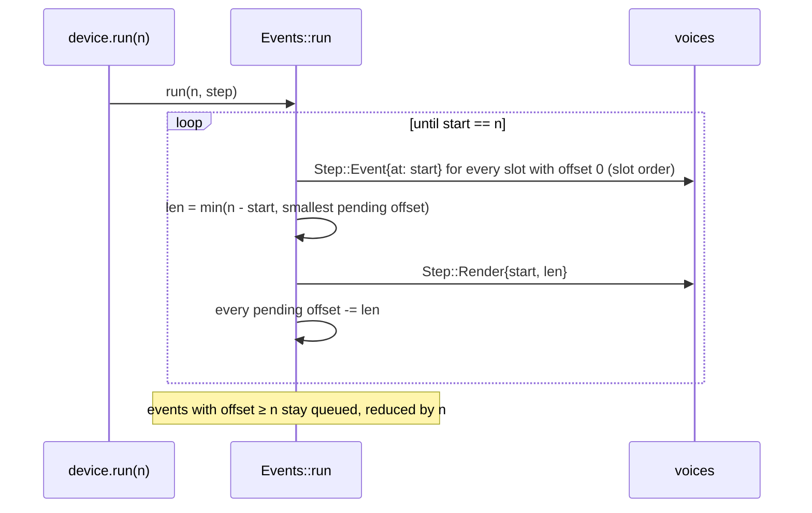
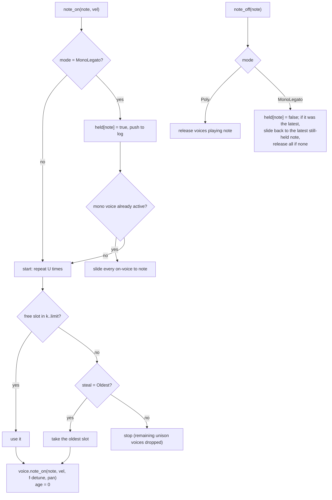
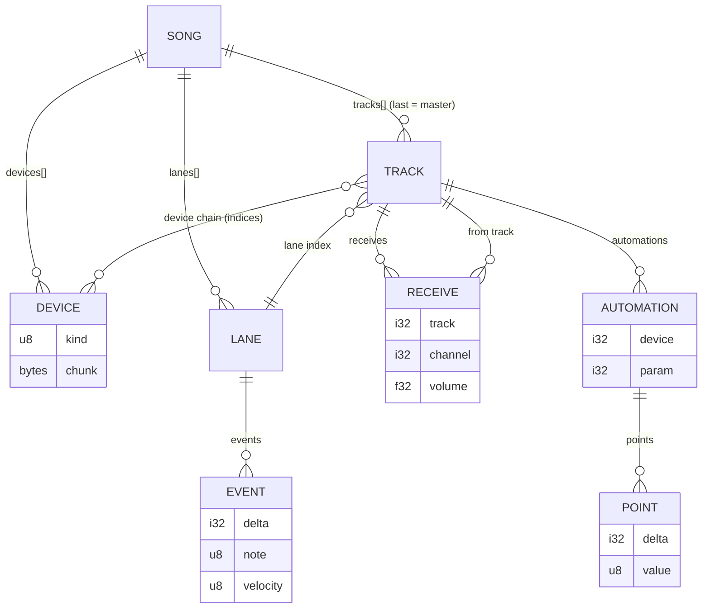
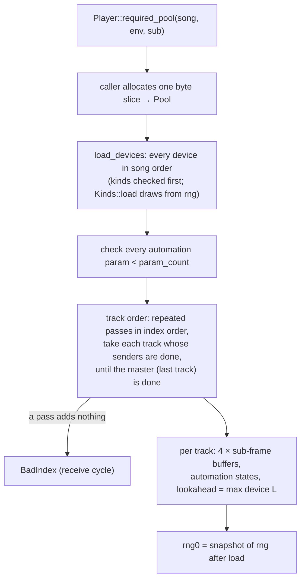
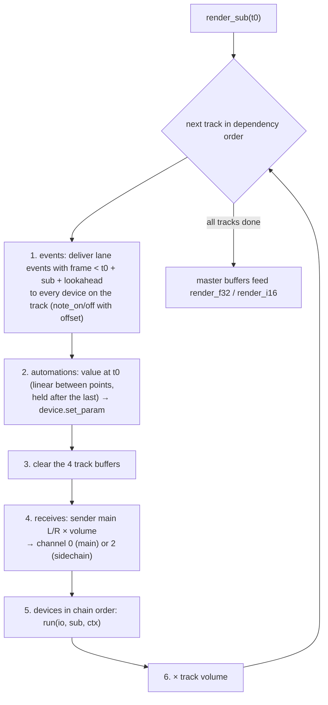
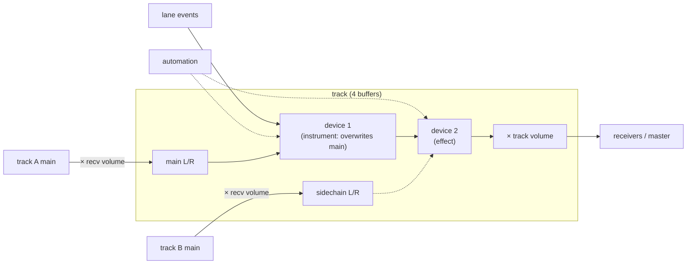
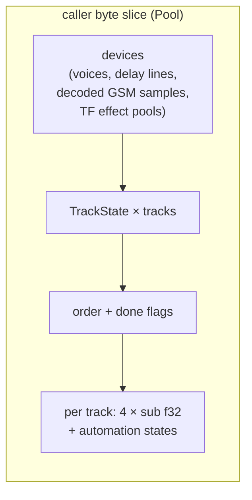

# synth-core: the shared synth layer

`crates/synth-core` is the part of the audio stack that both engines use. It is `no_std`, f32, has no heap, and
depends only on `libm`. It has two halves:

1. **Building blocks** for engines: the `Device` trait and its event slots, the `VoicePool`, DSP primitives, maths, the
   bump `Pool`, the `Rng` trait and the denormal guard.
2. **`mix`** (spec `synth-mix`): the song blob decoder (`Song`), the device registry trait (`Kinds`) and the song
   `Player`.

Source: `crates/synth-core/src/`. Per-file record: `crates/synth-core/AGENTS.md`. Engines: [`wavesabre.md`](wavesabre.md),
[`tunefish4.md`](tunefish4.md).

## Module map



## The device contract

Every instrument and every effect implements one trait (`device.rs`):

| Method | Contract |
|---|---|
| `param_count()` | Number of normalized parameters, constant for the device's life |
| `set_param(i, v)` | `v` normally in 0..1, not clamped; `i ≥ param_count` is ignored |
| `note_on(note, vel, offset)` / `note_off(note, offset)` | Queue an event `offset` frames after the start of the next `run`. Velocity 0 stays a note-on here; formats where 0 means off (`.tfm`) convert in their own decoder |
| `all_notes_off()` | Release all voices, drop queued events |
| `event_lookahead()` | `L` frames: the mixer delivers events with frame `< t + n + L`. A device with internal `B`-frame blocks needs `L = B − 1` |
| `reset()` | Back to the freshly loaded state (params kept). Required: seek uses it |
| `run(io, n, ctx)` | Render `n` frames in place |

### Channels



- Instruments **overwrite** main L/R. Whatever a receive put into main before the instrument is replaced.
- Effects transform main L/R and may read the sidechain pair.
- No device writes the sidechain pair; only track receives fill it.

### Context

`Ctx` replaces upstream globals: `rate` (Hz), `tempo` (BPM), `frame` (absolute song frame of this call's first frame,
used by block-based devices to stay on an absolute grid) and `rng` (the song's random source, `&mut dyn Rng`).

### Event slots

`Events<N>` is upstream `SynthDevice`'s fixed event array: a new event takes the first free slot, a full array drops
it, and due events fire in slot order. `Events::run(n, f)` splits one call at event offsets:



So a WaveSabre instrument renders sample-accurately: a note at offset 37 starts at frame 37 of the call.

## VoicePool

`VoicePool<'a, V>` owns `n` voices from the pool and implements upstream `SynthDevice` allocation. Voice types
implement `VoiceState` (`is_on`, `note`, `kill`) and `Voice<C>` (`note_on`, `note_off`, `slide`) where `C` is the engine's
voice context (`WsCx` for WaveSabre, `NoteCx` for Tunefish).

| Setting | Meaning |
|---|---|
| `limit` | Only slots `0..limit` are used (Tunefish `GenPoly`) |
| `unison` U | One note starts U voices |
| `detune`, `pan_spread` | Per unison voice: `f = j/(U−1)` counting down from 1, detune `f·detune`, pan `(f − .5)(2·pan_spread − 1) + .5` |
| `steal` | `Steal::None` (WaveSabre: no free slot → voice dropped) or `Steal::Oldest` (Tunefish: max age, lowest index on ties; `tick()` ages per block) |
| `mode` | `Mode::Poly` or `Mode::MonoLegato` (note log + held flags) |



`set_mode` kills all voices. Upstream's log overflow and empty-log read are guarded.

## DSP primitives (`dsp/`)

A primitive lives here only when at least two engines use the same algorithm.

| Type | Algorithm | Used by |
|---|---|---|
| `Comb<'a>` | Freeverb comb over a caller buffer: `out = buf; z = out(1−damp) + z·damp; buf = in + z·fb` | Cathedral, TF reverb |
| `AllPass<'a>` | Freeverb allpass: `out = buf − in; buf = in + buf·fb` | Cathedral, TF reverb |
| `Ring<'a>` | Circular delay: `write`, `oldest()` (read-then-write = len-sample delay), `at(k)`, `read_frac(d)`. `set_len` clears on change (WaveSabre `DelayBuffer`), `set_len_keep` keeps contents (Tunefish) | Echo, Chamber, Smasher, Twister, Cathedral pre-delay; TF delay, chorus, flanger |
| `Biquad` + `Coefs` | DF1, evaluated as `c1·x + c2·x1 + c3·x2 − c4·y1 − c5·y2` (WaveSabre op order). RBJ `lowpass/highpass/peak(cos, α)` take the engine's own sin/cos for parity | `WsBiquad` (Leveller), TF RBJ HP/BP, notch |
| `OnePole` | `z += k(x − z)` | TF EQ |

Other helpers: `math.rs` (`note_to_hz`, `db_to_gain` = 10^(dB/20), equal-power `pan_left/right` = √(1−p), √p, `mix`,
`clamp`, `exp2`), `denormal::Guard` (sets x86 MXCSR FTZ+DAZ or AArch64 FPCR.FZ for a render call, restores on drop),
`Pool` (bump allocator: zeroed aligned slices, `uninit` for values that themselves allocate from the pool, `need::<T>(n)`
upper bound; a failed request consumes nothing; destructors never run), `Rng` (one method, `next_f32`; the engine
chooses law and seed).

## The song blob (`mix/song.rs`)

The `synth-mix` format is WaveSabre's song blob, as written by `WaveSabreConvert`. Little endian:

```text
tempo i32, rate i32, length f64 (seconds)
devices: n i32, n × { kind u8, size i32, chunk[size] }
lanes:   n i32, n × { events i32, events × { delta i32, note u8 (bit 7 = note-off), [velocity u8 if note-on] } }
tracks:  n i32, n × { volume f32,
                      receives i32 × { track i32, channel i32 (0 main | 2 sidechain), volume f32 },
                      devices  i32 × { device index i32 },
                      lane i32,
                      automations i32 × { device (index into this track's devices) i32, param i32,
                                          points i32 × { delta i32 (signed), value u8 } } }
```



`Song::parse` validates once: counts against remaining bytes (a count is rejected before any loop if it cannot fit),
every index, receive channels 0/2, trailing bytes, tempo and rate > 0. After that the views (`devices()`, `lanes()`,
`tracks()`, `automations()`) read the borrowed bytes without failing. Note deltas are ≥ 0; automation times are signed.
Automation values are `byte/255`.

Device chunks follow upstream `Device::SetChunk`: `(size − 4)/4` little-endian f32 parameters, then the i32 size. A
short chunk leaves the remaining parameters at their defaults. Sample devices put their sample data first.

## Registry (`mix/registry.rs`)

`synth-core` cannot depend on the engines, so each engine provides an enum of its device kinds that implements
`Kinds<'a>: Device`:

- `need(kind, chunk, env)` → pool bytes for that device;
- `load(kind, chunk, env, pool, rng)` → the device; load-time random draws come from the song rng.

`Env { rate, tempo, bank: Option<&[u8]> }` carries the GM.DLS bytes for Adultery. `Either<A, B>` combines two
registries for a mixed-engine song: it tries `A`, and falls back to `B` on `UnsupportedKind`. Example:
`Either<WsDevice, TfDevice>` plays WaveSabre kinds 0–12 and Tunefish kinds 32–39 in one song.

## Player (`mix/player.rs`)

`Player<'a, K: Kinds, R: Rng + Clone>` is a single-threaded port of upstream `SongRenderer`.

### Load



### Render: one sub-block (`sub` = 100 frames by default)



A track's signal path:



- `render_f32(out)` and `render_i16(out)` fill interleaved stereo of any length from the master's sub-block buffer. i16
  uses upstream's `clamp(trunc(x·32767))`. The denormal guard is on for the call.
- `seek(frame)` resets every device and track, restores `rng0`, then re-renders silently up to `frame`.
- `length_frames()` = `trunc(length · rate)`.

### Determinism

All voices of all devices draw from one song random source, in track render order. Output does not depend on the
caller's buffer size, but it does depend on `sub`: the span length decides which voice gets which random number when
voices overlap. Upstream renders in 100-frame steps, so references are rendered with `DEFAULT_SUB = 100` (Global
Groove is bit-identical at 100 frames and looks like 0.9 dB SNR at 4096).

### Memory



`required_pool` is an upper bound that includes alignment padding; a pool one byte short of the measured use fails with
`OutOfMemory`. Adultery reads GM.DLS waves in place from `Env::bank`, so the bank costs no pool space.
