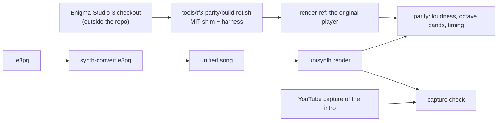

# Tunefish 3 (Enigma Studio 3) songs

Brain Control's intros of 2010–2012 (Pandora, Transplant, Train Control) were made with Enigma Studio 3, whose synth is
Tunefish 3, the predecessor of Tunefish 4 ([tunefish4.md](tunefish4.md)). There is no Tunefish 3 crate: projects
convert straight into the unified synth (change add-tf3-import), the way V2 songs do. The source
(`enigmastudio/Enigma-Studio-3`) states no licence: it is read for behaviour only and never enters the repository.

- **Behaviour**: `research/tunefish3-functional-spec.md` (signal flow, laws, the player build, song timing, quirks, the
  feature survey of Transplant and the 128 presets in §9).
- **Unified parts**: the `points` and `pad` oscillator types and their decimation stage
  ([unisynth.md, oscillator slots](unisynth.md#point-oscillator-us-osc-points)), stored at odd positions of the
  expanded oscillator-type choice with appended point fields ([unisynth.md, parameters](unisynth.md#parameters)).
- **Converter**: `synth-convert e3prj` and `synth-convert tf3` ([unisynth.md, Tunefish 3 projects](unisynth.md#tunefish-3-projects-e3prj-change-add-tf3-import)).
- **Tools**: `tools/tf3-parity` (reference renderer built from the checkout, feature survey, YouTube captures and the
  capture check; `tools/tf3-parity.AGENTS.md`).

## How Tunefish 3 differs from Tunefish 4

| | Tunefish 3 | Tunefish 4 |
|---|---|---|
| Sound sources | point oscillator (1–4 points, step/linear/spline, unison 1–11, sub-oscillator) and a static PADsynth table (2¹⁶, four profiles, an octave below the note), both through an always-on 12.83 kHz decimation stage with up to 8× oversampling | one spectral wavetable rebuilt every 4 blocks per voice |
| Block | 384 frames | 512 |
| Mod matrix | 10 slots, amount `(20(p − 0.5))²`; point, drive and ADSR-decay targets; MOD1–4 from the note's effect word | 8 of 10 slots, `2p` / `1 + 9(2p − 1)²`, self-modulation and LFO-depth targets |
| LFOs | sine `sin φ + 0.5`, ramps 0..2 and 1..−1 | all shapes 0..1 |
| Songs | tracker patterns on 16 sequence tracks (`.e3prj` XML in the editor, a binary stream without magic bytes in the intro) | `.tfm` event lists |
| Output | ×11 per instrument, ×5000 into i16 | ×11, ×200 |
| Player build | leaves out band-pass, notch, MOD1–4, chorus, flanger, EQ | everything |

## Songs available

| Intro | Song source | Reference |
|---|---|---|
| Transplant (2011) | the project ships in the Enigma-Studio-3 repository; the executable holds the same song (converts byte-identically) | original player render; YouTube capture `31cDnVWhS7w` |
| Pandora (2011) | inside the executable, in the 2011 engine's older layout (`tools/tf3-extract`; 21 instruments of 99 percent parameters plus a slot; no effect slots), converted with `--engine 2011` | YouTube capture `RlyIJD9AEWM` (no reference renderer for that engine) |
| Train Control (2012) | inside the executable (`tools/tf3-extract`; every parameter stored as a percentage) | original player render; YouTube capture `Gm0NWMdcbmU` |

`tools/tf3-extract` reads a released executable without Wine: `unpack.py` emulates the kkrunchy stub until the intro
makes its first API call and dumps the unpacked image; `extract.py` finds the synth block (the demo operator's `Song`
parameter: 32 instrument flags, each parameter for every present instrument, then the song) and writes an `.e3prj`.
When it finds none, it tries the older layout Pandora uses (change add-tf3-pandora), which it reads through a bit
reader:
- **Instruments:** each is 99 parameter bytes in percent plus its synth slot. Bytes 0–97 follow the current order,
  byte 98 is the gain, and there are no effect slots.
- **Song:** pattern sizes, cells and instances are packed arrays (`min + v · step`, any bit width). Each cell is a
  word whose top byte counts the empty rows before its note.

It writes that as a current-format `.e3prj` with band-pass, notch and effects off. That engine's laws differ (unison,
sub-oscillator, drive, LFO, oscillator offset; `research/tunefish3-functional-spec.md` §10), so the project is
converted with the older-engine option. A candidate counts only if the whole block parses, every cell is consumed and
every read stays inside the image.

`synth-convert e3prj --engine 2011` plays that engine's laws: unison `fi(15p) + 1` layers, sub-oscillator `fi(5p) + 1`
passes at halving gain, drive `1 + 32p`, and an LFO sine of `0.5 + 0.5·depth·sin` at 25p² Hz. It warns, per
instrument, about what the unified synth cannot play: the oscillator offset with its one-sided clip, clipping per
layer, the point curve played without a table, and no decimation. Measured on Pandora (spec §10.5):
- **Per-layer clipping** is the large one: the original's many-layer instruments are 2–10 dB louder than ours.
- **The offset** changes level only on the two instruments where it pushes three passes into the clip.
- **The table and decimation** stay under 0.1 dB in the judged bands.

The song still passes the capture check, with bands within 3.89 dB.

Transplant and Train Control are in `project/music/released/` as adapted versions (within 0.07 dB loudness and 1.02 dB
per octave band of the original player, 1.40 dB of the captures), published pending Brain Control's permission.
Pandora is there too (`pandora.song.json`, music by skyrunner), judged against its capture only, within 3.89 dB per
octave band. Its known differences (above) make its layered instruments quieter than in the intro. The
music belongs to Brain Control; projects, images, renders and captures stay outside the repository
([project/music/NOTICE.md](../../project/music/NOTICE.md)).

## Presets

Enigma Studio 3's bank (`binary/tf3programs`, 128 files) holds 53 distinct presets (75 are the same init patch). The
DAW's library lists them as "Tunefish 3 presets", converted in editor mode (the bank is the editor's and the VSTi's),
by `cargo run -p synth-convert --example library` from `$SYNTH_LAB/tunefish3/tf3programs`. Editor mode needed three
additions, each found by comparing the presets with the original editor:

- the band-pass and notch are Tunefish 3's own (`filtN.form` 1 on the RBJ and notch types): a wide, low-Q band-pass
  (Tunefish 4's narrow one played some presets up to 17 dB too loud);
- the chorus is Tunefish 3's one tap (kind 69 mode 1; Tunefish 4's three cascaded taps added up to 9 dB);
- the MOD1–4 inputs start at 1 until a note's effect word sets them (a route from one to volume silenced a preset).

`bun tools/unisynth-parity/tf3-presets.ts` plays each preset 16 notes in both: every preset within 1.41 dB loudness,
39 of 53 also within 3 dB in every octave band (`tools/unisynth-parity/tf3-presets-report.md`). The bank states no
licence: the presets belong to Brain Control and are published pending their permission, like the songs.
