# Tunefish 4 engine (`crates/tfsynth`)

An MIT `no_std` f32 synth that sounds like Brain Control's Tunefish 4. It is our own implementation, written from the
behavioural spec `research/tunefish4-functional-spec.md`; the upstream GPL source was read for behaviour only (no
copied code, comments, tables or identifiers). It runs on [`synth-core`](synth-core.md) (voice pool, Freeverb
comb/allpass, `Ring`, `Biquad`, `OnePole`, `Pool`, `Device`).

Fixed format: 44 100 Hz, stereo, 512-frame blocks. All control (envelopes, LFOs, mod matrix, filter coefficients,
wavetable rebuilds) runs once per block; audio runs per sample.

Per-file record: `crates/tfsynth/AGENTS.md`. Specs: `openspec/specs/tf-synth/spec.md`, `openspec/specs/tf-song/spec.md`.

## Crate structure

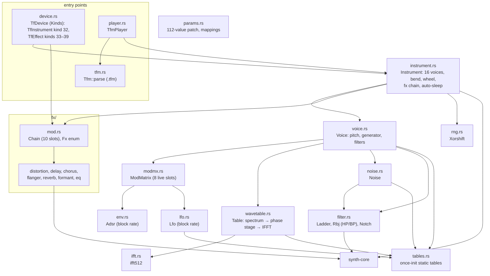

## Instrument

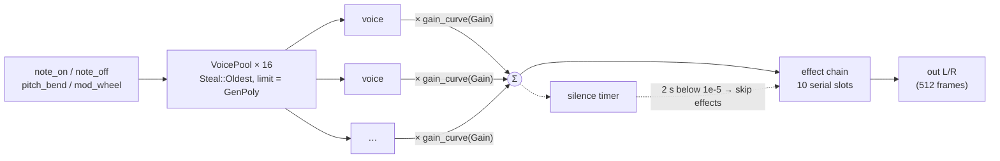

`Instrument::render(out)`:

1. Turn on flush-to-zero for the call (`denormal::Guard`), as the reference does. Without it the decaying ladder state
   goes subnormal and rendering is roughly 2× slower.
2. Clear `out`, render every active voice (held or still sounding) into it, and age the voices (`tick`).
3. Run the effect chain unless asleep.
4. Advance the auto-sleep timer: if the mean |x| of the block is below 1e-5, add 512/44100 s. Any voice rendering
   resets it. At 2 s the effects stop processing until a voice renders again.

Voice handling:

- **Polyphony.** 16 voice slots; `GenPoly` limits use to `trunc(15p + 1)` slots. When none is free, the oldest voice is
  stolen and hard-restarted.
- **Velocity 0** is a note-off.
- **Pitch bend** ∈ [−1, 1] applies to all voices, held or not. **Mod wheel** ∈ [0, 1] is mod source 5 from the next
  block. Songs never carry either (live input only).
- **LFO phase.** An LFO with Sync < 0.5 starts a new note at the instrument's free-running phase (the phase of the last
  voice rendered); with Sync ≥ 0.5 it starts at 0.
- **Randomness** comes from the instrument's own fixed-seed xorshift (the reference seeds from entropy).

## Voice: one 512-frame block

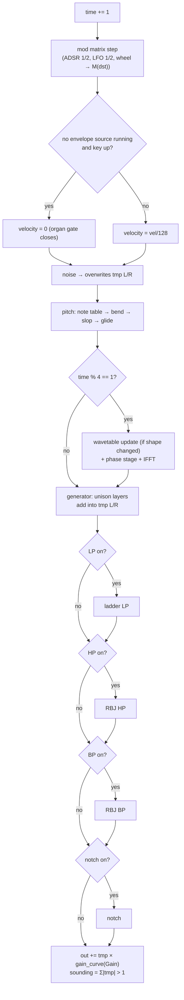

Signal path in one picture:

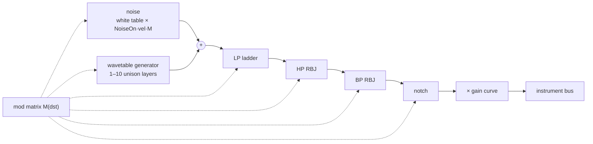

Amplitude shaping comes only from the mod matrix. The generator level is `GenVol·4·velocity·M(volume)`; an envelope
must be routed to `volume` (target 5) to get an ADSR shape. With no envelope routed, the note is organ-gated: full
level while the key is held, silent after release.

### Pitch

```text
base  = note_hz[note]                         # 128-entry f64-built table, semitone steps from 6.875·r³ Hz
up    = base × 1.0594631^bend_up_semitones     # trunc(12p + 1), repeated products
down  = base / 1.0594631^bend_down_semitones
f     = lerp(down, base, clamp(bend + 1)) then lerp(f, up, clamp(bend))   # linear in Hz
f    += slop · GenSlop³ · 8                    # slop ∈ [−1, 1), drawn at note-on
freq += (f − freq) / (10·GenGlide + 1)         # per block, when glide > 0 (state never reset)
```

### Wavetable generator (`wavetable.rs`)

Every fourth block (time % 4 == 1) the voice rebuilds its 512-sample single-cycle table, but only when the inputs
changed (counts exactly, floats by more than 1e-5).

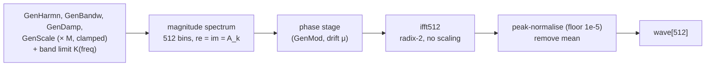

Spectrum, for partial `h = 1..H`:

| Quantity | Formula |
|---|---|
| Partial count H | `1 + min(trunc(64·harmonics), 64)` (1..65) |
| Centre bin | `1 + scale·(2h − 1)`, scale ∈ [0, 4] |
| Width | `0.3 + bandwidth·h` bins |
| Gain | `h^−(1 + damp)` |
| Shape | `A_k += e^(−d)·gain` (from the `exp` table) for `d = \|centre − k\|/width < 5` |
| Band limit K | `max(4, trunc(512·(1 − r)³))`, `r = clamp((freq − 8)/2000, 0, 1)`; bins ≥ K are zero |
| DC bin | `1 + 0i` |

K uses the glided keyboard frequency before octave and fixed-frequency mode, so those can alias (as in the reference).

**Phase stage.** With drift μ ≈ 0 the spectrum passes unchanged. Otherwise bin `i` (strength `i/512`) gets a table
offset `s = trunc(μ·512·(1 − GenMod·ρ_i)·strength) mod 512` and is multiplied by `sin[s]` (real) and `sin[s + 128]`
(imaginary). The 4096-entry sine table is indexed modulo 512, so both multipliers lie in [0, sin π/4] (reference quirk,
reproduced). μ starts at a random value in [0, 100) at note-on and advances by `GenMod³/100` per rebuild, wrapping at 100.

### Unison playback

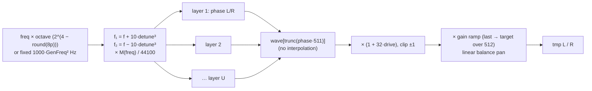

- U = `round(9p) + 1` layers (1..10). Each layer has a left and a right phase; after each layer `f₁ += spread`,
  `f₂ −= spread`, with `spread = 10·GenSprd⁴/44100`.
- At note-on each layer draws a base phase and a right phase `base + [0, 0.1)` (wrapped into [0, 1); the reference
  lets it start above 1).
- Pan is a linear balance: `L = vol·(1 − 2(pan − .5))` for pan > .5, `R = vol·2·pan` for pan < .5.
- The volume ramps linearly within the block from the previous block's gains. A voice whose volume and previous gains
  are below 0.001 skips the generator and keeps its last gains.

### Noise (`noise.rs`)

Each voice reads the shared 65 536-entry white-noise table from two random offsets (one per channel), scaled by
`NoiseOn·velocity·M(noise)`, silent at ≤ 0.01. With `NoiseBw < 0.99` it is band-passed by its own ladder LP at
`NoiseFreq + bw` and RBJ HP at `NoiseFreq − bw` (resonance 0.05). The noise stage overwrites the voice buffer; the
generator then adds into it.

### Filters (`filter.rs`)

Coefficients are set once per block from `(cutoff, resonance) × M`, clamped to [0, 1] and [0, 0.85]. Filters run only
when their `On` parameter is > 0.5, in the fixed order LP → HP → BP → notch.

| Filter | Cutoff | Structure |
|---|---|---|
| Ladder LP | `20000p² + 30` Hz | 4 two-tap one-pole stages `y = p·(old + in) − k·y`, global feedback `x − r·y₃`, output `y − y³/6`. `f = 2fc/sr`, `k = 3.6f − 1.6f² − 1`, `p = (k + 1)/2`, `r = q·e^(1.386249(1 − p))` |
| RBJ HP / BP | `10000p² + 30` Hz | `synth-core` DF1 `Biquad`; bandwidth law uses log₁₀2 instead of ln 2, so they ring more than the cookbook says (reproduced) |
| Notch | `20000p² + 30` Hz | Zeros at ±ω0 on the unit circle, poles at radius q, heuristic b0; the biquad is fed the previous input (1 sample latency, as in the reference) |

## Modulation

### ADSR (`env.rs`) and LFO (`lfo.rs`)

Both advance once per block.

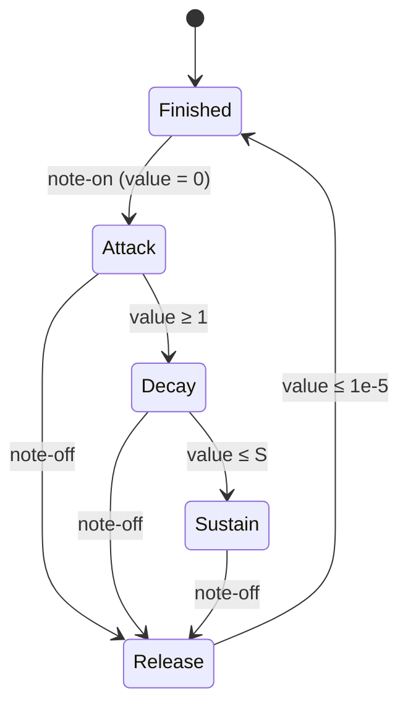

With `STEP = 0.0005·512`:

| Stage | Per-block update |
|---|---|
| Attack | `v += −log₁₀(0.94·max(a³, 1e-9))·STEP` (linear) |
| Decay | `v += ¼·log₁₀(0.94·max((d·M)³, 1e-9))·STEP · ((0.01 + v − S)/(1 − S))^slope`. With `d·M ≳ 1.02` the log turns positive and decay rises (quirk) |
| Sustain | `S = min(s, 0.99)`; a changed S is chased by the decay step |
| Release | `v += ¼·log₁₀(0.94·max(r³, 1e-9))·STEP · v^slope` |

LFO output is unipolar and multiplicative: `d·shape + 1 − d`, `d = (depth·M(depth))²`. Rate `50p²·512/44100` rad per
block (0 to about 8 Hz). Shapes `round(4p)`: sine `(sin φ + 1)/2`, ramp up, ramp down, square, stepped random
(256-entry table).

### Mod matrix (`modmx.rs`)

The patch stores 10 `(source, amount, target)` slots; only the first 8 run (reference behaviour). A destination's
factor `M(dst)` is the **product** of the results of all slots aimed at it, 1 if none. Every modulated parameter is
`base × M`, so modulation scales rather than adds.

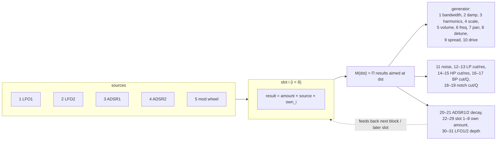

- Source `round(14p)`: 0 none, 1–5 as above, 6+ reserved (inert). Target `round(39p)`.
- Amount: `2p` up to 0.5, then `1 + 9(2p − 1)²` (0..10).
- `own_i` is `M(22 + i)` from the previous block: slots can modulate each other's depth.
- Slots are evaluated in order, and each source is computed once per block. A slot that reads `M` (LFO depth, ADSR
  decay) sees this block's results of earlier slots and the previous block's results of later ones. This one-block
  slot delay is the reference's.

## Effect chain (`fx/`)

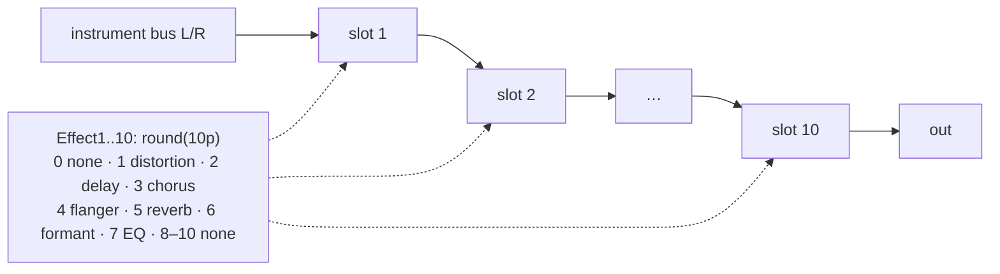

- All slots share the instrument's effect parameters (two delay slots sound alike).
- A slot type change creates a fresh zeroed instance from the instrument's effect pool. The pool is a bump allocator,
  so a replaced instance's memory is not reused; `Chain::need(patch)` sizes the pool for the patch's initial kinds. A
  kind that is not compiled in (`tf-fx-<kind>`) or no longer fits acts as none.
- Chorus control runs once per 512 frames; the other effects run per sample.

| Kind | Params | Algorithm |
|---|---|---|
| 1 Distortion | DistAmnt | Stateless: `sign(x)·(trunc(min(\|x\|, 1)·32767)/32768)^(1 − amount)` |
| 2 Delay | DelayL, DelayR, DelayDc | Two rings up to 1 s: `len = trunc(44100·trunc(1000p)/1000)`; `b = k(x + oldest)`, write `b`, `y = x + b`. The zero-latency copy makes dry ×(1 + k) and echoes k², k³… (quirk kept) |
| 3 Chorus | ChrsRate, ChrsDep, ChrsGain | 6 rings (3 per side in series), `y = x + 0.7g·x[n − d]`; per block `d = clamp(1 + 9·depth·(sin φ + 0.5), 1, 10)` ms (flat spot where it clamps); random start phases |
| 4 Flanger | FlangLfo, FlangFreq, FlangAmp, FlangWet | 2 rings of 4096; `y = clip(x − wet·ring.at(Δ), ±1)` written back; L/R sweep phases from a bouncing counter. FlangLfo = 0: L = R with a 480 s period |
| 5 Reverb | RevRoom, RevDamp, RevWet, RevWidth | Freeverb on `synth-core` `Comb` ×8 + `AllPass` ×4 per side (right +23): in `(L + R)·0.015`, fb `0.7 + 0.28·room`, damp `0.4p`; wet `3·wet` split by width, dry `2(1 − wet)` |
| 6 Formant | FrmtType, FrmtWet | 10th-order all-pole filter (musicdsp.org #110 coefficients), f64 state, vowel `trunc(4p)` A/E/I/O/U; `y = x(1 − w) + filtered·w` |
| 7 EQ | EqLow, EqMid, EqHigh | 3-band split with 4 one-poles at 880 Hz and 4 at 5 kHz per side; `out = l·gL + m·gM + h·gH`, gain `2p` up to .5, then `1 + 10(2p − 1)²` |

## Patch: the 112 parameters

All values are normalized 0..1 (`.tfm` stores `trunc(100p)` as a byte).

| Range | Group | Parameters |
|---|---|---|
| 0 | Output | Gain: `(2g)²` up to .5, then `1 + 20(g − .5)` (0..11) |
| 1–16 | Generator | Bandwidth, Harmonics, Damp, Mod (phase stage), Volume, Pan, Slop, Octave, Glide, Detune, Freq (0 = key-tracked), Poly, Drive, Unison, Spread, Scale |
| 17–19 | Noise | Amount (NoiseOn), Freq, Bandwidth |
| 20–25 | LP, HP | On, Cut, Res each |
| 26–30 / 31–35 | ADSR 1 / 2 | Attack, Decay, Sustain, Release, Slope |
| 36–39 / 40–43 | LFO 1 / 2 | Rate, Depth, Shape, Sync |
| 44–73 | Mod matrix | 10 × (Source, Amount, Target); slots 9–10 inert |
| 74–83 | Effect slots | Effect1..Effect10 kind |
| 84–103 | Effect params | DistAmnt, ChrsRate, ChrsDep, DelayL, DelayR, DelayDc, RevRoom, RevDamp, RevWet, RevWidth, FlangLfo, FlangFreq, FlangAmp, FlangWet, ChrsGain, FrmtType, FrmtWet, EqLow, EqMid, EqHigh |
| 104–105 | Bend | Up, Down range: `trunc(12p + 1)` semitones |
| 106–111 | BP, notch | On, Cut, Q each |

`params::NAMES` keeps the public names for preset compatibility (index 10 really is `GetDetn`).

## Songs

### `.tfm` and `TfmPlayer`

```text
u16 instrument count I (≤ 32), u16 tempo, I × u16 event counts,
"INST", I × 112 u8 params (p = byte/100),
"SONG", per instrument: u16 row deltas[], u8 notes[], u8 velocities[],
"ENDS"   (bytes after it ignored)
```

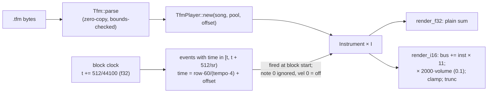

Rows are 4 per beat. `seek` sends all-notes-off and moves each instrument's cursor to the first event at or after the
target; `mute(i)` stops dispatch (tails still render); `length` skips empty instruments.

### On a `synth-mix` track (`device.rs`)

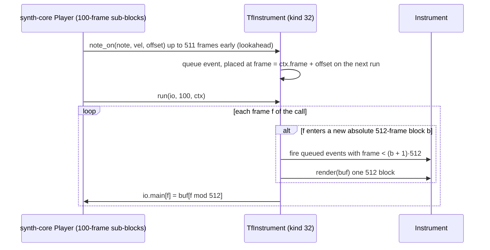

- Kind 32 (instrument): chunk = up to 112 f32 params + size. Blocks sit on the absolute song grid (`ctx.frame / 512`),
  so output is bit-identical to the `.tfm` player and independent of the caller's block size.
- Kinds 33–39: each effect as a standalone device with only its own parameters (`effect_params(k)`), so a
  WaveSabre track can end in a Tunefish reverb. Chorus keeps its 512-frame control grid across calls.
- Mixed songs load through `synth_core::mix::Either<WsDevice, TfDevice>`.

## Memory and tables

- Voices come from the caller pool; each instrument carves an effect pool of `Chain::need(patch)` bytes. Delay needs
  2 × 44 100 floats, reverb about 100 KB, chorus and flanger little. `TfmPlayer::required_pool` sizes a whole song.
- `tables()` is a once-initialised static built from a fixed seed: `sin[4096]`, `exp[4096]` (`e^(−5i/4096)`),
  `rho[512]`, `lfo_noise[256]`, `white[65536]`, `note_hz[128]`.

## Quirk policy

Reproduced because they shape the sound: phase-stage table range, 8 live mod slots, block-rate control, decay that can
rise, log₁₀2 HP/BP bandwidth, linear-Hz bend, delay zero-latency copy, chorus flat spot, flanger counter flip, effect
auto-sleep after 2 s, flush-to-zero.

Fixed because they are undefined behaviour with no audible role: song length with empty instruments, right-phase
overrun at note-on, unwrapped chorus/flanger phases, unbounded flanger counter, uninitialised state, entropy seeding.

## Verification

- Unit tests per module against analytic results (`src/tests.rs`), self-goldens (`tests/golden.rs`, `tests/golden.txt`),
  `.tfm` vs shared-track bit identity (`tests/tfm.rs`, `tests/device.rs`).
- `tools/tf-parity`: reference build outside the repo, metrics from `tools/synth-parity`. no_remorse and tf4testsong
  pass with differences of the same order as the reference's own run-to-run spread; 12.9× real time.
- Rendering: `cargo run -p tfsynth --example render -- <song.tfm> <out.wav> [tail-s]`.
