# Unified synth (`crates/unisynth`)

Status: **in progress** (change `add-unified-synth`). The chunk format, the parameter layout and laws, the voice
framework (allocation, control grid, envelopes, LFOs, mod matrix), all four oscillator types, the noise source, the four
filter slots and the nine effect kinds exist, and the converter has started (song structure and effects). The rest
follows the task list in `openspec/changes/archive/2026-10-26-add-unified-synth/tasks.md`. This page grows with each task group.

The unified synth replaces [`wavesabre`](wavesabre.md) and [`tunefish4`](tunefish4.md) with one slot-based instrument
(`synth-mix` kind 64) and one merged effect set (kinds 65–73), playing through the same [`synth-core`](synth-core.md)
mixer. Old songs convert with a host-only tool; the old crates stay as parity oracles until a parity report passes and
the A/B listen is signed off. Decisions and alternatives: `openspec/changes/archive/2026-10-26-add-unified-synth/design.md`.

## Where it sits

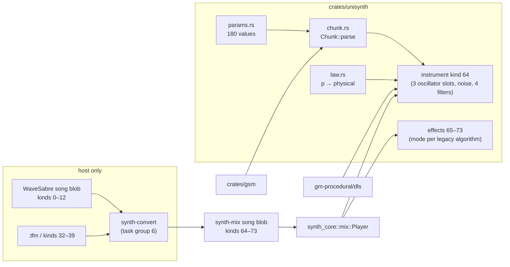

## The instrument

One voice has a fixed set of slots; every legacy sound is a configuration of them.

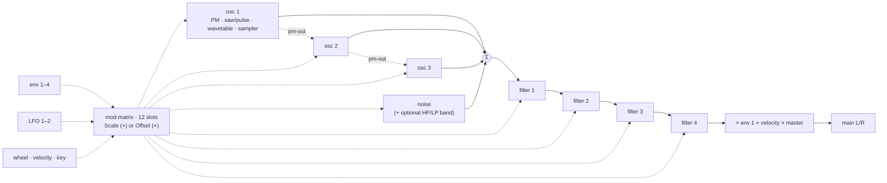

- **Oscillator types:** phase-mod operator (Falcon), band-limited saw/pulse (Slaughter), spectral wavetable (Tunefish,
  1–10 unison layers), sampler (GSM sample from the chunk, a GM.DLS wave or a GM.DLS instrument with its key/velocity regions),
  V2's naive oscillator, and the clocked oscillator (TBL's mini-cauldron waveforms).
- **Filter types:** state-variable LP/HP/BP/notch, ladder LP, RBJ HP/BP, resonator notch.
- **Envelopes:** each picks the WaveSabre curve (ms, linear attack, quadratic decay/release) or the Tunefish curve
  (rate steps with a slope); envelope 1 ends the voice.
- **Control** runs on a 32-frame block of absolute song frames, linearly interpolated (8 frames for the first 256 frames
  after a note-on and a note-off); audio runs per sample.
- Every module is a cargo feature `us-*`; a patch that uses a missing module fails at load, not at render.

## Parameters

The v3 layout (change unify-v2-algorithms, task 6.4): 294 values in module blocks, plus the point fields that change
add-tf3-import appended (321) and the Elevated fields that change add-elevated-import appended (331 in all), everything
normalized (0..1)
except the three sample indices (raw whole numbers). Indices below 240 take one chunk byte, the rest two (they need
`us-chunk-wide`). A value outside its law is clamped, and NaN reads as 0. The layout before it (260 values, chunk
versions 1 and 2) is frozen host-side as `params::old` for the migration; the player rejects it.

| Group | Indices | Count | Fields |
|---|---|---:|---|
| voice | 0–15 | 16 | master, pan, capacity, steal, unison, uni-detune, uni-spread, mode, slide, glide, transpose, velocity, start-spread, one-shot, noise level, env1-at-output |
| voice settings | 16–22 | 7 | `voice.amp_source` (master × velocity × env 1 / env 1 only), `voice.pan_stage` (per slot / after the drive), `voice.dc_filter`, `voice.law` (transpose in semitones / 7-bit steps), `voice.keysync` (free / restart / full reset), `voice.routing` (serial / parallel), `voice.balance` |
| oscillator ×3 | 23–97 | 25 each | type, tracking, coarse, fine, octave, ratio, ratio fine, fixed Hz, gain, mix, pan, pm-out, feedback, shape[9], sample (raw: GSM sample number, DLS wave index or packed DLS instrument), combine (add / multiply / replace), law (unisynth / 7-bit steps) |
| noise | 98–101 | 4 | band on, hp, lp, width |
| filter ×4 | 102–125 | 6 each | type, cutoff, resonance, form, oversample, law |
| envelope ×4 | 126–161 | 9 each | law (seconds, rate, frame), attack, decay, sustain, release, curve (by law, quadratic, power, exponential), curve_slope, sustain_slope, amplify |
| LFO ×2 | 162–177 | 8 each | shape, rate, depth, sync (song time, continue, restart), law (Hz / frame), phase, polarity (positive, negative, bipolar), one_shot |
| mod slot 1–10 | 178–217 | 4 each | source, target, amount, operation |
| controllers | 218–220 | 3 | `ctl.wheel` (0..1), `ctl.bend` (0..1, centre 0.5), `ctl.bend_range` (0..24 semitones, default 2) |
| drive | 221–224 | 4 | `drive.mode/gain/p1/p2` |
| quirks | 225–229 | 5 | `quirk.exact_math`, `integer_fm`, `fixed_seed`, `lcg_noise`, `coarse_env` (off / on; see [Quirks](#mono-sum-voice-drive-channel-strip-and-speech-change-add-v2-import-names-unify-v2-algorithms)) |
| channel strip | 230–260 | 31 | `strip.on`, `volume`, `drive_mode/gain/p1/p2`, `send_reverb`, `send_delay`, `boost`, `order` (one-byte up to here), `send_aux_a/b`, `recv_aux_a/b`, `dc_filter`, `chorus_*` ×7, `comp_*` ×9 |
| mod slot 11–16 | 261–284 | 4 each | as slots 1–10 |
| controllers 2–7 | 285–290 | 6 | `ctl.cc2` … `ctl.cc7` (breath, 3–6, volume; default CC7 = 127/128) |
| speech | 291–293 | 3 | `speech.on`, `speech.select`, `speech.pitch` |
| point fields ×3 | 294–320 | 9 each | `osc{n}.points` (`count(1..4)`), `mode1`–`mode4`, `mode_last` (step / linear / spline), `layers` (`count(1..11)`), `layer_detune` (`10p³` Hz), `layer_spread` (`10p⁴` Hz); add-tf3-import, read by `points` (and `pad`: the detune) slots |
| Elevated fields | 321–330 | 10 | `drop.base` (`20 000p` Hz), `drop.rate` (`1 − k = 10^(−6(1 − p))` per sample, 0 = off), then per envelope `envN.linear` (off / on) and `envN.hold` (`5000p²` ms); add-elevated-import, see [Pair oscillator](#pair-oscillator-us-osc-pair) |

**Choices are plain** `Choice(n)` (`law::choice`, stored `k/(n − 1)`), except the oscillator type: an expanded
`Choice(25)` whose id is the stored position (change add-tf3-import). Off, phase mod, saw/pulse, wavetable, sampler,
naive saw/tri, naive pulse, sine, coloured noise, FM, aux in A, aux in B and clocked sit at the even positions 0–24
(the stored value of each is unchanged from the earlier `Choice(13)`); points is 1, PAD table 3; the other odd
positions are free and a chunk that names one fails to load (`BadChunk`). The plain ones:
filter type of 11 (off, state-variable low/high/band/notch, 4-pole low, RBJ high/band, resonator notch,
state-variable all-pass, 4-pole high: the algorithm with its response), LFO shape of 8, mod source of 17, operation
of 3. Defaults are each new field's first option, except the balance and the sustain slope (centre), amplify (1) and
the LFO sync (restart).

**7-bit fields** store `step / 128` (`params::v2_raw`): the drive, the strip, the controllers 2–7, the speech, the
balance, sustain slope, amplify and LFO phase, and the fields a 7-bit law reads (an oscillator's coarse, fine, gain
and colour on its 7-bit law, a filter's cutoff and resonance on its 7-bit law, an envelope's times on the frame law,
an LFO's rate on the frame law).

**Settings and their modules.** A setting that adds code is its module (design D5): the oscillator combine's multiply
and replace (`us-osc-combine`), a non-plain filter form or law (`us-flt-feedback`; the plain state-variable and 4-pole
forms are `us-flt-svf` and `us-flt-ladder`), the power curve (`us-env-rate`), the exponential curve, sustain slope and
amplify (`us-env-frame`), LFO settings beyond the plain Hz-law LFO (`us-lfo-frame`), the voice settings
(`us-voice-out`), each quirk (`us-quirk-*`). `needs` lists them; a patch whose module the build lacks fails at load.

`shape[9]` means different things per oscillator type:

| Type | shape[0..9] |
|---|---|
| phase-mod | waveform blend (sine + Square35) |
| saw/pulse | waveform (saw → pulse), pulse width |
| wavetable | bandwidth, harmonics, damp, scale, mod, drive, layers, layer detune, layer spread |
| sampler | start, loop mode, loop boundary, loop start, loop length, reverse, interpolation, source (GSM / DLS instrument / DLS wave), (unused: the sample index is the slot's raw `sample` field) |
| naive generators | (unused), colour (`step/128`: the saw/triangle break point, pulse width, noise filter, FM depth) |
| points | P1 offset, P1 value, … P4 offset, P4 value (0–7), drive `1 + 32p³` (8); count, segment modes, layers, layer detune and spread are the point fields |
| PAD table | bandwidth, scale, damp, harmonics, profile `Choice(4)` (single, detune, spread, gauss), drive `1 + 32p` (0–5; all but the drive read at load) |
| clocked | wave `choice(p, 6)`, voices `round(10p)`, version `choice(p, 3)` (0 v1, ½ v2 in a glide, 1 v2), clock `p·2²⁰` Hz, retrigger byte `round(255p)` = `2k + accent`, filter base `8p`, filter amount `8p`, filter decay `1 + (0.5 − p)/100`, filter damping `p` (see [Clocked](#clocked-us-osc-clocked)) |

Structural parameters (voice capacity, each oscillator type, each sampler source, the three sample indices, the quirks)
are read from the chunk only; `set_param` ignores them, so automation cannot change what was sized or built at load.

### Laws

Module parameters keep the law of the legacy code they come from; only the places where the two engines meet got new
laws. Constants live in `crates/unisynth/src/law.rs`; the inverses (for the converter) are host-side.

| Law | Formula | Range | Notes |
|---|---|---|---|
| `cutoff` | `20 + 19 980·p²` Hz | 20–20 000 | WaveSabre's law, every filter type |
| `gain` | `16·p²` | 0–16 | unity at p = 0.25 |
| `lfo_rate` | `0.01·10^(4p)` Hz | 0.01–100 | ≤ 4 % per byte |
| `time` | `10·p⁴` s | 0–10 | slide / glide |
| `transpose` | `(2p − 1)·24` st | ±24 | continuous |
| `start_spread` | `10^(6p − 2)` samples of the slot's period, whole turn at `p = 1` | 0.01–10 000 | reach of the random start phase of phase-mod and saw/pulse slots (a saw/pulse takes it at its first note only); default 1 |
| `coarse` / `fine` / `octave` | whole st / `2p − 1` st / whole octaves | ±24 / ±1 / ±4 | |
| `ratio`, `ratio_fine` | `1 + floor(32.99p)`, `(2p − 1)³` | 1–33, ±1 | Falcon |
| `fixed_hz` | `1000·p²` Hz | 0–1000 | Tunefish |
| `feedback`, `pm_out` | `8p²`, `4p²` | | radians per unit of the slot's output |
| `pan` | `(√(1 − p), √p)` | | equal power |
| `env_ms` | `p²·5000 + 1` ms | 1–5001 | timed envelope mode (WaveSabre) |
| `scale_amount` | `2p` ≤ .5, else `1 + 9(2p − 1)²` | 0–10 | Tunefish mod amount |
| `offset_amount` | `sign(x)·x²·range`, `x = 2p − 1` | ± target range | fine steps near 0 |
| `choice`, `count`, `index` | `round(p·(n − 1))`, `lo + round(p(hi − lo))`, `round(255p)` | | stored as `i/(n − 1)` |

Resolution rule: a law that *is* a legacy law (cutoff, envelope time, slide time) is exactly as fine as the legacy
byte. New laws carry perceptual bounds (rate ≤ 4 %, gain ≤ 0.7 dB above −40 dB, transpose ≤ 0.2 semitone, vibrato
amount ≤ 0.1 semitone per byte). Tests: `crates/unisynth/src/params/tests.rs`.

## Chunk v3

```text
u8 version = 3 (4: + speech text)
count n, n × { index, f32 value }        only values that differ from the defaults, indices strictly increasing
u8 s,  s × { u32 size, GSM sample chunk } header + WAVEFORMATEX + blocks, nothing after the blocks
version 4 only: u16 len ≥ 1, len bytes    speech text
(end)
```

Versions 1 and 2 held the old layout (change unify-v2-algorithms). The checked player rejects them, and any other
version, with `LoadError::UnknownVersion`; `synth-convert migrate` and `song migrate` (or `unisynth::migrate`) bring an
old song to v3. A trusted build (`us-trusted`, songs generated on the host) reads no version.

Escapes (change add-v2-import), like UTF-8 lead bytes. A count byte `c < 0xFF` is the count, and `0xFF` is followed
by a `u16` count of 255 or more. An index byte `b < 0xF0` is the index, and `0xF0 + k` is followed by a byte `x`:
index `240 + 256k + x` (up to 4335). The encoder writes the shortest form, and the reader rejects an escaped count
below 255. A two-byte index is always 240 or more, so every index has one form. A version 4 chunk without `us-speech`
fails with `UnsupportedModule(SPEECH)`. Reading escapes is module `us-chunk-wide` (implied by `us-strip`). Without
it, an escape fails with `UnsupportedModule(CHUNK_WIDE)`, and the reader steps through 5-byte pairs, so a song whose
indices are all below 240 pays nothing here (design D4, D11).

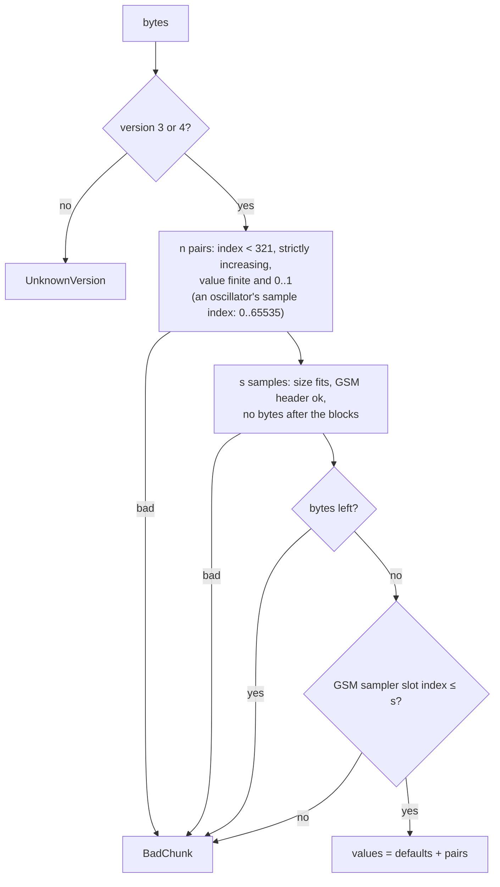

- The encoding is canonical (sorted, defaults omitted): the same patch gives the same bytes. The worst case is 1751
  bytes (all 331 values differ); a Slaughter-like patch is about 100 bytes.
- The three sample indices (`oscN.sample`) are the only raw values. Each reads like the legacy `(int)v`, 1-based,
  0 = none; DLS uses the legacy `(int)v − 1`. A GSM index beyond the section is an error, a DLS index is checked against
  the bank at render.
- Without `us-sample-gsm`, a chunk with samples fails with `UnsupportedModule(SAMPLE_GSM)`.
- Sizes are `u32` and `usize` is 32-bit on i686: every offset uses checked arithmetic, so hostile sizes cannot wrap.

The format went through a cross-model adversarial review (task 1.4); the decisions are recorded in design D3.

### Migration from the old layout (`unisynth::migrate`, host only)

`migrate::values(old)` turns a patch of the old layout into v3 by the value rules of the change's design ("v3 layout
(frozen, task 6.4)"): the naive generator's mode becomes the type, ring the combine; the old filter kinds become a type
with a form and law; an envelope's mode becomes a law with the curve "by law"; the frame-law LFO's 7-bit shape and sync
become the union shape and the sync choice; 7-bit switches become choices; the format version (`voice.era`) becomes
the quirks its patch reaches and the settings it decided. `instrument_chunk`, `effect_chunk` and `lane` (one lane per
v3 field that moves) build on it. The converters build patches in the old layout and the song writer migrates them
(`synth_convert::model::SongM::write`), so a converter's output is the migration of its old output by construction.
`research/unify-v3-layout/layout.py` is an independent reference: both give the same pairs for all 4,820 instruments of
the tracked songs (`MIGRATE_CROSSCHECK`).

## Voice framework

`UInstrument` (`instrument.rs`) is a `synth_core::device::Device`. Notes arrive as `Events<256>` (offsets inside the
next `run` call, dropped when full), voices live in a `VoicePool<Voice>` of 1–64 slots, and everything that changes with
time runs on the **absolute 32-frame control grid**.

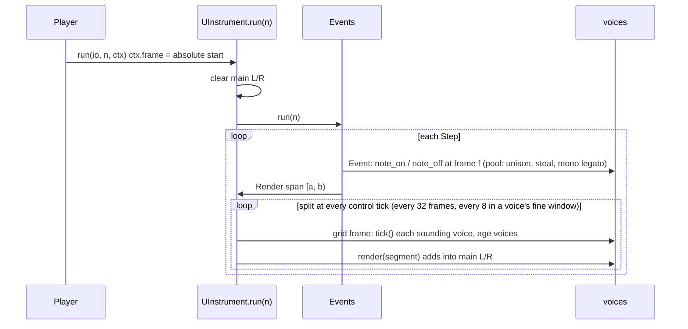

Rules that make the output independent of how the caller splits its calls (checked by the tests with calls of 1, 7,
32, 33, 100, 511 frames and player sub-blocks of 1, 37, 100, 512):

- The grid is `absolute frame mod 32`, never the call start. Events fire on their exact frame.
- Every random draw comes from the instrument's own xorshift, seeded from **one** draw of the song random source at
  load; each voice takes a seed from it at note-on. Nothing depends on other tracks' render order.
- Free-running LFOs use `rate · frame / sample rate`, so every voice shares one phase without instrument state.
- `reset()` restores the seed, voices and queues; parameters stay as loaded or automated.

### Fine window and inaudible releases

Two rules came out of running the parity tool (`tools/unisynth-parity`), and both keep the output independent of the
call split because they depend only on absolute frames and the voice's own state.

- **Fine window.** WaveSabre's envelopes run per sample, and a 2 ms noise hit sampled every 32 frames and interpolated
  loses its peak and gains a tail (Global Groove, nothing but such hits, read 1.75 dB quiet). For `FINE_SPAN` = 256
  frames after a note-on or note-off a voice ticks on the absolute 8-frame grid (`FINE`). `render_span` runs each span up
  to the shortest segment left in any voice (`Voice::left`) or the next 32-grid frame, whichever is first, so voices on
  different grids share one loop. A hit then keeps its energy within about 6 %; it costs under 1 % of a song.
- **Inaudible releases.** A voice in the release stage whose mean output magnitude stays under `QUIET` = 2.5e-4
  (−72 dBFS) over 256 frames is freed, as the legacy Tunefish engine frees a voice whose block level falls under a
  threshold. Without it no_remorse held 33 voices on average (the exponential release reaches the envelope's own end,
  1e-5, seconds after it is inaudible) against 19 for the legacy engine, and rendered at half the speed.

### Voice control segments

A voice holds two copies of its control state: `start` (segment start) and `end` (one segment later). Control outputs
(pitch increment, gain, pan, ...) are `Ramp`s that move linearly from the values at `start` to the values at `end`.

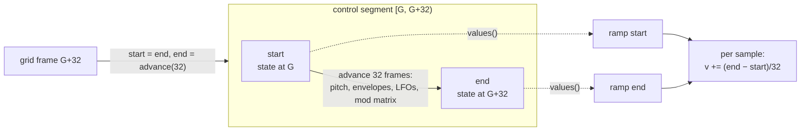

- **Note-on mid-block** (frame `G + k`): the first segment is `32 − k` frames long and ends on the grid. A note-on
  exactly on a grid frame lets the grid tick start the first segment.
- **An event inside a segment** (note-off, slide): `start` is advanced to the event frame, changed, and `end` is
  recomputed for the rest of the segment; the ramps retarget from their current value. So a release begins on its
  exact frame even though control runs every 32 frames.
- A voice whose envelope 1 reaches `Finished` switches itself off at the next grid frame, after its output has ramped to
  zero.
- Pitch has three movements: snap, **slide** (mono legato, linear over `time(slide)` seconds), **glide** (exponential
  towards the new note from the voice's last pitch, time constant `time(glide)`).
- Gain is `master · mod · velocity sensitivity · envelope 1`, velocity sensitivity `1 − s + s·vel/128`. With
  `env1-at-output` off, envelope 1 only ends the voice and the patch routes it through the matrix.

### Envelopes

One stage machine for every law (`env.rs`, change unify-v2-algorithms 4.1), advanced by elapsed seconds.
- **Time law:** turns attack, decay and release into a time constant, computed only for the stage that runs.

  | Law | Attack (full rise) | Decay / release |
  |---|---|---|
  | seconds | `p²·5000 + 1` ms (`law::env_ms`) | the same law: the stage's length |
  | rate | rate `−log₁₀(0.94a³)·STEP` per block | rate `¼·log₁₀(0.94(dM)³)·STEP`, `¼·log₁₀(0.94r³)·STEP` |
  | frame | `2^(7 − 0.09375·128a)` per frame of 128 | factor `1 − calcfreq2(1 − x)` per frame → seconds per halving |

- **Attack:** linear in level for every law, from 0 (from the current level on the frame law).
- **Curve:** quadratic (`(1 − t/T)²` towards the sustain level, from the value at note-off), power
  (`((0.01 + v − S)/(1 − S))^slope` and `v^slope` on the rate, one Euler step per control segment, the sustain
  level at most 0.99), or exponential (halving per time constant towards 0, stopping at the sustain level).
- **Sustain slope:** multiplies the held level by `2^(0.0019375·(128·slope − 64))` per frame of 344.5 per second
  (falls below ½, rises above, capped at 1).
- **Amplify:** scales the output.
- **End:** at the end of a quadratic release, below 1e-5 in a power release, or below `2⁻¹³/128` in any
  exponential stage.

Rate-law rates are the legacy per-512-block steps per second (`STEP = 0.256`, 86.13 blocks/s). Two deliberate
deviations: a power decay that would rise (`d·M` above ≈ 1.02) holds at the peak instead of growing past 1, and the
sustain level is fixed at note-on (no chase).

The fields: `envN.law` (seconds, rate, frame), `envN.curve` (by law: quadratic for seconds, power for rate,
exponential for frame; or any of the three), `envN.curve_slope` (the power exponent), `envN.sustain_slope` (the
held level's drift, 7-bit, 64 = flat), `envN.amplify` (output gain, 7-bit).
- The frame law re-reads its fields every control segment (the matrix may move them) and keeps the level at note-on.
  The other laws take their fields at note-on.
- The power curve's code is built with `us-env-rate`; the exponential curve, the sustain slope and amplify with
  `us-env-frame` (a patch that sets them on another law needs that module too). Quirk `coarse_env` (a frame-law
  envelope on 256-sample frames with the year-2000 laws) is `us-quirk-coarse-env`.

### LFOs

One LFO for every law (`lfo.rs`, change unify-v2-algorithms 3.1): a phase in turns advanced by elapsed time, with
settings read per control segment (`LfoP::read`).
- **Shapes:** sine `(sin + 1)/2` (one table sine for every law), ramp up, ramp down, square (high first),
  stepped random (256 hashed steps per cycle, the same for every voice), triangle (rising first), sample-and-hold
  (a new value at every cycle start from the LFO's seed), pulse (low first).
- **Rate law:** Hz (`law::lfo_rate`, `0.01·10^(4p)`), or frame: `¼·calcfreq(p)` turns per 128-sample frame at
  344.5 frames/s.
- **One-shot:** one cycle, then the end value is held.
- **Polarity:** what an Add slot sees, `shape·depth` (+), `−shape·depth` (−) or `(shape − ½)·depth` (±).
- **Key sync:** restart at the start phase (and draw a new sample-and-hold seed), run on song time (every voice
  shares the phase of an LFO running since frame 0), or continue the voice's previous phase.

A Scale slot sees `1 − d + d·shape`, an Offset slot `d·(2·shape − 1)`, with `d = (depth · M(depth))²`.

The fields: `lfoN.shape` (`Choice(8)`), `rate`, `depth`, `sync` (song time, continue, restart; default restart),
`law` (Hz, frame), `phase` (start phase, 7-bit), `polarity`, `one_shot`. The plain LFO (Hz law, the first five shapes,
restart or song time, no phase, positive, free) needs nothing else; any other setting is built with `us-lfo-frame`.

## Mod matrix

16 slots `(source, target, amount, operation)`; `modmx.rs` (slots 1–10 one-byte, 11–16 two-byte in the chunk). Slots
13–16, the Add operation and the sources added after the first 10 (CC2–7, centred note) need `us-matrix-add` (change
add-v2-import).

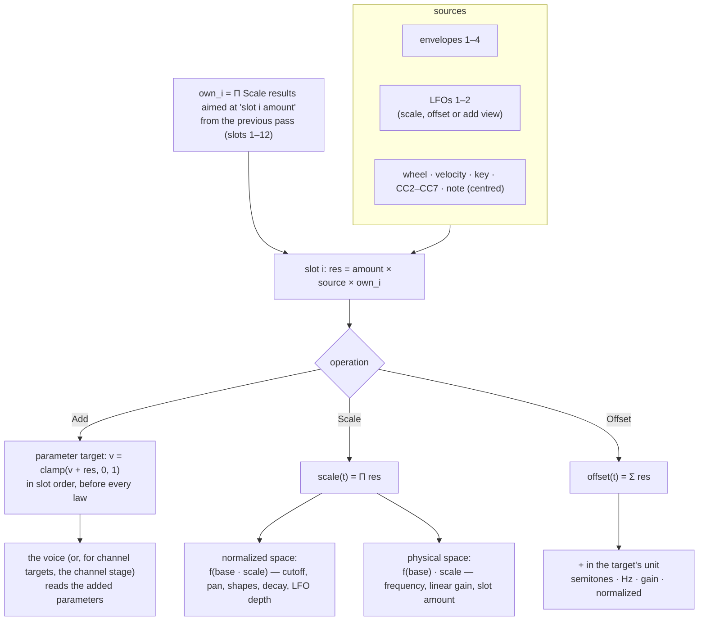

| Target ids | Meaning | Scale works on | Offset range |
|---|---|---|---|
| 0 | none (slot inert) | | |
| 1 pitch | all oscillators | frequency | ±36 semitones |
| 2 gain, 3 pan | voice | linear gain / normalized pan | ±4 / ±1 |
| 4–48 | oscillator slot `i` (`4 + 15i + f`): pitch, gain, mix, pan, pm-out, feedback, shape 0–8 | pitch and gain physical, rest normalized | ±36 / ±4 / ±1 / ±1 / ±4 / ±8 / ±1 |
| 49–51 | noise level, HP, LP | level physical, cutoffs normalized | ±4 / ±19 980 Hz |
| 52–59 | filter `i` cutoff and resonance | normalized | ±19 980 Hz / ±1 |
| 60–63, 64–65 | envelope decay, LFO depth | normalized | ±1 |
| 66–77 | mod slot `i` own amount | physical (multiplies the slot result) | ±1 |
| 78–141 | parameter targets (Add only): `target::PARAMS[t − 78]`, the 64 V2 parameters `sounddef.h` marks as destinations, in V2's order; 118–141 (`ch.*`) are channel targets | | |

**Add** (V2's rule, design D3). The amount is `2p − 1` (V2's `(val − 64)/64`), and the sources are 0..1 (V2's value /
128). Each Add slot adds `amount · source` to the normalized value of its parameter target and clamps to 0..1, in slot
order, as V2's `storeV2Values` does per entry. Voice targets are applied where the voice reads its parameters
(`voice::added`, before laws, envelopes and LFOs). Channel targets are applied by the channel stage from the newest
voice. An Add slot on a target below 78, and a Scale or Offset slot on a parameter target, do not route.

Sources: 0 none, 1–4 envelopes, 5–6 LFOs, 7 wheel (live input via `UInstrument::mod_wheel`), 8 velocity, 9 key
(`note/127`), 10–15 controllers 2–7 (`ctl.cc2..7`), 16 V2 note (`2·(note − 48)/128`). An Add slot reads an LFO as
`depth · shape`, or as a V2-mode LFO's own output. Evaluation order matters and mirrors Tunefish: slots run in order; a slot sees this pass's results of
earlier slots and the previous pass's results of later ones (the one-segment slot delay), which makes self-modulation
and slot-to-slot depth modulation possible. The target ids are frozen (78–141 with change add-v2-import); a parameter
target names its parameter, so it follows the layout.

## Oscillator slots

Each of the 3 slots has a type fixed at load (`o::TYPE` is structural); a type whose module is not in the build fails
the load with `UnsupportedModule(module)`. Slots run in order and are summed into the voice: a slot's **mix** level
scales what reaches the output, its **pm-out** scales what it sends into the *next* slot's phase, independently, so a
slot can be a pure modulator (mix 0). An `Off` slot sends nothing.

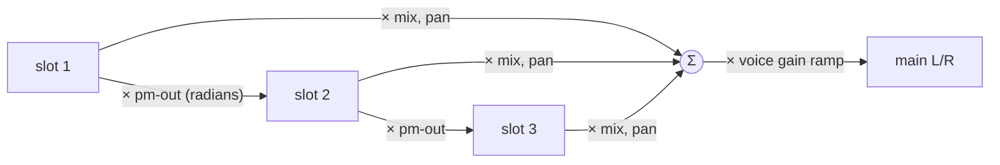

Every slot shares the pitch path (voice note + unison detune + transpose + mod pitch offset, then the slot's coarse,
fine, octave and Offset route, then `ratio` or a fixed frequency, then the Scale routes) and the gain, mix, pan
laws; only `shape` changes meaning with the type.

### Phase-mod operator (`us-osc-pm`)

Falcon's operator. Output `y = (sin 2πt + w·(sin 6πt/3 + sin 10πt/5))·gain` with `t = φ + (fb·y₋₁ + in)/2π`, where `w`
is the waveform shape value (0 sine .. 1 full `Square35`), `fb` the feedback law (`8p²`), `in` the previous slot's send
and `y₋₁` this slot's last output. At note-on every phase-mod slot restarts at one common random phase (Falcon draws a
single value per note).

### Band-limited saw/pulse (`us-osc-blit`)

Slaughter's integrated BLIT, run in phase units instead of samples so the pitch can change every sample:

- impulse train: a sinc `sin(πx)/(πx)` with `x = (phase − ½)/increment` samples, one per period; the pulse subtracts a
  second one `pw` later, scaled by the waveform value `w` (0 saw, 1 pulse);
- `integral = leak·integral + dc·(1 − w) + impulse₁ − w·impulse₂`, with `dc = −0.996·increment` removing the saw's DC;
- output = `−integral · gain`: Slaughter's output stage is `−16·…`, and the gain law cannot be negative, so the sign
  lives here;
- the leak is `0.998` at 44.1 kHz and `0.998^(44100/rate)` elsewhere, which keeps the integrator's corner at about
  14 Hz;
- phase and integrator are **not** reset at note-on: they run on across notes, as Slaughter's do, and every voice and
  slot starts from its own random phase drawn once from the instrument's stream when the voice is built (so `reset`
  repeats them).

Measured against its spec: the harmonics of a note-45 saw (110.25 Hz) stay within 8 % of `1/n` up to the 45th (4.96 kHz);
a square has no even harmonics; a quarter pulse has none at multiples of 4.

### Spectral wavetable (`us-osc-wt`)

Tunefish's generator: a single cycle of 512 samples is built from a parametric partial spectrum, played back by up to
10 unison layers. It needs a table per voice and slot (`Wt`, about 10 KB: spectrum, work buffer, cycle and the layers'
phases), taken from the pool at load; `need` counts capacity × wavetable slots, so a patch without wavetable slots costs
nothing.

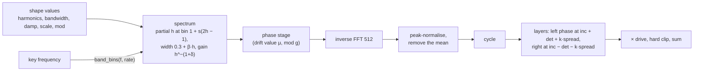

- **Rebuild cadence.** The cycle is built at note-on and the inputs are checked again every 2048 frames of the voice's
  age (Tunefish: every 4th block of 512). The spectrum is recomputed only when an input changed (counts exactly, floats
  beyond 1e-5); the phase stage and the inverse FFT run at every check, which advances the drift value `μ` by `g³/100`.
- **Band limit.** `K = max(4, trunc(512·(1 − r)³))`, `r = clamp((f − 8)/2000)` with `f` the key frequency scaled to
  44.1 kHz, so the band follows the Nyquist frequency at other rates. Octave and fixed-frequency modes can still alias.
- **Phase-stage quirk.** The 4096-period sine is indexed modulo 512, so the multipliers stay within `[0, sin π/4]`; a
  one-partial table has an amplitude of about 0.2. It is kept so the converted Tunefish patches sound the same, and
  drive and the slot gain make up for it.
- **Unison.** Layer `k` plays at `|inc ± det ± k·spread|` (left `+`, right `−`). Detune is `10p³` Hz, spread `10p⁴` Hz
  per layer (divided by the sample rate), drive `1 + 32p`; detune scales with the frequency routes, spread does not.
  Layer phases start random (the right phase up to 0.1 turn ahead of the left) and read the table without
  interpolation, as Tunefish does.
- The shape values go through the mod matrix like every other shape value; the unison layer count does not (it is an
  integer).

### Sampler (`us-osc-sample`)

Plays a **GSM 6.10 sample** from the chunk's sample section (decoded into the pool at load, once per distinct sample)
or a **GM.DLS wave** of the caller's bank (read in place, 8 or 16 bit). `source` and `index` are structural: the index is
1-based, 0 is none, and the DLS wave is `index − 1` as in WaveSabre's `Adultery`. No bank, an unreadable bank or an
index past the bank leaves the slot silent while the rest of the voice sounds.

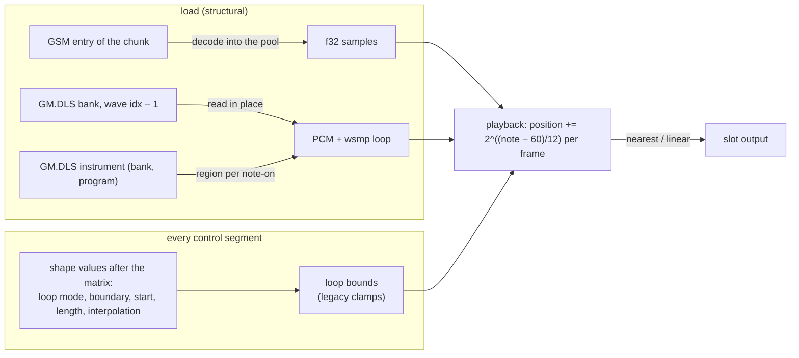

- **Pitch.** The step is `2^((note − 60)/12)` sample units **per output frame**, so at the root note the data plays one
  sample per frame at any song rate (a sample lasts the same number of frames at 22 and 96 kHz, as in the legacy
  samplers); coarse, fine, octave, ratio, pitch routes and the voice's transpose add as for the other types. The fixed
  frequency is relative to note 60 (`hz / 261.6256`).
- **Start and direction.** Note-on places the position at `start·(len − 1)`, or at `(1 − start)·(len − 1)` playing
  backwards with `reverse`.
- **Loops.** `off` ends the slot past the data; `repeat` wraps by the loop length (linear interpolation reads the loop
  start across the seam); `ping-pong` reflects at the bounds and plays each edge sample twice. Bounds come from the
  sample (the whole GSM sample, or the DLS wave's own `wsmp` loop) or are set by hand as fractions of the length; the
  legacy clamps apply (length at least 1, start inside the data, end at most the length).
- **One-shot.** With `one-shot` set the voice ignores note-off and ends when every sampler slot has run out, except that
  all-notes-off still releases it. A repeat-looped one-shot therefore sounds until it is stolen or all notes are turned
  off; the converter never emits one.
- The sampler has no phase input; its output can still be sent into the next slot (`pm-out`).

### Clocked (`us-osc-clocked`)

A slot that runs at its own sample clock: naive, aliasing waveforms (saw, square, spike, pulse, noise, fold, with a
detuned second voice) and a resonant low-pass with a compounding envelope, computed at the slot's clock and resampled
to the song rate. The aliasing therefore falls where it falls at that clock, the low-fi sound of a low-rate sample
synth. Named by function since change unify-v2-algorithms. Source: the waveforms of Probe's mini-cauldron, the precalc
sample synth of TBL's Jizz and Stash (1997), for songs converted from those intros (`synth-convert xm`, change
add-cauldron-xm-import). Algorithm and sources:
`research/tbl-mini-cauldron/mini-cauldron-spec.md`. The type is stored at odd position 3 of the expanded type choice
(0.375).

- **Phase.** A signed 16-bit phase word as in the original, naive (not band-limited): the aliasing is the sound. The
  original pitch word is `inc·65536/clock`, where `clock` is the phrase frames per output frame (`shape[3]`: the
  original's internal rate 35 441.2 Hz times the playback ratio, over the song rate; 0 means one per output frame).
- **Phrase clock.** The slot (waveform and filter) runs one original frame per phrase frame and a 4-point cubic
  (Catmull-Rom) resamples it to the song rate, so the naive waveforms alias as the original's do at its own rate
  (rendered directly at 44.1 kHz they aliased elsewhere: +3.7 dB in a 63 Hz band). Latency: 2 phrase frames.
- **Note-on.** A non-legato note-on sets the phase to −32766 (the original's retrigger) and the phrase frame counter
  `t` to `(velocity − 1)` eighths of a 3530-frame step: the converter writes each note's phrase position as its
  velocity (an automation value is one byte, too coarse for a frame count). A legato note keeps both. Converted
  instruments set the velocity sensitivity to 0.
- **Phase byte** (`o::PM_OUT`; the clocked slot sends nothing into the next slot). 0 keeps the second saw running
  across note-ons; b ≥ 1 sets it to `(b − 1)/255` turn at a non-legato note-on. The converter replays the original's
  second saw to write it before each retrigger: the starting phase decides how a low note's detuned pair beats.
- **Filter settings latch at a note-on** (`ClockedSlot::flt`): base, amount (after the retrigger byte's compounding
  and accent), decay and damping are taken at a non-legato note-on and kept for the note, as the original computes a
  step's filter at its retrigger. So the retrigger, phase and age bytes matter only around note-ons, and the converter
  writes them as `latched_lane`s: each note's byte holds from its step (`LANE_LEAD` before the note) through
  `LATCH_WINDOW` (lead + 128 frames), free between, so a count rising by one per note is one ramp (Jizz: retrigger
  points 10 874 → 3 637). Before, the next note's byte reached the sounding note `LANE_LEAD` early; parity is the same
  (85 of 88, the songs' figures unchanged).
- **Age byte.** A clocked slot always tracks the note, so its `o::TRACKING` is the filter envelope's age at a
  note-on (`osc::clocked_age`): 0 restarts the envelope at the amount (a retrigger), b ≥ 1 enters `(b − 1)` eighth
  steps after the last retrigger, the envelope at `a·d^n` (a converted XM jumping into a phrase).
- **Reconstruction low-pass.** Below one phrase frame per output frame the cubic leaves images of the phrase-rate
  signal: the slot low-passes its output at `0.45·clock` of the output rate (4th-order Butterworth, `ClockedLp`,
  coefficients recomputed when the clock changes), as the original's player band-limits a slowed sample; bypassed at
  a clock of 1 or more.
- **Restart declick.** A note-on restarts a clocked voice with the filter's output at 0. A note cut while it sounds
  (a converted ping-pong joint, an XM jump) would drop in one frame, so the voice carries the step from the cut
  note's last output frame to the new note's first into the new note and fades it out linearly over 1 ms
  (`DECLICK_MS`, `Declick`): the join is continuous. A note from silence (a fresh voice, a forward retrigger after the
  old note's fade, below −80 dB) carries nothing: its instant start is unchanged.
- **Playback rate.** The voice-wide transpose and bend are a playback rate for a voice with a clocked slot (an XM
  pitch slide resamples the precalc sample): the phrase clock is multiplied by `2^((transpose + bend)/12)`, so the
  pitch word stays and the filter and phrase position move with it, and the voice's envelopes advance at that rate
  too. Note, coarse, fine and octave stay pitch only. (Change add-cauldron-xm-import: a riser bent up within a
  slow phrase clock aliased into sub-bass.)
- **Word byte** (`o::FIXED_HZ`; the slot always tracks the note). b ≥ 1 makes the pitch word
  `rint(f·65536/clock) + b − 128`: the original's integer word, which note + fine byte (±0.39 cents) cannot reach for
  high words. 0, the default, keeps the frequency's word, so bends stay smooth. The converter writes it per note.
- **Glide register** (version ½). The original's glide stores the signed interpolation of its words, so in a tied
  step's first 1764 frames a word above 32767 is negative: the phase steps the same, the second saw by
  `fistp(w·1.02)` of the signed word and the spike reads its dword. Version ½ holds a word above 32767 as `w − 65536`;
  the converter sets it over such glide windows. Words above 32767 are otherwise played unsigned (the note asks for
  `w·R·r/65536`, beyond the phrase clock's Nyquist), as Stash stores them.
- **Voice.** A voice with a clocked slot slides linearly in frequency (the original glides its pitch word), and a
  timed attack of 0 is instant (the original has no attack; WaveSabre's minimum is 1 ms).
- **Voices** (`shape[1]`, 0–10). Above 0, a second saw steps by `round(pitch·1.02)` per phrase frame and is added to
  the first; it runs on across note-ons, as the original's does across retriggers.
- **Waves** (`shape[0]`): 0 saw (the phase word, plus the second saw); 1 square (±30000 by the sign of the sum: PWM
  with voices); 2 spike `32767·u⁷` of each half cycle, plus one copy offset by `t·voices·pitch/128` (only the
  original loop's last voice survives); 3 pulse (30000 above 31000, else 0); 4 noise (`(r & 0xFFFFFF) mod 64001 −
  32000`, a per-note seeded xorshift); 5 fold (`32767 − x` above 0).
- **Version** (`shape[2]`). Version 1 (Jizz) plays saw for waves 1, 3 and 5, and its spike has a sign branch and
  negates the copy's offset for even voices. Version 2 (Stash) has all six waves; its spike's base voice has no sign
  branch (the negative half clips), `t·voices` is truncated to 16 bits (the copy jumps when it wraps), and the
  oscillator output is clamped to ±32767.
- **Scale.** The output is the 16-bit value / 32768, so the saw pair and the spike can reach about ±2.
- **Fidelity.** The test vectors from the bit-exact Python references (`osc/cauldron_vectors.rs`, generated by
  `research/tbl-mini-cauldron/tools/osc_vectors.py`) match exactly for every wave but the spike, which is within 3 LSB:
  the shaping runs in f64 here and in x87 24-bit precision in the original.
- **Filter** (`shape[5..8]`). The original's resonant low-pass, run on the slot's output before its gain (the filter
  is linear, so this is the original's order): `v1 ·= d`, `c = v1 + base`, `y = (1 − q)·(y − c·(x + prev))`, output
  `prev = y + prev`. All in phrase-frame units: base `c` (`shape[5]·8`), envelope amount (`shape[6]·8`), decay per
  phrase frame (`1 + (0.5 − shape[7])/100`; above 1 the cutoff *rises* the longer a note is held, as in 7 of the
  intros' patches), damping `q` (`shape[8]`). Base and amount both 0 (the defaults): no filter. Its DC gain is −1
  and its resonance is not clipped: the converter clips the voice output at full scale, as the original's 16-bit
  store did. `y` and `prev` saturate at ±65 536 (`CLK_SATURATE`, the original's 32-bit integers of 16-bit samples)
  and `v1` stops growing there: a rising cutoff held for long turns the filter unstable (Stash song 1's record 4
  held 30 s ran to infinity and silenced the song), where the original's integers saturate.
  - *Note-on.* A non-legato note-on is the original's retrigger: `prev` = 0, `v1` = the amount; `y` runs on. A legato
    note keeps all three, so `v1` goes on decaying (or rising) across a tie chain.
  - *Compounding.* The note's retrigger byte (`shape[4]`, one automation step before the note) is `2k + accent`. Base
    and amount are multiplied by `mul` (the slot's `FEEDBACK` field, `4p`; the clocked slot reads no feedback) k
    times, each product rounded to f32 as the original stores it, then by the accent (×4 version 1, ×2 version 2).
  - *Rate.* It runs at the phrase clock with the original coefficients (per phrase frame), before the resampler.
  - *Fidelity.* The filter vectors (`osc/cauldron_filter_vectors.rs`, from
    `research/tbl-mini-cauldron/tools/filter_vectors.py`: saw, resonant pair, spike, rising decay, the brightest
    Stash patch, each with a retrigger) are within 1e-4 of their peak: the original rounds its output to an integer
    every frame.

### Point oscillator (`us-osc-points`)

Tunefish 3's oscillator (change add-tf3-import; behaviour from `research/tunefish3-functional-spec.md` §3.1, cycle
checked sample by sample against the original): a cycle drawn through 1–4 control points, played by up to 11 unison
layers whose **sum** is driven and hard-clipped, through the decimation stage below. A per-voice `Pts` (about 1.3 kB:
cycle, layer phases, decimation filters) comes from the pool.

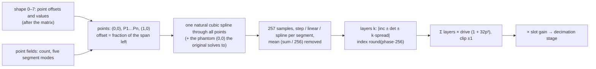

- **Cycle.** User point k sits at `x_k = x_(k−1) + (1 − x_(k−1))·clamp(offset, 0.01, 0.99)` with value `2v − 1`. The
  segment ending at point k uses `osc{n}.mode{k}`, the last one `mode_last`. The spline is solved over every point
  even when only some segments use it, one segment past `(1, 0)` to a phantom `(0, 0)` (the original's loop runs to an
  unset point), with widths and rises nudged by 1e-4.
- **Rebuild.** At note-on and at every control segment when the count, a mode or a point (after the matrix) changed.
- **Layers.** Layer 0 starts at phase 0, every other layer at one shared random pair (the original seeds them from the
  same tick count). The index rounds half to even, so a phase of exactly 1 reads the guard sample 256.
- **Fields.** Shape 0–7 = P1–P4 offset and value (matrix shape targets; shape 7 is structural for every type, so P4's
  value is not automatable), shape 8 = drive; the point fields (`params::pt`, 294–320) = count, modes, layers
  (`count(1..11)`), layer detune `10p³` Hz and spread `10p⁴` Hz.

### PAD table (`us-osc-pad`)

Tunefish 3's additive generator (change add-tf3-import, spec §3.2): one static PADsynth table of 2¹⁶ samples per slot
and instrument, built **at load** from the slot's shape values (a later change of them is not applied; the drive
stays live), shared read-only by the voices. Each voice keeps a `Pts` for its two phases and the decimation stage.

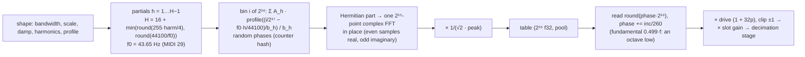

- **Laws.** `A_h` = `1/(1 + h(1 − damp))` for odd h, `2/(1 + h(1 − damp))` for even h; width
  `b_h = (2^(256·bw/1200) − 1)·f0·h^(1 + 19·scale²) / (2·44100)`; profiles single (`|x| ≤ 0.1`), detune
  (`0.4 ≤ |x| ≤ 0.5`), spread (`|x| ≤ 5`), gauss (`e^(−x²)`, cut at `x² > 14.71`). Built for 44.1 kHz at every song
  rate, so its pitch ratio is fixed.
- **Playback.** Left/right detune from the slot's point field `layer_detune`; no unison, no velocity of its own (the
  converter decides the velocity routes).
- **Cost.** 256 kB per PAD slot; 5.7–17 ms to build (release). The magnitude spectrum matches the original's per
  profile (bands of 16 bins within 2 % of the peak band); phases differ (random in both).

### Pair oscillator (`us-osc-pair`)

Elevated's oscillator pair (change add-elevated-import; Mentor's 4k synth, `docs/synth/elevated.md`), stored at the
free type position 5. One slot plays two naive copies of a waveform from two f64 phases that advance by `inc·(2 − d)`
and `inc·d`. Both start at 0 at every note-on and advance before they are read (the original reads `φ·(2 − d)` and
`φ·d` from one unwrapped phase; two wrapped phases are the same under any pitch movement). Each copy adds the phase
shift `s` and folds to `x = 2·(t − round(t))`, then gives sine `sin(πx)`, square (+1 above 0, else −1) or saw `x`. The
slot is their sum, times −1 with the polarity set: an added negated pair is the original's subtract. Shape fields:
`s0` wave (`Choice(3)`), `s1` shift (turns), `s2` detune `d = 2p`, `s3` polarity (`Choice(2)`). Two more voice settings
come with Elevated:

- **Pitch drop** (`us-voice-drop`, `drop.base`, `drop.rate`): the voice frequency is `b + (f − b)·k^(n+1)` at frame `n`
  after note-on (`Move::Drop`, evaluated at the control points, the increment ramped between them; kicks fall from the
  note to the base).
- **Linear timed envelope** (`us-env-linear`, `envN.linear`, `envN.hold`): attack 0 → 1, decay → sustain, hold, release
  → 0, each linear over `5000p²` ms (no 1 ms floor). It ends by itself, and a note-off ends it at once (Elevated's `0x7F`
  cut). With envelope 1 linear, the voice ends its control segment at each stage corner (`Env::linear_left`; the
  instrument ticks a voice whose segment ended off the 8-frame grid), so a 3-frame attack keeps its corner.

### Decimation stage (points and PAD)

Both Tunefish 3 slot types always run Tunefish 3's oversampling and decimation (spec §3.3): the slot renders `k`
samples per frame, `k` the smallest integer with `k·rate ≥ 64·f` for the voice's note frequency (at most 8, so `k = 1`
below 689 Hz at 44.1 kHz), each scaled by the slot gain and passed through two cascaded ladder low-passes at 12.83 kHz
designed at `k·rate` (no resonance, output `y − y³/6`), and the mean of the `k` samples is the frame. It runs at `k = 1`
too: it is part of the sound. Filters clear at note-on. One voice with an 11-layer point slot runs at 82× real time at
`k = 1` and 11× at `k = 8` (release).

### Controllers: wheel, bend and bend range

`ctl.wheel`, `ctl.bend` and `ctl.bend_range` (indices 218–220) are ordinary automatable parameters, so a song carries
wheel and bend as automation lanes. The wheel feeds mod source 7 (the live input `UInstrument::mod_wheel` writes the
same parameter). Bend shifts every voice by `(bend − 0.5) · 2 · range` semitones: it is added to the voice's transpose, so
held and releasing voices follow it and, like transpose, a fixed-frequency oscillator does not. The defaults (wheel 0,
bend 0.5, range 2) leave a song that never sets them unchanged; a seek restores the values the chunk loaded.

### DLS instruments (`us-sample-dls`)

The sampler's `source` is a choice of three: **GSM** sample of the chunk (0.0), **DLS instrument** (0.5) and **DLS wave**
by index (1.0, Adultery's way). An instrument is named by `index = 1 + drums·16384 + bank·128 + program` (0 = none), so
the same index finds "Piano 1" (bank 0, program 0) in Windows `gm.dls` and in macOS `gs_instruments.dls`, and 16385 the
Standard kit.

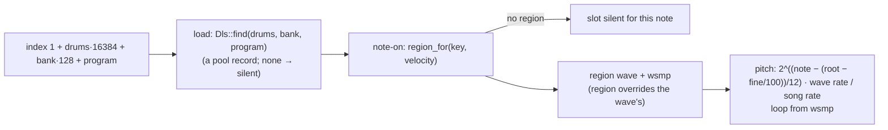

The region is picked at note-on and kept for the life of the voice, so a chord uses one region per note and a velocity
layer cannot change mid-note. The wave plays at the region's (or wave's) root key and fine tune, at the rate its own
sample rate implies (a 22.05 kHz wave at a 44.1 kHz song steps half a unit per frame), with its `wsmp` loop when the
loop boundary is "from the sample". A missing bank, a missing instrument or a key with no region is silence for that
slot, never a load error. Not applied: the bank's articulation (envelopes, LFOs) and the `wsmp` gain, which Apple's bank
stores as −20 dB (kit) to −113 dB (piano) and makes up for in the articulation; the patch's own envelopes and gain
shape the sound. Checked against the real macOS bank (skipped when absent): Piano 1 note 36 plays wave 289 (region
0–38) and note 72 wave 294 (region 68–74); the Standard kit's 36 and 38 play waves 376 and 161, each at its own root.

### Stereo DLS pairs (`us-sample-stereo`)

A bank may pair waves with a top-level `LIST 'stpr' { pair }` chunk of `u32` (left, right) indices (the gmplus bank,
change add-gmplus-bank D5/D6). With `us-sample-stereo` (implies `us-sample-dls`, in `us-all`), a DLS-instrument or
DLS-wave slot whose wave has a valid partner (`dls::Dls::partner`: both waves parse with equal rate, length and loop)
plays the left wave on its left output and the partner on its right, read at one position (`smp::State::next_pair`);
the slot's pan gains then apply per side. An unpaired wave, a malformed pair or a build without the feature plays the
left wave on both outputs, exactly as before (`next` is unchanged; `next_pair` is a separate copy so builds without the
feature keep `next`'s inlining). Test: `osc_dls_instrument.rs` `a_stereo_pair_plays_left_and_right`.

Size (i686 compo probe, `research/us-size-probe/songs-size.sh`, 2026-11-06): without the feature the change is neutral
(engage 48 160 / elysian 53 924 / no-remorse 28 564 B xz against HEAD 48 176 / 53 916 / 28 556, same squishy); with it,
engage (a DLS song) costs +748 B xz, +512 B squishy (`EXTRA_FEATS=unisynth/us-sample-stereo`). `needs.rs` does not
derive it: the chunk does not say which bank the build ships; a build that ships the plus bank adds it.

## Noise and filters

After the oscillators the voice adds the noise source, runs the sum through the four filter slots in series, and only
then applies the voice gain (master, matrix gain, velocity, envelope 1).

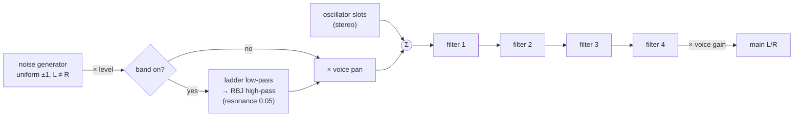

### Noise (`us-noise`)

A per-voice stereo generator, uniform in ±1, seeded at note-on from the voice's own stream
(so a retriggered voice sounds different, and the sequence does not depend on other tracks or the call split). Level
is `gain(p)` through the matrix (Scale on the physical level, Offset in linear gain); the voice pan places it
(equal-power: the centre is −3 dB per channel, which the converter compensates). The optional band is Tunefish's: a
ladder low-pass at the `lp` cutoff and an RBJ high-pass at the `hp` cutoff, both at resonance 0.05. A patch that sets
or routes the level in a build without `us-noise` fails at load naming the module.

The width parameter `noise.width` (index 183, default 1) sets how far the channels differ: at 1 each has its own noise
(Tunefish's), at 0 both carry the same noise (WaveSabre's Slaughter, which the converter sets), between them
`(w·r + (1 − w)·l)/√(w² + (1 − w)²)`, so each channel keeps its power. Independent channels read 3 dB lower in a mono
sum, which showed in every octave band of Global Groove's hi-hats while the per-channel level was already right.

### Filter slots

Each slot is off or one of four topologies, each one formula (change unify-v2-algorithms, design D1): the
state-variable filter, the 4-pole filter, the RBJ biquad and the resonator notch. The type is an ordinary parameter (it
can be automated; a change between types of one topology, e.g. state-variable low-pass to high-pass, or the input form
to the feedback form, keeps the state). `us-flt-svf`, `us-flt-ladder`, `us-flt-feedback`, `us-flt-rbj`,
`us-flt-notch` gate the types: a patch that loads with a missing one fails at load; a type automated to a missing one
bypasses.

The type is the algorithm with its response (`Choice(11)`); `filtN.form`, `filtN.oversample` and `filtN.law` are
settings of the state-variable and 4-pole types (the RBJ and resonator types ignore them):

| Type | Form 0 / 1 | Oversample 0 / 1 | Law 0 / 1 |
|---|---|---|---|
| state-variable low/high/band/notch/all-pass | input / feedback resonance | interpolated / held | Hz / 7-bit steps |
| 4-pole low/high | feedback before / after the clip | 1 / 2 steps | Hz / 7-bit steps |

The earlier types are settings now: SVF = state-variable, input, interpolated, Hz; ladder = 4-pole low, before the
clip, 1 step, Hz; the feedback SVF types = state-variable, feedback, held, 7-bit; the 4-pole 2× types = 4-pole, after
the clip, 2 steps, 7-bit.

| Type | Topology |
|---|---|
| RBJ high/band-pass | biquad with the reference's `log₁₀2` bandwidth law, `w0 = 2π·fc/rate`; Hz, `clamp(p, 0, 0.85)` |
| Resonator notch | zeros on the unit circle, poles at radius `q`, one sample of input latency, `z = cos(2π·fc/rate)`; Hz, `clamp(p, 0, 0.85)`; the pole radius does not scale with the rate |

`filtN.form` 1 on these three types (which otherwise ignore it) is **Tunefish 3's form** (change add-tf3-import),
under `us-flt-feedback` like the other forms: the RBJ band-pass takes Tunefish 3's shelf-slope bandwidth
`α = sin ω0/2 · √((A + 1/A)(1/BW − 1) + 2)`, `A = 1.059253725`, `BW = 1 − clamp(q, 0, 0.95)` (a wide, low-Q band:
`Q = 1/√(…)` between 0.16 and 0.71, peak gain `Q`); the RBJ high-pass takes resonance up to 0.95; the notch type
becomes an RBJ notch (`b = 1, −2cos ω0, 1`, the same α, no latency). No stored song used the field on these types,
and filter types stay one `Choice(11)`: they can be automated, so an expanded choice would move off-centre values.

**State-variable** (`flt::sv_coefs`, 2× oversampled): per half-step `low += f·band; high = a·(x − c·band) − low;
band += f·high`. The responses are low, band, high, notch (`low + high`) and all-pass (`low + band + high`: flat at
zero resonance, a band-pass peak above it).
- The **input form** scales the input by `q = 1 − p` (`a = q, c = 1`), so the passband falls with resonance. The
  **feedback form** damps only the band feedback (`a = 1, c = 1 − p`).
- **Interpolated** oversampling feeds the first half-step the mean of the previous and the current input and outputs the
  mean of both half-steps. **Held** feeds both the input and outputs the second.
- No bias: the source's 2⁻¹⁸ input bias against denormals left a standing DC near −60 dB in low and band; it moved
  no song (survey, unify-v2-algorithms 6.4) and the player flushes denormals, so it is gone.
- Laws: Hz `f = 1.5·sin(π·fc/2/rate)`, so the corner is 3/4 of the cutoff (the original coefficient, kept); 7-bit
  steps `f = calcfreq(step/128)·44 100/rate`.

**4-pole** (`flt::p4_coefs`): per step `xin = x − fb·s₄`, four poles `(in + prev)·p + g·s` with
`p = f + 0.8·f·(1 − f)` and `g = 1 − 2p`, then the cubic clip `y − y³/6` (the source's bias is dropped, as above). The high-pass is the input
minus the low-pass: about 10 dB down a decade below the corner, not a 24 dB/octave slope.
- **Feedback before the clip** (a linear loop) feeds back the unclipped last pole, and the first pole's previous input
  is the fed-back input. The feedback is `min(p, 0.85)·e^(1.386249·(1 − p_pole))`, which stays stable.
- **Feedback after the clip** feeds back the clipped output (also the last pole's state), and the first pole's previous
  input is the dry one. The feedback is `4·p·(1 + ½·t·(5.6t² + 1 − t))`, `t = 1 − f`, which the clip keeps bounded.
- **1× or 2×**: one or two steps per sample on the same input; `f` is set for the step rate.
- Laws: Hz `f = 2·fc / step rate`; 7-bit steps `f = calcfreq(step/128)·44 100/rate·½` (¼ at 2×).

Both formulas are exact for the earlier filters they replace, except the ladder, which rounds `(in + prev)·p` where it
had `prev·p + in·p` (within 1e-4 of Tunefish's filter).

The cutoff is `cutoff(p) = 20 + 19 980·p²` Hz for every type (Tunefish's own `30 + 20 000p²` / `30 + 10 000p²` laws
are re-mapped by the converter). The matrix reaches it as Scale (on the normalized value) or Offset (in Hz), clamped
to `0..19 980` Hz after the sum, as Slaughter does. All coefficients are computed for the song rate (cutoff clamped to
0.49 · rate) once per control segment and ramp linearly across it.

## Mono-sum voice, drive, channel strip and speech (change add-v2-import; names: unify-v2-algorithms)

The voice output settings (`us-voice-out`; a converted V2 voice sets all of them):
- `voice.amp_source`: the amplitude is envelope 1 alone (not master × velocity × envelope 1)
- `voice.pan_stage`: the pan comes once, after the drive, on the mono sum (not per slot)
- `voice.dc_filter`: the output DC filter
- `voice.law`: the transpose on 7-bit steps (`step − 64`)

The player has no format version (change unify-v2-algorithms, the format switch). What V2's version decided is
written by the converter (and the migration of old songs): no FM generator before version 4 and no aux-in or 4-pole
filter before 6 (the slot or filter off), key sync 2 as 1 before 6, the DC filters on at 6, a channel route on a voice
source dropped before 5; the rest are the quirks below, each set only where its code is reached. A test fails if the
player reads `era` anywhere.

**Quirks** (survey of 2026-11-01, change unify-v2-algorithms task 6.3, `tools/unisynth-parity/quirk-survey.ts`).
A quirk reproduces one source build; each is a structural choice of the instrument (`quirk.*`, indices 225–229) and
a module of its own (`us-quirk-exact-math`, `-integer-fm`, `-fixed-seed`, `-lcg-noise`, `-coarse-env`; module ids
57–61): a patch that sets one in a build without it fails with `UnsupportedModule`. A quirk exists only if some
converted song leaves the parity tolerance (1 dB loudness, 3 dB per octave band) without it: against the original V2
render where one exists (the 18 parity songs), else against the song's own render with the quirk on. Each was cleared
in turn (`--cfg us_quirk_off="<quirk>"` before the switch) over the 347 V2 songs:

| Quirk | Reproduces | Format versions | Songs that set it | Without it: outside parity tolerance | Decision |
|---|---|---|---:|---|---|
| `coarse_env` | 256-sample control frame, year-2000 envelope laws | 0, 1 | 9 | 5, incl. fr08 against its original (−1.46 dB loudness) | keep |
| `lcg_noise` | the MSVC LCG noise generator | 0–4 | 19 | 6, incl. fr014 (+5.1 dB in one band) and fr08 against their originals | keep |
| `exact_math` | exact sine and arctangent instead of the fast approximations | 0–5 (not the 2004 build) | 311 | 8, incl. kkrieger against its original (−6.4 dB in one band) | keep |
| `integer_fm` | FM phase offset rounded to an integer; out of range collapses the carrier (x87 `fistp`) | 0–5 (not the 2004 build) | 311 | 11, incl. kkrieger (+7.6 dB) and fr029 (+3.0 dB) against their originals | keep |
| `fixed_seed` | noise seeds start at 0 | 0–5 | 311 | 1: a keygen tune (−3.33 dB in one band) | keep |
| `boxed_osc` | 4× box-averaged naive saw and pulse | 0–2 | 9 | none; none past the listening thresholds either | dropped |
| `dc_bias` | the channel strip's and the 7-bit effects' denormal bias | 6 | 36 | none; none past the listening thresholds either | dropped |
| `filter bias` | the feedback and 4-pole forms' denormal bias (every version; the drive's filter modes too) | 0–6 | 347 | none; none past the listening thresholds either (checked at the freeze, task 6.4) | dropped |

Each kept quirk, its source build, cargo feature and module id, and the songs that leave the parity tolerance without
it (song files under `project/music/released/v2/`; loudness / worst octave band in dB; "original" = against the V2
render of the parity suite, else against the song's own render with the quirk on):

| Quirk | Source | Feature (module id) | Songs past tolerance without it |
|---|---|---|---|
| `quirk.coarse_env` | V2 format versions 0–1 (the 2000 envelope) | `us-quirk-coarse-env` (61) | fr08 against its original (−1.46 / −2.21); `kb-fr-08-the-product-main` (−1.34 / −2.20), `loader` (−1.24 / −2.07), `tpinv` (−1.27 / −2.13), `entropy-fr-010-art-entroxion-sanxion-remix` (−1.01 / −2.09) |
| `quirk.lcg_noise` | V2 format versions 0–4 (MSVC `rand`-style LCG) | `us-quirk-lcg-noise` (60) | fr014 (+1.33 / +5.07) and fr08 (+0.58 / +3.43) against their originals; `wayfinder-fr-014-garbage-collection-main` (+1.32 / +5.00), `kb-fr-08-the-product-main` (+0.70 / +3.48), `loading` and `whateverload` (+0.48 / +6.95) |
| `quirk.exact_math` | V2 format versions 0–5, not the 2004 build (C runtime `sin`, `atan`) | `us-quirk-exact-math` (57) | kkrieger against its original (−0.88 / −6.40); `tport-metaproducts-kg` (−1.16 / −5.96), `entropy-fr-010-art-entroxion-sanxion-remix` (−0.94 / −5.15), `tport-mp3-joiner-1-0-crk` (−2.92 / −4.35), `tport-metaproducts-picture-downloader-1-0-589-kg` (−0.24 / −3.64), `quickyman-funny-rythm` (−1.33 / −2.07), `pista-crystal-gate-loader` (−1.25 / −1.74), `quickyman-welcome-mr-saw` (−1.10 / −1.06) |
| `quirk.integer_fm` | V2 format versions 0–5, not the 2004 build (x87 `fistp` phase offset) | `us-quirk-integer-fm` (58) | kkrieger (+0.34 / +7.56) and fr029 (+0.79 / +3.04) against their originals; `v2mplayer-greetz-to-breakpoint` (+1.09 / +9.92), `icefall-subcelestial-beauty` (+0.08 / +5.76), `preston-demo-or-suck` (+0.92 / +5.70), `kz-total-commander-6-7-x-x-crk` and `v2mplayer-the-2nd-movement-sid-remix` (−1.29 / −5.29), `quickyman-stop-the-user` (+0.37 / +4.98), `tad-short-fm-2` (−0.79 / +4.64), `tport-flash-sound-grabber-1-10-crk` (+1.93 / +3.89), `icefall-subcelestial-silence` (+0.46 / +3.79), `dq-coop-biff-3d-igel-intro` (−0.09 / +3.25) |
| `quirk.fixed_seed` | V2 format versions 0–5 (noise seeds at 0 instead of per voice) | `us-quirk-fixed-seed` (59) | `under-seh-auslogics-boostspeed-4-1-4-135-crk` (−0.09 / −3.33) |


**Combine.** Every slot meets the running sum of the earlier slots through one step (`osc::mix_in`): add (panned by
the slot and the voice pan), multiply (ring) or replace (both on both channels of the sum). The running mono sum
(the FM and ring input of a later naive generator) is unpanned. `oscN.combine` sets it for every slot (multiply and
replace: `us-osc-combine`); a converted V2 slot multiplies when it rang, replaces for FM and aux in. The naive
generators share the slot path: one `slot_targets` with `oscN.law`, the 7-bit oscillator law (transpose `step − 64`,
detune `(step − 64)/128`, volume `step/128`, note 60 = 130.8 Hz) or the semitone and Hz laws.

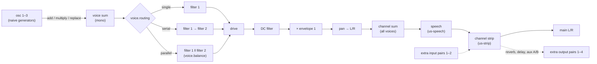

| Module | Feature | What it is |
|---|---|---|
| oscillator types naive saw/tri … aux in B | `us-osc-naive` | generators saw/tri (colour morphs), pulse (colour = width), sine, coloured noise (state-variable filtered; colour), FM (from the running sum), aux in A/B; coarse/fine/gain on the slot's law |
| `oscN.combine` multiply, replace | `us-osc-combine` | ring (multiply the running sum) and replace, on any slot |
| filter forms and the 7-bit law | `us-flt-feedback` | the feedback-resonance and held forms of the state-variable filter, the after-the-clip and 2-step forms of the 4-pole filter, the 7-bit cutoff/resonance law |
| `voice.routing`, `voice.balance` | `us-flt-parallel` | filter slots 1 and 2 single, serial or parallel with a balance |
| drive | `us-drive` | off, overdrive (arctangent), clip, bit crush, decimate, low/band/high/notch/all-pass/4-pole filter; `drive.*` input gain, param 1/2 |
| envelope law `Frame` | `us-env-frame` | per-frame (344.5 /s) attack/decay/sustain/release in 0..128 steps, sustain slope, `envN.amplify` |
| LFO law `frame` | `us-lfo-frame` | the frame law and the LFO settings beyond the Hz law's: triangle, pulse, sample-and-hold, `lfoN.polarity` (+, −, ±), `lfoN.one_shot`, start phase, key sync reseed |
| voice output | `us-voice-out` | the voice path above (sum, DC filter, keysync, pan after drive) |
| channel strip | `us-strip` | see below; needs `synth-core/pairs` |
| speech | `us-speech` | formant speech; text in chunk version 4 |
| quirks | `us-quirk-*` | one per quirk (table above) |
| matrix Add | `us-matrix-add` | the Add rule, CC2–CC7 and centred-note sources, slots 13–16 |

`us-all` enables them all. With `voice.pan_stage` after the drive, a naive oscillator outputs the same mono signal to
both channels and ignores the slot pan; the voice pan applies after the drive.

**Mixing.** Every module above is chosen per slot or by its own parameter. A unisynth voice (the voice settings off) can
use any of them beside the unisynth ones:
- a feedback SVF or 4-pole filter in any filter slot
- a naive oscillator next to a wavetable or BLIT slot
- the frame law on any envelope or LFO
- the drive
- parallel routing of filter slots 1 and 2, whatever their kinds

A naive oscillator then pans like a unisynth slot (slot pan + voice pan, the unisynth pan law), and the voice keeps
unisynth's gain, velocity and pan. The 7-bit laws stay as they are: a feedback SVF's cutoff moves with Scale and Add
routes, not Offset (Hz). The mixed cases are checked by the `mix_*` tests in `src/instrument/tests/v2.rs`. The
overdrive output gain (`drive.p1`) defaults to 0, which is silent.

### Channel strip

The channel strip runs once per instrument on the sum of its voices, in this order:
1. aux receive
2. DC filter
3. compressor (peak or RMS, 5700-frame look-ahead, shared body with compressor `Look-ahead`)
4. bass boost (150 Hz shelf)
5. drive and chorus/flanger, in `strip.order` order
6. DC filter
7. × 0.6 · volume

The reverb, delay and aux A/B sends leave on extra output pairs 1–4 (reverb and delay mono, copied to both sides). The
aux receives come in on extra input pairs 1–2. The same input pairs feed the aux-in oscillators (format version 6):
`(l + r) · gain · 0.6`, replacing the voice sum or ring-multiplying it. An aux-in oscillator needs `us-strip`, and
`needs` names it. The aux buses are cleared every frame and channels render in order, so `synth-convert v2m` wires
each reader to the aux sends of the lower MIDI channels only (`v2-report.md`, "Aux buses"). Strip parameters
(`strip.*`, targets 118–141) are modulated from the newest voice. A muted channel still renders but feeds no bus.
Without sends, `run` behaves as before and writes no extra pair.

### Speech

`us-speech` is a formant speech synth. The chunk's text section (version 2) holds the speech texts, separated by NUL.
The phoneme strings use phoneme names and durations; `!` waits for a note-on and `_` for a note-off. Speech runs on
the voice sum before the channel strip. `speech.select` selects the text and sets the rate (CC4 in converted songs),
and `speech.pitch` sets the pitch (CC5). Note-ons and note-offs advance the waits. The table holds 69 phonemes and 52
syllables, decoded at build time.

### Provenance

The functional names above come from these source modules. Source names appear only here, in the converters and in
the parity tools.

| here | source | original |
|---|---|---|
| naive oscillator generators, ring, Add/Mul/Set | Farbrausch V2 | `V2Osc` (`synth_core.cpp`; v2redux `v2core.cpp`) |
| feedback SVF, 4-pole 2× filter | V2 | `V2Flt` LRC and Moog modes |
| seconds-law envelope (quadratic) | WaveSabre | Slaughter/Falcon envelope |
| rate-law envelope (power slope) | Tunefish 4 | `eTfEnvelope` |
| frame-law envelope and LFO | V2 | `V2Env`, `V2LFO` |
| drive | V2 | `V2Dist` (voice) |
| channel strip | V2 | `V2Chan` (DCF, compressor, boost, distortion, chorus) |
| speech | V2 | Ronan (`ronan.cpp`) |
| clocked oscillator, flanger `comb`, distortion `wrap` | TBL Jizz / Stash (1997) | Probe's mini-cauldron (`research/tbl-mini-cauldron`): waveforms, comb/doubler, wrap-around specials |
| pair oscillator, pitch drop, linear timed envelope; EQ `svf-lfo`, distortion `atan`/`sine`/`knee`, delay `ping-pong`/`allpass` | Mentor's 4k synth (Elevated, Atrium; TBC 2008–09) | `synth.asm`: the synth machine, filter (coupled-form LFOs), distortion and compressor machines, delay and allpass (`research/elevated-synth.md`) |
| reverb `Comb`, delay `Modulated`, compressor `Look-ahead`, EQ `Cut` | V2 | `V2Reverb`, `V2ModDel`, `V2Comp`, post filters |
| matrix Add, CC2–7, centred note | V2 | `storeV2Values` modulation |
| the quirks (`quirk.*`) and the converter's version-dependent writes | V2 format versions 0–6, the 2004 build | v2redux `v2eras.h` ledger |

The port follows V2's `synth_core.cpp` (public domain) and v2redux's `v2core.cpp` where the x87 rounding and bugs
matter (fast sine below −π, the arctangent table path, `fistp` round-to-nearest, the integer-indefinite FM collapse).

## Module features

Every module sits behind a Cargo feature, so a build carries only what its songs use. A patch that needs a module the
build lacks fails at load with `UnsupportedModule(id)` (`module.rs` names the id); nothing is silently dropped.

| Feature | Module | Load check |
|---|---|---|
| `us-osc-pm`, `us-osc-blit`, `us-osc-wt`, `us-osc-sample` | the four oscillator types | the slot's type |
| `us-osc-clocked` | the clocked oscillator (change add-cauldron-xm-import) | the slot's type |
| `us-sample-gsm`, `us-sample-dls` | sampler sources (imply `us-osc-sample`) | the sampler's source, at chunk parse |
| `us-sample-stereo` | stereo DLS pairs (implies `us-sample-dls`) | not checked: without it a pair plays mono |
| `us-noise` | noise source | level set above 0, or any matrix slot targeting the noise level |
| `us-flt-svf`, `-ladder`, `-rbj`, `-notch` | filter families | each filter slot's type |
| `us-env-seconds`, `us-env-rate` | timed (WaveSabre) and rate (Tunefish) envelope modes | the mode of envelope 1, and of any envelope a matrix slot reads |
| `us-voice-lfo` | the two voice LFOs | any matrix slot whose source is LFO 1 or 2 |
| `us-voice-glide` | glide and mono slide (pitch moves) | glide above 0, or slide above 0 in mono-legato mode |
| `us-voice-mono` | mono-legato mode (the pool's note log) | mode is mono-legato |
| `us-voice-unison` | more than one voice per note | unison above 1 |
| `us-voice-oneshot` | one-shot voices (sampler runs out, note-off ignored) | one-shot is on |
| `us-matrix` | the mod matrix | any slot with a source and a target |
| `us-automation` | the mixer's automation walk (song-level) | any track with an automation lane (refused by `Player::new`) |
| `us-quiet` | quiet-track skip (`Device::quiet_skip`; [synth-core](synth-core.md#quiet-tracks-sleep-devicequiet_skip-quiet_after-wake)): a silent track skips its devices. A speed option, not a module: no song needs it, `features` does not list it, a build without it plays the same. The instrument answers `quiet_after` 0 without voices, queued events, channel stage or speech; shaper, EQ 3band, wrap (no offset) 0, tempo delay and comb their line capacity; freeverb (not frozen) its core's sleep span + pre-delay line; every other mode unknown (keeps its track awake). Costs Jizz's build +512 raw / +484 xz / +512 squishy | none |
| `us-chunk-wide` | chunk escapes (index ≥ 240, ≥ 255 pairs); implied by `us-strip` | a chunk that uses an escape, at parse |
| `us-matrix-add`, `us-speech`, `us-osc-naive`, `us-flt-feedback`, `us-flt-parallel`, `us-drive`, `us-env-frame`, `us-lfo-frame`, `us-voice-out`, `us-strip` | the mono-sum voice modules ([Mono-sum voice](#mono-sum-voice-drive-channel-strip-and-speech-change-add-v2-import-names-unify-v2-algorithms)) | an Add or controller route; non-empty speech text; the slot, filter, routing, distortion, envelope, LFO law; `voice.stage`; any strip field off its default |

Automating a parameter to a module the build lacks does not fail (the song is already loaded): a filter bypasses, an
envelope runs the mode it has, an LFO reads 0, glide and slide snap, mono and unison play one poly voice, one-shot is off,
a route created without `us-matrix` does nothing. Groups `us-osc`, `us-flt`, `us-env`, `us-voice` and `us-all` exist for convenience.
`tools/check-unisynth-features.sh` builds every single-module set for i686 core-only and wasm32 and runs its tests.

**A feature removes the module's code.** The match arms that run an oscillator, the noise source and each filter family
read `Kind::X if cfg!(feature = "us-…")` with a bypass arm, so the compiler drops the code of a module the build lacks
(before this, those features only made the load fail: a noise-only song still carried every oscillator and filter).

**Voice paths.** The voice switches are features too (shrink-unified-synth 4.2). An ablation build that stubbed each optional
path out (`research/us-size-probe/ablate.sh`, `--cfg us_ablate=…` stubs, not committed) measured, compo configuration, raw / xz:
LFOs 1–1.5 K / 0.4–0.8 K, glide/slide 1 K / 0.5 K, mono-legato 0.5–1 K / 0.3–0.4 K, unison 0.5 K / 0.1–0.2 K, one-shot 0–0.5 K /
0.2 K; pitch bend and wheel, start-phase spread, the fine control grid and voice stealing under 0.5 K raw each, so those stay
in every build. Mono and unison live in `synth_core::voice::VoicePool`, shared with the legacy engines: the `Voice` trait carries
`const MONO` and `const UNISON` (default `true`), which `unisynth` sets from its features, so the pool's note log and unison
loop fold away without a `synth-core` feature. Songs that use none of a path play bit for bit as before (the golden test plays
every patch a reduced build can load and compares it with the full build's hash).

**The matrix.** Gating groups of matrix targets (pitch, gain/pan, oscillator fields, noise, filter, envelope decay, LFO depth,
slot amounts) made the player *bigger* (+0–0.5 K raw): most target ids are computed in loops, so the check stays in the code.
Even every target no reference song uses, cut at its call site, saves only 0.5 K raw / 0.3 K xz. The whole matrix is
2–2.5 K raw / 1.2–1.4 K xz: `us-matrix` (shrink-unified-synth 4.3), needed by any slot with a source and a target
(`modmx::routes`) or a lane on a routing parameter. Without it `Matrix::eval` does nothing and every query reads neutral.
Of the reference songs only Global Groove routes nothing (−1 KB packed).

**Automation and other song-wide facts** (shrink-unified-synth 4.5). Specializing the voice per instrument (patch values
as `const`) would need one copy of the ~9.5 K voice per instrument (16–20 in the Tunefish songs): not pursued. Song-wide
facts were checked instead: fewer used slots changes nothing (a loop's code is there once whatever its count), the
sample rate is a struct field read at run time (folding it would mean rewriting every use for a few divisions). What
pays is a song without automation lanes: `us-automation`. `Device::automation()` (default `Ok`, a method so `Device`
stays dyn-compatible) returns a constant `Err(module::AUTOMATION)` in a `unisynth` build without the feature, so the
mixer's `automate` call folds away and `Player::new` refuses a song with a lane with `UnsupportedModule(37)`. The legacy
engines keep the default. Packed (baked, compo configuration): Global Groove 13,824 → 13,312, no_remorse 22,528 → 22,016,
tf4testsong 20,992 → 20,480, turtles 25,088 → 24,576 (−364 to −464 xz); songs with lanes link the same code as before.
The parallel path (`mixer/par.rs`, feature `threads`) still calls `automate`; it has nothing to walk, since such a song is
refused at load.

### Open filters are not run

A filter slot set so that the signal comes out as it went in is passed through (`flt::transparent`): a low-pass or ladder with the
cutoff at the top of its range (19 980 Hz), or a high-pass with it at the bottom (1 Hz), with no resonance. The slot's
coefficients and state are left alone while it is open (`Slot::pass`); the voice only remembers the last frame that went past. When
the cutoff leaves the open position the state starts as the steady state of that signal (a low-pass or ladder holds it, a
high-pass, band-pass or notch has none of it at rest), so the change does not click. The decision is taken per control segment
on the effective cutoff, so a modulated cutoff is bypassed exactly while it sits at the end of its range.

The open end is a position, not a gain of 1, so the sound changes a little. Measured at 44.1 kHz:

| Filter at its open end | 1 kHz | 5 kHz | 10 kHz | 16 kHz |
|---|---:|---:|---:|---:|
| state-variable low-pass | −0.02 dB | −0.4 | −1.6 | −4.0 |
| state-variable high-pass (1 Hz) | −0.02 | −0.4 | −1.7 | −4.2 |
| ladder (small signal / full scale) | 0 / −1.15 | | | |
| RBJ high-pass (1 Hz) | 0 | 0 | 0 | 0 |

The state-variable filter rolls the top off at any cutoff (its 2× oversampling), which the legacy filter also did; a song that
leaves it open therefore comes out brighter: Eladamri +1.9 dB in the 16 kHz octave, Global Groove +2 dB loudness (it is nothing
but noise through such a filter). The parity report lists Global Groove under *Accepted differences* (loudness ±2.5 dB, bands ±4 dB)
and the converter's sampler tests allow 4 dB in the top band. In return a rendered song needs 1–6 % less time (Eladamri 6 %, Elysian
1.6 %, Engage 1 %); the Tunefish songs leave no filter open.

### The map of a song

`synth-convert features <song>` prints the features the song needs: every module its devices use, plus every module its
automation can reach (a lane on a filter type, on the noise level, on a voice switch, or on a routing parameter, which can create any
route and so needs the matrix). The build links exactly these.

```text
$ synth-convert features song.song --explain --cost research/us-size-probe/out/marginal.csv
us-noise   +0.5 K raw, +0.2 K xz
    instrument device 0: noise_level is above 0
    instrument device 0: mod3 routes to the noise level
    instrument device 3: noise_level is above 0
    … and 19 more (`--json` lists all)
us-flt-rbj   +1.0 K raw, +0.4 K xz
    instrument device 3: filt2.type can be an RBJ filter
marginal cost of the listed features (each measured with every other module present): +… K raw, +… K xz
```

`--explain` names, per feature, what calls for it (device, parameter by its `osc1.type` name, automation lane); the cost
column is what `research/us-size-probe/marginal.sh` measured when the feature was removed from the all-modules build
(compo configuration: core rebuilt with `optimize_for_size`, opt-level z), so it is the size of the module as it stands
in the linked player, not a guess. `--json` prints the same as `[{"feature", "why": […], "raw", "xz"}]`. Without
`--explain` the output stays one comma list, which the build and `tools/check-song-features.sh` read.

`research/us-size-probe/attr.sh <song>` shows where the rest goes (function groups from the linker map of a no-LTO,
no-inline build: ranks, not totals).

### Songs as Rust (`synth-convert rust`)

`synth-convert rust <song> <out.rs> [bank.dls]` writes a unified song as Rust for a compo build. It first loads the song
with the real player on the host (every module, the given bank), so every check the player makes at load runs once there:
the song layout, each instrument and effect chunk, the modules, automation targets, receive cycles. A song the player would
refuse is refused. The file holds:

```rust
// Generated by `synth-convert rust` from turtles.song. Do not edit: regenerate from the song.
// unisynth features: us-osc-wt,us-noise,…
const _: () = assert!(unisynth::module::compiled_all(&[3, 7, 9, …]), "the build lacks a unisynth module this song needs");
static S0: [u8; 4021] = [...];   // devices, lanes, tracks: the blob's own bytes
pub static SONG: synth_core::mix::Song<'static> = synth_core::mix::Song::from_sections(230, 44100, f64::from_bits(0x…), [(41, &S0), (20, &S1), (21, &S2)]);
```

The sections are byte for byte the blob's (`Song::sections`), so the player's iterators decode them unchanged and the data
is no larger; the length is written as bits, so the frame count is exact. The assert makes a build that lacks a module
the song needs fail to compile (`module::compiled_all`; ids, features and `cfg!` come from one table in `module.rs`).
With that guarantee the build can take `unisynth/us-trusted`: `Chunk::parse` only locates the sections and
`check_modules` returns at once. `Song::parse` is not linked. Never use `us-trusted` with songs that were not generated:
an invalid chunk then indexes out of range instead of failing with `BadChunk`.

Size (compo configuration, squishy): blob → baked Global Groove 14,848 → 13,824 (below the legacy 14,336), Elysian
45,568 → 44,544, Engage 38,400 → 37,888, Eladamri 31,232 → 30,720, no_remorse 23,040 → 22,528, tf4testsong 21,504 →
20,992, turtles 25,600 → 25,088 (−1.0 to −1.6 K xz each). `research/us-bake-check/check.sh` renders every reference
song from the blob (full build) and from the generated file (its features + `us-trusted`): f32 from frame 0 and i16 after
two seeks, sub-blocks 100 and 77, hashes identical. The probe builds it with `--features baked`.

### Elementary functions (`fm.rs`)

`libm` was 11.8 KB of the i686 player (no_remorse), more than any module: general `pow` twice (f64 and f32), `sin`/`cos`
with a large-argument range reduction (`rem_pio2_large` alone 2.3 KB), a software `sqrt`. The synth's arguments are
bounded, so `fm.rs` has `exp2`/`log2`/`pow` (exponent split, polynomial for `2^f`, `atanh` series for the logarithm), `sin_cos`
(π/2 reduced in three parts, exact for `|x| < 1e6`) and the hardware `sqrt` on x86, all in f64 with the f32 functions
as wrappers. Errors are under 2e-15 relative (f64) over the ranges tested against `libm`, 2 ulp at most in f32.
Only `floor` and `fabs` (and `atan2` in the formant effect's host build) still come from `libm`: 0.3 KB. The player
shrank by 8–9 KB raw, 3–4 KB packed. Consequences: the effect parity tests that demanded bit-equality with the legacy
crates (which use `libm`) now allow 1e-5 (the crusher, which quantizes, 1e-4: a last-bit difference before a rounding
moves one sample by a step); the self-goldens were regenerated.

## Goldens

`tests/golden.txt` holds, for 32 synthetic patches (one per oscillator type and voice feature, one per filter type, series filters, a modulated cutoff), an FNV-1a hash of the stereo f32 output of a fixed phrase (two
overlapping notes, releases, a late note). It pins the numbers: a changed law constant or rendering detail changes a
hash. After an intended change run `UPDATE_GOLDEN=1 cargo test -p unisynth golden` and review the diff. The same patches
are rendered at two caller block sizes and must match bit for bit.

### Editor probe (`probe`, host only)

The DAW's live view reads the instrument through the feature `probe` (implies `std`; never enabled in a player or
size build): `UInstrument::probe()` returns each sounding voice (`VoiceSnap`: note-on id, note, amplitude, released,
age, envelope levels and stages, LFO phases, sampler positions, cutoffs as normalized value + Offset Hz, see
`probe::cutoff_hz`) and, after `set_taps(true)`, each active filter slot's mono input and output summed over the voices
and scaled by each voice's amplitude (`probe::Ring`, the last 2048 frames). It only reads: with the feature on, the
goldens run with taps on and must match. The tap code sits behind `cfg(feature = "probe")` in `Voice::render`, so the
player's loop is unchanged (same i686 size); in the DAW build it is one branch per filter slot per frame (about 5 %
render time with nothing watched). Change: `add-device-live-view`.

## Memory

The instrument allocates nothing: the caller gives it a pool, and `UInstrument::need(chunk)` (also
`UDevice::need`) reports a size from the chunk alone.

| Part | Bytes |
|---|---|
| voices | `capacity` × one voice (about 2.3 kB each: four envelopes, two LFOs, the matrix, four filter slots, noise) |
| wavetable tables | `capacity` × the number of wavetable slots × one table (about 10 kB) |
| point and PAD voices | `capacity` × the number of point and PAD slots × one `Pts` (about 1.3 kB) |
| PAD tables | one table per PAD slot (2¹⁶ f32, 256 kB), whatever the capacity |
| GSM samples | each *distinct* sample index in a sampler slot, decoded once to f32 (4 bytes per sample), however many slots use it |
| DLS waves | nothing: read in place from the caller's bank |

Because the slot type, the capacity and the sampler source and index are structural (chunk-only, `set_param` ignores
them), automation cannot ask for memory that was not sized. A phase-mod-only patch carries no tables, so it needs under a
fifth of the same patch with a wavetable slot (16 voices: 37 kB against 203 kB), and the difference is exactly one table
per voice.

`need` is an upper bound that includes worst-case alignment padding; loading consumes no more than it, at any start
alignment. A pool one byte short of what loading consumes fails with `OutOfMemory`. Sizing is overflow-checked: a chunk
declaring 255 samples of 4 GiB, or one entry of nearly 4 GiB, is a `BadChunk` before anything is allocated, and a GSM
entry's decoded length is bounded by the data it carries.

## Effects (kinds 65–73)

The nine effect kinds replace the fifteen legacy effects. Each legacy algorithm is kept whole as a *mode* of its kind;
the first parameter selects the mode (`choice(p, n)` of the kind's modes, in the order of the tables below), and the
parameters after it are the legacy effect's own, in its order and with its normalized ranges and curves. A legacy
effect chunk therefore converts by putting the mode in front, and its automation converts by shifting the parameter
index by one. The chunk ends in the version tag `fx::TAG` (`0xFFFF_FF03`: never a legacy size trailer, a NaN as a
value); a checked player rejects a chunk without it (`UnknownVersion`: an old chunk, migrate it) or with a length that
is not whole values (`BadChunk`). The tag alone is mode 0 with its defaults.

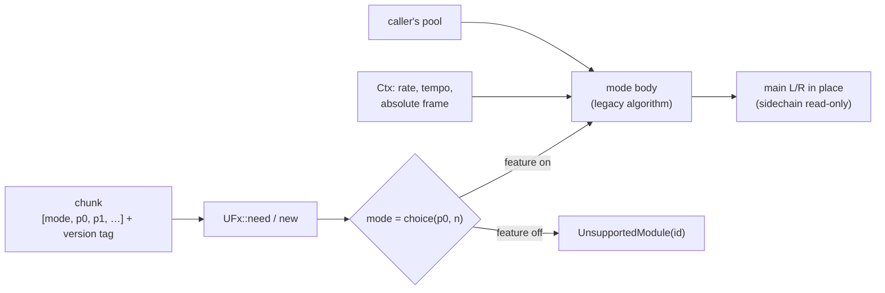

| Kind | Mode 0 | Mode 1 | Mode 2 |
|---|---|---|---|
| 65 distortion | shaper (6): drive, threshold, foldover, dry/wet, shaper, oversampling | curve (8): x1, y1, x2, y2, power1–3, dry/wet (QM Screwdriver, qm210 WaveSabre fork) | power (1): amount |
| 66 crusher | crusher (3): vertical, horizontal, dry/wet | | |
| 67 EQ | parametric (14): low cut f/Q; peaks 1–3 f/gain/Q; high cut f/Q; master | 3band (3): low, mid, high | |
| 68 delay | tempo (9): L/R coarse + fine, low cut, high cut, feedback, cross, dry/wet | ms (3): left, right, decay | |
| 69 chorus | chorus (3): rate, depth, gain | one tap (3): rate, depth, gain (Tunefish 3: `y = x + gain·x[n − d]`, `d = 1 + (sin(t·π·rate/sr) + 1)/2 · fi(50·depth²)` ms; `us-fx-chorus-tf3`) | |
| 70 flanger | phaser (9): type, amount, feedback, spread, vibrato f/amount, low cut, high cut, dry/wet | ring (4): lfo, freq, amp, wet | |
| 71 reverb | freeverb (8): freeze, room, damp, width, low cut, high cut, dry/wet, pre-delay | compact (4): room, damp, wet, width | rooms (6): room size, feedback, low cut, high cut, dry/wet, pre-delay |
| 72 compressor | compressor (7): sidechain key, input gain, threshold, ratio, attack, release, output gain | | |
| 73 formant | formant (2): vowel, wet | | |

The 7-bit modes (change add-v2-import; names: unify-v2-algorithms; features `us-fx-eq-cut`, `-delay-modulated`,
`-reverb-comb`, `-compressor-lookahead`) store `step / 128`. They have no format version: the converter sets the
reverb's low cut off below V2 format 4, and the cut EQ's DC filter is a choice (on from format 6). Their sources are
in "Provenance".

| Kind | mode |
|---|---|
| 67 EQ | Cut (3): low cut, high cut, DC filter (off / on, default on) |
| 68 delay | Modulated (7): volume, feedback, delay L, delay R, mod rate, mod depth, mod phase |
| 71 reverb | Comb (4): time, high cut, low cut, volume; wet only, mono input |
| 72 compressor | Look-ahead (9): detect (off/peak/RMS), couple (stereo link), auto gain, lookahead, threshold, ratio, attack, release, out gain |

Mode ids per kind (the order modes were added): distortion shaper, curve, power, wrap, atan, sine, knee; EQ parametric,
3band, cut, svf-lfo; delay tempo, ms, modulated, ping-pong, allpass; flanger phaser, ring, comb; reverb freeverb,
compact, rooms, comb; compressor, look-ahead. **The stored mode is a position, not the id** (`fx::MODES` carries both;
change add-elevated-import). Distortion (7 positions), EQ (5) and delay (5) were expanded as the oscillator type was:
every earlier mode keeps its stored value at position `2·id`, and the Elevated modes sit at the odd positions. EQ
position 3 is free and gives `BadChunk` at load. The old-layout migration decodes against `fx::migrated_total`.

The Elevated modes (change add-elevated-import, `fx/elevated.rs`, one feature each):

| Kind | mode |
|---|---|
| 65 distortion | atan (2): `y = b·atan(x/a)`, `a = 10^(6p − 3)`, `b = 16p` (V2's overdrive arithmetic, exact arctangent) |
| 65 distortion | sine (2): `y = b·sin(a·x)`, same laws |
| 65 distortion | knee (3): threshold `t = 4p`, ratio `r = 4p`, offset `o = 4p − 2`; `y = sign(x)·(t + (|x| − t)·r + o)` for `|x| ≥ t`, else `x` |
| 67 EQ | svf-lfo (8): cutoff, resonance `q = 2p`, LFO 1 rate (`0.01p` per sample) and depth, LFO 2 rate and depth (cutoff and depths `65 536p`, the original's units), dry `2p − 1`, output low/high/band. The shared state-variable step (`flt::run`, input form) once per sample at `g = (cutoff + l₁ + l₂)·f32::from_bits(0x3815_0000)`; the LFOs are the coupled-form recurrence in closed form from the absolute frame (seekable) |
| 68 delay | ping-pong (2): length `round(65 536p)` frames, feedback `2p − 1`; `y = x + g·w`, the line stores the channels swapped |
| 68 delay | allpass (2): the same laws; `v_L = x_L + g·w_R`, `v_R = x_R + g·w_L`, `y_L = w_R − g·v_L`, `y_R = w_L − g·v_R` |

The mini-cauldron modes (change add-cauldron-xm-import, features `us-fx-flanger-comb`, `us-fx-distortion-wrap`):

| Kind | mode |
|---|---|
| 70 flanger | comb (4): delay K (`round(p·16384)` frames), amount g, sweep rate (`p·0.01` per frame), restart (a step restarts the sweep). Sweep 0: `y = x[n] − g·x[n − K]`; sweep s: `(x[n − K] + x[n − K + s·t])/2`, t = frames since the restart, offset capped at K (Stash's comb and doubler) |
| 65 distortion | wrap (2): drive (`p·4`), offset (`2p − 1`); `v = x·drive + offset` wrapped into −1..1 (Stash's 8-bit wrap-around specials) |

Properties that hold for every mode:

- **Chunk.** Little-endian f32 values `[mode, p0, …]` and a 4-byte trailer that is ignored; missing parameters keep the
  legacy defaults. The mode is chunk-only (`set_param(0, …)` is ignored) because it sizes the memory.
- **Close to the legacy effect.** At 44.1 kHz and tempo 120 every mode renders bit-identically to its legacy effect
  (WaveSabre's biquad and SVF keep its 512-entry sine table, whose error shifts low resonant corners audibly).
- **Rate and tempo from the context.** The WaveSabre effects always did this. The modes taken from Tunefish (power, 3band, ms, chorus, ring, compact, formant) assumed 44.1 kHz and
  now take the song's rate: the delay is in milliseconds, the EQ corners (880 Hz, 5 kHz) and the flanger's sweep speed
  and delay range are in Hz and seconds, the chorus's LFO rate is per second, the Freeverb tunings scale with the
  rate, and the formant filter's poles are mapped (`z → z^(44100/rate)`, DC gain kept) so the vowels keep their
  formant frequencies (A 800/1150 Hz, E 350/2000, I 260/2140, O 450/800, U 320/700). All are unchanged at 44.1 kHz.
- **Call size independence.** The output does not depend on how a render is split into calls. The chorus's 512-frame
  control grid counts the song's absolute frames (`Ctx::frame`).
- **Buffers.** Main L/R are transformed in place; the sidechain pair is read (compressor key) and never written.
- **Memory.** Delay lines and reverb buffers come from the caller's pool, sized at load from the rate, the tempo and
  the chunk's parameters (tempo delay: 16 eighths + 200 ms at the song tempo; ms delay and phaser: 1 s; reverb: the Freeverb
  lines at the rate; pre-delay: 500 ms).
- **Features.** `us-fx-distortion-shaper`, `-curve`, `-power`, `us-fx-crusher`, `us-fx-eq-parametric`, `-3band`, `us-fx-delay-tempo`,
  `-ms`, `us-fx-chorus`, `us-fx-flanger-phaser`, `-ring`, `us-fx-reverb-freeverb`, `-compact`, `-rooms`,
  `us-fx-compressor`, `us-fx-formant`. A chunk that selects a mode the build lacks fails at load with
  `UnsupportedModule` naming the (kind, mode) (`module::FX_*`).

Goldens: `tests/golden_fx.txt` holds a hash of every mode's output on a fixed input at 44.1 kHz / 120 BPM and at
48 kHz / 90 BPM (`UPDATE_GOLDEN=1 cargo test -p unisynth golden` rewrites it).

## Converter (`crates/synth-convert`)

Status: song structure, effect devices, the WaveSabre and Tunefish instruments, `.tfm` songs, loose patches and the feature list (tasks 6.1–6.4).

```text
synth-convert ws    <in.song> <out.song>                   synth-mix song, legacy kinds → unified kinds
synth-convert tfm   <in.tfm> <out.song> [tail-seconds]     .tfm song → unified song (tail after the last event, default 4)
synth-convert patch <patch.txt> <phrase.txt> <out.song>    one Tunefish patch (112 numbers) played by `block note velocity` lines
synth-convert features <unified.song>                      the cargo features of `unisynth` the song needs, comma separated
```

`ws` reads a `synth-mix` song with legacy kinds, maps each device **in place** (same device index, so tracks, lanes,
receives and volumes need no renumbering) and writes a song with only unified kinds.

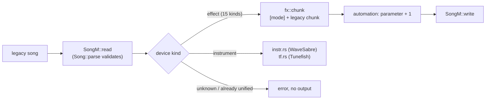

| Legacy effect | Unified kind | Mode |
|---|---|---|
| WaveSabre Scissor / fork Screwdriver (kind 13) / Tunefish distortion | 65 distortion | 0 / 1 / 2 (stored 0 / 0.5 / 1.0; power keeps 1.0) |
| WaveSabre Crusher | 66 crusher | 0 |
| WaveSabre Leveller / Tunefish EQ | 67 EQ | 0 / 1 |
| WaveSabre Echo / Tunefish delay | 68 delay | 0 / 1 |
| Tunefish chorus | 69 chorus | 0 |
| WaveSabre Twister / Tunefish flanger | 70 flanger | 0 / 1 |
| WaveSabre Cathedral / Tunefish reverb / WaveSabre Chamber | 71 reverb | 0 / 1 / 2 |
| WaveSabre Smasher | 72 compressor | 0 |
| Tunefish formant | 73 formant | 0 |

An effect's parameters keep their legacy meaning, so its chunk is the legacy chunk with the mode value in front, and
its automation keeps the points and moves to parameter index + 1 (index 0 is the mode). Everything outside the devices
is copied: tempo, rate, length, lanes, track volumes, receives with their channel (main or sidechain) and volume,
device order and automation timing. The output is written only when every device converted, so an error never leaves a
partial file.

### V2 songs (`.v2m`, change add-v2-import)

Farbrausch's V2 synth (kb, 2000–2008; public domain) stores songs as `.v2m`. "v1/v2/v3" are its **format versions
0–6**. Each version adds patch or global parameters: v1 compressors and boost, v2 transpose and ring mod, v3 filter
balance, v4 reverb low cut, v5 LFO polarity, v6 aux sends. `src/v2m.rs` reads every version. It finds the version
from the globals size and the patch sizes, and upgrades the file to the version 6 layout exactly as V2's own
`ConvertV2M` does. The output is byte-identical to the v2redux loader on all 359 local songs.

```text
u32 timediv, u32 maxtime, u32 gdnum, gdnum × {time 3 planes, usecs u32, num, den, tpq}  (planar)
16 × channel: u32 notes [+ notes 5 B, u32 pcs + 4 B, u32 bends + 5 B, 7 × (u32 ctls + 4 B)]   (3 delta-time planes, then
              one plane per value, each value a wrapping delta of the previous one)
u32 23 + globals, u32 size + patch block (u32 offsets, patches: 89 params, modnum, modnum × (source, amount, dest))
u32 size + speech block (u32 n, n × u32 offset, zero-terminated phoneme strings)
```

`V2m::timeline(rate)` replays V2's sequencer: one tick per distinct event time, per channel in the order program,
controllers 1–7, bend, notes. The first tick is at frame 0, and frames advance by V2's integer `UpdateSampleDelta`.
Its remainder carries only on u32 overflow, so each segment is in effect truncated. The test against v2redux's
sequencer is event-identical on the 15 acceptance songs. V2 reads bend values at the *program-change* plane width, so
bends decode correctly only when a channel has as many program changes as bends. The timeline keeps this, because
it is what the songs play.

The `.v2m` files, references and oracles live outside the repo: `tools/v2-extract` and `research/v2-intros.md`. The
songs are © their authors. Their conversions are committed as DAW songs in `project/music/released/v2/`
(`tools/v2-extract/make-demos.py`) while the authors are asked for permission; see `project/music/NOTICE.md`.

### Mini-cauldron XMs (change add-cauldron-xm-import)

TBL's Jizz and Stash (1997) ship as XM modules whose samples a precalc synth, Probe's *mini-cauldron*
(`research/tbl-mini-cauldron/mini-cauldron-spec.md`), renders at load: 16-step phrases, one per record and variant.
`synth-convert xm` turns such an XM plus the patch data (`research/tbl-mini-cauldron/ref/patches_*.json`) into a
unified song that plays the phrases live. Full design and measurements: `openspec/changes/archive/2026-10-30-add-cauldron-xm-import/design.md`.

| Original | Unified song |
|---|---|
| a generated phrase sample (record, variant) | notes of a clocked instrument (`us-osc-clocked`, see [Clocked](#clocked-us-osc-clocked)): untied steps note-ons with the retrigger byte and phrase position as velocity, ties legato, v2 gates note-offs |
| a stored sample (Stash's drum kit, Jizz's vocals) | a sampler instrument on the sample GSM-encoded (upsampled ×1–4 to ≥ 0.95 correlation) |
| the XM's replay (FT2 semantics: `src/xm/replay.rs`) | the converter's per-tick control: triggers, volume, pan, pitch |
| 16-bit clamp → comb → echo → doubler → song0 specials → decimation | the track's chain: clipper → comb (`us-fx-flanger-comb`) → tempo delay → comb sweep (restart lane) → wrap (`us-fx-distortion-wrap`, slot 9's ×1.25 only) → two-stage low-pass at the stored Nyquist |
| sample volume, envelopes, fadeout, pan | after the chain: EQ 3band post gain and pan, automated per tick |
| a pitch slide, an XM note's ratio | a playback rate (transpose + bend; the phrase clock and envelopes follow), cut into hand-overs past 94 semitones |
| a ping-pong loop's backward pass | **approximation:** the loop's steps in reverse order, each played forwards, one warning per sample |

**Tracks (D2).** Triggers of one record on one XM channel at one ratio class (a semitone class of the trigger's
sounding range, −48…+24) share a track; channel groups whose spans never overlap merge. The comb, echo and doubler
times are fixed in phrase frames, so a track's chain is built for its class. That is the `--split-pitches` layout;
the default packs them (below).

**Compact layout (default; change compact-cauldron-xm-import).** The XMs fake stereo and reverb with channels: a pad
plays one note hard left and hard right (one side detuned by `E11`), then 1–2 quieter echo taps on other channels
panned in turn (Jizz +3/+6 rows, Stash song 1 +1/+2, BLUISH +2/+4), and Jizz doubles its hi-hat left and right.
`compact::layers` drops a trigger repeating a kept one (same instrument, sample, note, offset; another channel) at the
same frame, or later while the kept one sounds (≤ 2.5 s) at a lower first-tick volume; the kept one takes the
same-frame copies' level, per side: copies at its own pitch add as amplitudes, detuned ones (`E11`) as powers (a hard
pair: centred, ×√2; its post gain can pass 1, encoded through the EQ 3band law: `post_value`). `compact::pack` then puts a record's
triggers on the first track they overlap nowhere whose pitch range stays within one track's reach (94 semitones),
whatever the channel and ratio; the class is the most frequent one moved into reach (the transpose and bend carry
the rest; the chain's echo, comb and doubler times stay the class's). Stored samples pack per (instrument, sample)
the same way. What the dropped layers did comes back as effects on their tracks, no extra tracks
(`compact::ambience`, when at least half of a track's triggers had layers): after the post gain, a two-tap stereo
tempo delay without feedback at the most common tap pattern (first left tap, first right tap; Jizz 298/596 ms on
opposite sides) at the taps' RMS level, and on phrase tracks a small freeverb (`compact::REVERB`: room 0.3, 12 % wet,
150 Hz–7 kHz); the track volume keeps the dry level, and the song tempo reaches the longest tap. The freeverb answers
`quiet_after` (core sleep span + pre-delay), so these tracks still sleep. `--dry` leaves the effects out;
`--keep-layers --split-pitches --exact-chain` gives the layered layout byte for byte (the parity tool uses it).

**Slim chain (default; change slim-cauldron-chain).** The band-limiting low-pass keeps one SVF stage
(`compact::slim_lowpass`; two with `--exact-chain`), and none on a track that does not slide when its cut (stored
Nyquist × ratio) is at least 16 kHz (`OPEN_HZ`). Each clip is checked with a solo render of the track's devices before
it, on the track's own notes and automation (`compact::idle_clips`, tracks in parallel): a clip whose input never
passes its threshold by more than 1e-4 is a no-op and is left out, so the sound does not change. Most clips work: the
16-bit clamp after the instrument is hit by up to +37 dB, the echo's by up to +6 dB; idle are Stash song 1's 2 and
BLUISH's 25. Devices (all tracks): Jizz 123 → 110, song 1 335 → 301, BLUISH 267 → 216.
Measured 2026-10-31 with the slim chain (`bun tools/unisynth-parity/cauldron-compact.ts`, `tools/unisynth-parity/cauldron-compact.md`;
render: `fast` profile; loudness against the OpenMPT reference):

| Song | Layout | Tracks (phrase + stored) | Song | xz | Render | Loudness |
|---|---|---:|---:|---:|---:|---:|
| Jizz | layered | 58 + 13 | 327 810 | 17.8 KB | 23.0 s | +0.33 dB |
| | `--dry` | 13 + 11 | 144 182 | 14.3 KB | 7.0 s | −0.61 dB |
| | compact | 13 + 11 | 145 251 | 14.4 KB | 8.4 s | +0.55 dB |
| Stash song 1 | layered | 106 + 13 | 1 379 893 | 38.8 KB | 70.4 s | +0.23 dB |
| | `--dry` | 35 + 10 | 784 170 | 30.1 KB | 23.8 s | −0.10 dB |
| | compact | 35 + 10 | 786 006 | 30.3 KB | 28.4 s | +0.10 dB |
| Stash BLUISH | layered | 64 + 12 | 573 993 | 31.0 KB | 27.4 s | +0.13 dB |
| | `--dry` | 29 + 10 | 326 174 | 24.9 KB | 8.9 s | −0.35 dB |
| | compact | 29 + 10 | 327 549 | 25.2 KB | 12.0 s | +0.03 dB |

Layers dropped: Jizz 591 of 2 061 triggers, song 1 656, BLUISH 414. Octave bands stay within 3.4 dB of the
reference in every layout; the pads are centred, the echoes come from the delay instead of channels.

**Control rate (`--controls tick|row|note`).** The XM's volume, pan and pitch reach the song every tracker tick
(`tick`, the default), only at row starts (`row`: slides and fades become steps, tremor and vibrato go), or once per
note (`note`: its first tick's values). The replay's control is held before anything else, so tracks, phrase paths
and every lane follow it. Measured 2026-10-31 (xz of the song blob, release render on one thread, against the OpenMPT
reference: loudness and median / 99th-percentile per-second octave-band difference):

| Song | Mode | Tracks | xz | Render | Loudness | Bands (median / 99th) |
|---|---|---:|---:|---:|---:|---:|
| Jizz | tick | 71 | 17.9 KB | 33.4 s | +0.39 dB | 0.6 / 6.5 dB |
| | row | 71 | 17.7 KB | 33.1 s | +0.40 dB | 0.7 / 6.1 dB |
| | note | 71 | 17.4 KB | 30.6 s | +0.85 dB | 1.0 / 18.8 dB |
| Stash song 1 | tick | 119 | 38.4 KB | 85.5 s | −0.31 dB | 0.8 / 11.4 dB |
| | row | 117 | 30.1 KB | 83.4 s | +0.26 dB | 1.1 / 11.2 dB |
| | note | 112 | 23.9 KB | 74.9 s | −0.43 dB | 1.5 / 26.4 dB |
| Stash BLUISH | tick | 76 | 30.5 KB | 33.0 s | −0.16 dB | 0.7 / 10.2 dB |
| | row | 78 | 23.5 KB | 38.2 s | +0.03 dB | 0.8 / 11.1 dB |
| | note | 66 | 17.6 KB | 23.2 s | +0.29 dB | 1.1 / 30.1 dB |

`row` keeps the sound close (Stash −22 % xz); `note` loses the risers, fades and tremor (Stash −38 to −42 %). Jizz
has little per-tick control to drop. The parity harness and A/B sign-off cover `tick`.

**Thinning (`--thin <bytes>`).** Points are written only where a value changes, but a change costs two (the player
interpolates linearly, so a step is a hold point and a jump point). `--thin b` lets the volume, pan, pitch-bend and
low-pass lanes differ from the per-tick steps by up to `b` bytes of 255 at any frame (`thin_lane`): a slide or fade
becomes ramps through as few points as fit; a step larger than `b`, and the bend's step where the transpose changes,
stay exact; the transpose, restart and start lanes are never thinned. Stash song 1 (raw / xz of the song blob):
`tick` 1 447 168 / 38.4 KB, `--thin 1` 1 298 888 / 37.5 KB, `--thin 2` 1 180 608 / 36.5 KB, `--thin 4` 1 016 048 /
35.3 KB; BLUISH 616 853 / 30.5 KB → 426 623 / 27.8 KB at 4; Jizz 17.9 → 17.6 KB. The raw size falls by up to 30 %,
the packed by 1–9 % (xz already packs regular steps); loudness and octave bands against the reference stay within
0.15 dB and 0.1 dB of `tick`, render time is unchanged. About 47 000 of song 1's 122 000 changes are jumps of 20 bytes
or more (tremor gates, hard pans), which no tolerance removes. The demo songs (`make_demos.py`) use `--thin 2`:
Jizz 43 468 → 30 892 automation points with the latched per-note lanes, files 2.8 / 13.2 / 5.3 MB → 2.1 / 9.7 /
3.4 MB. Pitch (`osc1.fine`, coarse, word) stays exact: the oscillator reads it continuously.

**Known deviations** (all accepted with the A/B sign-off, `tools/unisynth-parity/cauldron-signoff.json`): reversed
step attacks land at a step's start, not its end; the echo cannot wrap a phrase's end into its start (song0
record 3); a filter past its stability edge stays smoother than the original's integer store (record 4); an
extreme slow-down's echo, baked into the original's sample, is near-silent in ours (song 1 21.5–22 s). Parity:
all 3 songs and 82 of 85 phrases, 85 of 88 checks (`bun tools/unisynth-parity/cauldron.ts`).

### Generator maps: plain XMs (change add-plain-xm-import)

XMs whose intro synthesized most samples at start-up with its own engine, then played them with a tracker player:
Fudge's Alien Sex Clone and Quad's Pure and Theta (1998, GUS). A song stores only the samples the original stored;
every generated one is played live by its engine. `synth-convert xm <in.xm> <map.json> <out.song>` takes, in place of
mini-cauldron patch data, a generator map (`xmgen`, told apart by `"format": "xm-gen/1"`):

```json
{"format": "xm-gen/1", "intro": "fudge-asc", "samples": [
  {"instrument": 1, "sample": 0, "kind": "generated", "engine": "fm-shaper", "length": 4096,
   "params": {"frames": 4096, "args": [1124073472, 1124073472, 1065353216, "..."]}},
  {"instrument": 7, "sample": 0, "kind": "stored"}]}
```

- Every non-empty XM sample is listed once (instruments from 1); a generated `length` equals the XM sample's; `params`
  is the engine's record as the original computed it (integer flags stay integers). Identical records share one
  instrument. A missing engine, sample or record is an error that names it; nothing is written.
- Maps come from the running originals: `tools/xm-gen/run.sh` (writer of every byte of the module buffer, generator
  calls hooked) writes `tools/xm-gen/maps/*.json`. Stored: Fudge 7, 14, 15; Theta 1, 2, 3, 18; Pure 33, 34, 35.
- The conversion is the mini-cauldron's flow (`src/xm/convert.rs`, a `Source` per format): replay, paths, pitch
  classes with transpose + bend as the playback rate, volume/pan lanes, stored samples on a GSM sampler.
- **Engines** are oscillator types of their own (free odd positions of the type choice), run through the clocked
  machinery (phrase clock = `R` × the track's ratio, Catmull-Rom resampling, reconstruction low-pass). They arrive with
  their changes (`add-fudge-softsynth`, `add-poespack-softsynth`); until then a map's conversion fails naming the
  engine, and the parity reports the song pending.

**Note byte contract** (engines with one note per run of the sample): a note starts at each trigger, loop re-entry and
ping-pong turn, with its start frame in the slot's per-note bytes, latched from `LANE_LEAD` before the note-on:

| Byte | Meaning |
|---|---|
| `o::TRACKING` | start frame ÷ 4096 |
| `o::PM_OUT` | the rest ÷ 16 (rounded; 1 048 560 + 4080 frames at most) |
| `o::FEEDBACK` | 255: a backward pass (seekable engines), else 0 |

A note whose bytes differ from the previous note's starts more than `LANE_LEAD` frames after it, or the conversion
fails (the three XMs' tightest re-entry is 255 frames). A non-seekable engine plays a backward pass forwards from its
lowest frame. Phrase engines bring their own events and lanes.

**XM replay additions** (FT2 semantics, pinned to `openmpt123` renders of synthetic songs in
`tests/data/ft2_fixtures.json`): volume column fine slides, `Hxy`, `Pxy`, `X1x`/`X2x`, `Rxy` (counter across rows, a
note's tick 0 resets it, a retrigger re-applies the row's set-volume column), auto-vibrato (amplitude truncated toward
0), `F00` ignored. Parity: `bun tools/unisynth-parity/plain-xm.ts` against each XM with the map build's generated
samples (Theta's XM is a later build than its executable). Research: `research/xm-softsynth-intros.md`.

### WaveSabre instruments

Each instrument becomes one kind-64 device. Its patch is a pure function of the legacy parameters, built through their
physical values (`crates/synth-convert/src/instr.rs`), so a legacy parameter maps to a unified value by the legacy law
and the unified inverse, never by copying the normalized number unless the two laws are the same.

| Legacy | Unified |
|---|---|
| Falcon | slots 1–2 phase-mod: ratio/fine/blend copied, slot 1 gain 13.25 (`16p²` law), mix 0, feedback `fb²/2`, send `ff²`; slot 2 gain 1, feedback `13.25·fb²/2`. Envelope 1 = operator 2 (Scale route to its gain, ends the voice), envelope 2 = operator 1 (Scale route to slot 1 gain), envelope 3 = pitch (Offset routes `±36·(2a − 1)` st to each slot's pitch). Envelope 1 at output off, velocity 0, master `(0.4m)²` |
| Slaughter | slots with volume > 0 (or automated) saw/pulse: gain volume², coarse `floor(24.99d)`, fine 0..1 st, blend, width `1 − v`; noise level `v²`; filter 1 SVF (type `(int)3p`), cutoff and resonance copied; envelope 1 amp, 2 mod (Offset `19 980·(2m − 1)` Hz to the cutoff), 3 pitch (Offset `36·(2a − 1)` st); master `16·(0.4m)²`; rise → transpose `24·rise`; velocity 0 |
| Vibrato (Falcon, Slaughter) | LFO 1 sine at `((v² + 0.1)·70)/2π` Hz (upstream's phase is in radians), Offset on pitch of `amount` st; left out when the amount is 0 and never automated |
| Specimen, Adultery | slot 1 sampler (GSM entry 1 or DLS wave `index`), start/loop mode `(int)2v`/bounds/reverse/interpolation as choices, coarse `floor((2c − 1)·12)`, fine `2f − 1`; filter 1 and the mod-envelope route as Slaughter; envelope 1 amp, 2 mod; master `(0.4m)²`; velocity 1 (`vel/128`) |
| Thunder | slot 1 sampler, fixed pitch at middle C, one-shot, gain ×√2 (equal-power pan), no filter, velocity 0, 1 ms attack (upstream has none) |
| Common | unison `(int)(15p) + 1`, detune and spread copied, mono legato `(int)v == 1`, slide copied; capacity from the song; start-phase spread 12.57 samples (Slaughter) or minimum (Falcon) |

**Capacity.** The most voices that sound at once: overlapping notes of every lane the device hears (note-on to
note-off plus the amp release at its largest in the chunk and its automation) times the unison count, 1–64. A song that
needs more gets a warning (WaveSabre's 256 voices never steal, the unified instrument steals the oldest).

**Automation.** A legacy parameter's byte lane is re-mapped to every unified parameter that parameter changes, found by
evaluating the mapping at all 256 byte values. Continuous laws keep the legacy points (same frames) at the unified
values and gain points where linear interpolation would be more than one byte step from the unified value of the legacy
interpolation at a 100-frame sub-block start. Discrete decodes (filter and sampler choices, unison, coarse, ratio) are
read at every sub-block start and written as steps (two points at one frame) where the decoded value changes. Lanes of
structural parameters (capacity, oscillator type, sampler source and index) are not written.

**Known differences.** The mapping is checked by rendering the same songs with the legacy crate and, converted, with
`unisynth` (`crates/synth-convert/tests/parity.rs`): loudness within 0.3 dB and every octave band within 1 dB for all
synthetic songs, 0 dB for Thunder, Specimen and Adultery. What does not match: a Slaughter filter envelope that drives the
cutoff below 0 Hz (the state-variable filter freezes upstream and passes a little of the transient here, up to 0.8 dB
and 5 dB in the lowest band), and Thunder's first millisecond (the envelope's minimum attack).

### Tunefish instrument and `.tfm` songs

The Tunefish instrument (kind 32, or one `.tfm` instrument) becomes one kind-64 device plus its insert effects. The
patch is again a pure function of the 112 values (`crates/synth-convert/src/tf.rs`).

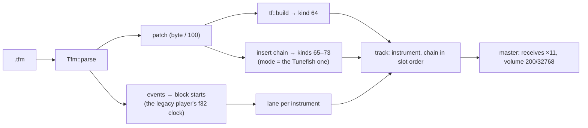

| Tunefish | Unified |
|---|---|
| generator `Gen*` | oscillator slot 1, wavetable: every shape value copied, unison `round(9p) + 1` layers, octave `4 − round(8p)`, fixed frequency from 0.00001 up (no left/right detune then) |
| `Gain` | voice master, `gain_curve` (`(2g)²` to 0.5, then `1 + 20(g − 0.5)`) through the unified gain law |
| `GenVol`, `GenPan` | slot gain `0.4·vol·k` and the equal-power pan that gives the same left and right levels as Tunefish's linear balance (`k = √(1 + r²)`, √2 at the centre, `r = 2·min(p, 1 − p)`) |
| noise | level `NoiseOn·√2`; band on below `NoiseBw` 0.99, low-pass ladder at `f + bw`, high-pass RBJ at `f − bw` |
| filters | slots 1–4 = ladder low-pass, RBJ high-pass, RBJ band-pass, notch; on above 0.5; the cutoff is the same Hz (`30 + 20 000f²`, RBJ `30 + 10 000f²`) through the unified cutoff law |
| LFOs | rate `50p²/2π` Hz, same five shapes, key sync from 0.5 up |
| ADSRs | rate-mode envelopes (Tunefish) with the same curve values. The ADSR routed to volume is envelope 1 (ends the voice); without one, envelope 1 is the **organ gate** |
| mod slots 1–8 | Scale slots at the same index with the same source, amount and target (destination ids map one to one; `LFO`/`ADSR`/wheel sources become ids 5–7/1–2/7); slots 9 and 10 never ran in Tunefish and are dropped; velocity (`vel/128`) gets two more Scale routes, to the generator gain and to the noise level |
| `GenPoly` | capacity (1–16), stealing the oldest |
| `GenGlid` | exponential glide of `10g + 1` blocks (a time constant of that many 512-frame blocks) |
| effect slots 1–10 | one effect device each after the instrument, in slot order: kind `round(10p)` 1–7 → kinds 65 (power), 68 (ms), 69 (chorus), 70 (ring), 71 (compact), 73 (formant), 67 (3band), parameters from the patch |

**Organ gate.** A Tunefish voice sounds while its key is held and until every envelope that a mod slot reads has
finished, then gates at once (its volume ramps to 0 within that block). With no ADSR on volume, envelope 1 holds the
note: instant attack, sustain 1, a release equal to the longest release among the envelopes in use (simulated from their
sustain level, in whole blocks, up to 5 s), plus a third of a block, the point where an abrupt cut carries the energy of
Tunefish's linear fade. It does not scale the output (`env1-at-output` is off).

**`.tfm` songs.** One track per non-empty instrument (the instrument, then its inserts), a master track last. An event
at row `r` lands at the start of the 512-frame block that contains `r · 60/(tempo·4)` s, found with the legacy
player's own `f32` clock (tempo 125, row 1 → block 10). Note 0 is dropped, velocity 0 becomes a note-off, notes keep
their low 7 bits. The master receives every instrument at ×11 and has volume `200/32768`, so the unified 16-bit output is
the legacy one.

**Songs with kind 32 devices.** The device converts in place; its insert effects become devices appended to the song and
listed after it in every track that lists the instrument. Automation of effect parameters (patch indices 84–103) moves
to those effect devices at parameter index + 1 in the effect's own order; automation of instrument parameters follows
the rules above (`GenUnis` and the octave step, the filter switches step, the voice limit is structural). Automating an
effect slot's kind (74–83) or a mod slot's source or target is an error, because the unified patch cannot change its
routing during a song; a slot's amount may move. Lane events keep their frames (the unified instrument starts a note at
its exact frame, not at the block start).

**Known differences.** `GenSlop` (a random detune of up to ±8 Hz per voice) has no unified counterpart; the converter
warns above 1 Hz. Stepped-random LFO shapes draw their own sequence. The wavetable's random phases, its random
phase-stage drift and the unison layers' start phases are drawn from different generators, so a short passage differs by
a few dB between engines while a song of a few dozen notes agrees on loudness (two-instrument `.tfm`, 48 notes: 0.2–0.7 dB
over seven seeds; every synthetic patch in `tests/tunefish.rs`, single layer: ≤ 1 dB, bands ≤ 3 dB). The pan matches at
rest; a pan modulated through the matrix scales the equal-power value instead of the linear balance.

### Elevated / Atrium (`music.asm`, change add-elevated-import)

`synth-convert elevated <music.asm> <out.song> [--table 7|8] [--solo k] [tail]`: a song of Mentor's 4k synth as a
unified song. Format, the machine-tree routing and the mapping are in [`elevated.md`](elevated.md). Parity against
the original code: `tools/elevated-parity`.

### Tunefish 3 projects (`.e3prj`, change add-tf3-import)

An Enigma Studio 3 project (XML) holds Tunefish 3 songs and instruments (`docs/synth/tunefish3.md`; behaviour in
`research/tunefish3-functional-spec.md`). `crates/synth-convert/src/e3prj.rs` reads it, `tf3.rs` maps an instrument,
`tf3song.rs` the song.

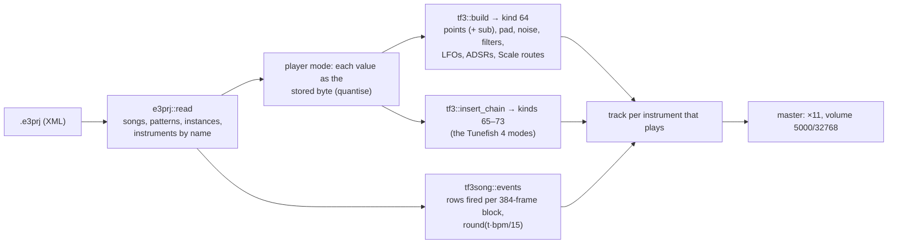

| Tunefish 3 | Unified |
|---|---|
| point oscillator `Osc*` | slot 1 `points` (shape 0–7 the points, 8 the drive; point fields: count, modes, layers `round(10p)+1`, detune `8.82p³` Hz and spread `4.41p⁴` Hz on the `10p³`/`10p⁴` laws); fixed frequency `441p²` Hz |
| `OscSubOsc` | slot 2 `points` one octave down at half gain, the same points, about half the detune; every route to the oscillator also reaches it |
| `Add*` | the next slot `pad` (shape 0–5; octave, `√2·AddVolume` gain at the centre, the oscillator's detune) |
| `OscVol`, `OscPan` | slot gain `comp·OscVol` with the equal-power pan of Tunefish's linear balance (`tf::pan`, as Tunefish 4) |
| noise, LP, HP | as Tunefish 4; band-pass and notch only with `--editor` |
| ADSRs, LFOs | as Tunefish 4 (rate-law envelopes; organ gate from a 384-frame release simulation); each LFO's depth and the amounts of the routes that read it rescaled so the unified 0..1 shapes give Tunefish 3's values (`sin φ + 0.5`, ramps 0..2 and 1..−1) |
| mod slots 1–10 | Scale slots in the v3 layout, amount `(20(p − 0.5))²`; points → shape targets, volume → every slot's gain, frequency (twice on a fixed frequency: `(p·M)²`), pan, drive, noise, filters, ADSR decays; detune and spread routes and the wheel are not converted; MOD1–4 → controllers CC2–CC5 (editor) |
| velocity | Scale routes to the oscillator slots and the noise (not the PAD table) |
| effects 1–10 | the Tunefish 4 insert mapping by parameter name; chorus, flanger, EQ only with `--editor` |

**Songs.** Rows fire at the start of the 384-frame block whose f32 time rounds (half to even) to the row:
`round(t·bpm/60·4)`, so a row starts half a row early, and one row per block. Per sequence track the first instance
covering the row plays; a column's new note first releases its previous one; note 128 releases; a note without
instrument does nothing; velocity −1 plays 127 (Tunefish's 128). One pass: the song ends where the row would wrap to 0.

**Parity (Transplant, player mode).** Against the original player (`tools/tf3-parity`): loudness within 0.06 dB, every
octave band 63 Hz–16 kHz within 0.93 dB, timing lag 0. Against the YouTube capture of the released intro: bands within
1.13 dB, timing in all 7 windows. Known differences: per-voice point cycles (Tunefish 3 shares one per instrument),
per-slot drive and decimation (Tunefish 3 drives and filters the oscillator and PAD sum), per-instrument MOD values,
LFO depths past the representable range (clamped, warned), slop.

### Walkthrough

Every command below runs as written from the repository root (the legacy songs come from the WaveSabre test suite;
`song.tfm` is any Tunefish module, here the one the size probe builds).

```sh
cargo build -q --release -p synth-convert
SC=target/release/synth-convert
mkdir -p /tmp/uni && FEATURES_DUMP=/tmp/uni cargo test -q -p synth-convert --test features dump   # legacy/*.song and converted *.song

# a legacy song → unified kinds; warnings (voice cap, unison > 16, GenSlop) go to stderr
$SC ws /tmp/uni/legacy/slaughter_automation.song /tmp/uni/slaughter.song
$SC features /tmp/uni/slaughter.song                    # → us-osc-blit,us-noise,us-flt-svf,us-env-seconds
tools/check-song-features.sh /tmp/uni/slaughter.song --minimal   # exactly that list builds, loads, and each feature is needed

# a .tfm song (tail = seconds after the last event, default 4)
$SC tfm "$(find research/tf-size-probe -name song.tfm | head -1)" /tmp/uni/tf.song 2
$SC features /tmp/uni/tf.song

# one Tunefish patch + a phrase (examples/patch.txt: 112 numbers, examples/phrase.txt: block note velocity)
$SC patch crates/synth-convert/examples/patch.txt crates/synth-convert/examples/phrase.txt /tmp/uni/pad.song
cargo run -q --release -p unisynth --features std --example render -- /tmp/uni/pad.song /tmp/uni/pad.wav   # listen

# a V2 song (no songs in the repo: `bun tools/v2-extract/v2.ts gather` fills $V2_SONGS); tail seconds, then
# --channels <hex mask> / --era auto|kkrieger2004 for debugging
V2=${V2_SONGS:-$HOME/Downloads/64k-tools/synth-lab/v2songs}/acceptance/fr08.v2m
[ -f "$V2" ] && $SC v2m "$V2" /tmp/uni/fr08.song 4 && $SC features /tmp/uni/fr08.song

# a mini-cauldron phrase (patch data in the repo): call, record, variant at native speed
$SC xm-phrase research/tbl-mini-cauldron/ref/patches_stash.json song0 10 0 /tmp/uni/jaceb1.song
cargo run -q --release -p unisynth --features std --example render -- /tmp/uni/jaceb1.song /tmp/uni/jaceb1.wav
# a whole TBL song (XMs are rebuilt by research/tbl-mini-cauldron/tools/run_all.sh, git-ignored): warnings, track
# counts, ping-pong seconds and the lead on stderr; `xm-triggers` lists the replay's triggers
XM=research/tbl-mini-cauldron/out/listen/stash_bluish.xm
[ -f "$XM" ] && $SC xm "$XM" research/tbl-mini-cauldron/ref/patches_stash.json /tmp/uni/bluish.song && $SC features /tmp/uni/bluish.song
# the layered layout (stereo/echo channels and per-ratio tracks kept, as the parity tool converts)
[ -f "$XM" ] && $SC xm "$XM" research/tbl-mini-cauldron/ref/patches_stash.json /tmp/uni/bluish-layered.song --keep-layers --split-pitches --exact-chain
[ -f "$XM" ] && $SC xm-triggers "$XM" | sed -n 1,3p

# a Tunefish 3 project (Enigma-Studio-3 checkout in $TF3_REF: tools/tf3-parity/build-ref.sh clones it); player mode
# unless --editor; one preset as a chunk
TF3=${TF3_REF:-/tmp/tf3-ref}/demos/transplant/transplant.e3prj
[ -f "$TF3" ] && $SC e3prj "$TF3" /tmp/uni/transplant.song 4 && $SC features /tmp/uni/transplant.song
[ -d "${TF3_REF:-/tmp/tf3-ref}" ] && $SC tf3 "${TF3_REF:-/tmp/tf3-ref}/binary/tf3programs/program0.txt" /tmp/uni/tf3.chunk

# errors name the problem, exit non-zero and write nothing
$SC ws /tmp/uni/slaughter.song /tmp/uni/again.song; echo "exit $?"      # already unified
```

### Feature list (`features`)

A compo build links only the modules its song uses (`default-features = false`). `synth-convert features song.bin`
prints them, ready for `--features`:

```text
$ synth-convert features slaughter.song
us-osc-blit,us-noise,us-flt-svf,us-env-seconds
```

The analysis (`unisynth::needs`, `crates/synth-convert/src/features.rs`) reads the **unified** song (a legacy device is an
error: convert first) and mirrors the load-time checks, so the build it describes loads the song:

| Module | Needed when |
|---|---|
| `us-osc-pm`, `-blit`, `-wt`, `-sample` | an oscillator slot has that type (the type is structural: it comes from the chunk) |
| `us-sample-gsm` | the chunk carries a sample section (a GSM index must name one of its entries) |
| `us-sample-dls` | a sampler slot's source is the GM.DLS bank |
| `us-flt-svf`, `-ladder`, `-rbj`, `-notch` | a filter slot has such a type, **or a lane can step it to one**: the span of the lane's values is read, and every type between its lowest and highest value counts |
| `us-env-seconds`, `-tf` | envelope 1 always; the others when a mod slot reads them; the mode is the chunk's or any a lane reaches |
| `us-noise` | the noise level is above 0, a mod slot routes to it, or a lane can raise it |
| `us-fx-<kind>-<mode>` | an effect device of that kind and mode |

A lane on a mod slot's source or target can create any route, so it counts as reading every envelope and reaching the
noise (the converter never writes one: Tunefish's routing automation is rejected and WaveSabre has none). The instrument
itself and its voice framework have no feature. `us-osc-sample` is implied by the two sample sources.

**Compo-build check.** `tools/check-song-features.sh song.bin [--minimal] [bank.dls]` takes that list and builds
`unisynth` with exactly those features twice: on the host (`--example render` loads and renders the song, exit 1 names
the missing module) and for the i686 core-only target (`-Zbuild-std=core`, no std). `--minimal` then drops each listed
feature and requires the song to fail to load or to sound different. Checked on the converted WaveSabre test songs
(Falcon `us-osc-pm,us-env-seconds`; the showcase 16 features including both sample sources) and on a `.tfm`
(`us-osc-wt,us-noise,us-env-seconds,us-env-rate` and the seven Tunefish effect modes): every list builds and loads, and every
feature in every list is needed.

### Demo songs

The six reference songs (WaveSabre Global Groove, Elysian, Engage, Eladamri; Tunefish no_remorse, tf4testsong) are the
songs the A/B renders play. `tools/demo-songs/build.ts` converts them and saves them as `song/2` in `project/music`
(`WS_SONG_DIR=<dir with elysian.bin …> TF_SONGS=<dir with *.tfm> bun tools/demo-songs/build.ts`; a missing source is
skipped). Each file starts with a `meta` block:

```json
"meta": {
  "title": "Elysian",
  "author": "logicoma (the composer is not named in the repository)",
  "description": "Elysian, an Ableton Live project … This is an adapted version, not the original recording: The project was converted to a WaveSabre song …, then by `synth-convert ws` to the unified synth …, then imported … sound close to, not identical with, the original …",
  "copyright": "Copyright 2012-2021 WaveSabre Team",
  "license": "MIT",
  "url": "https://github.com/logicomacorp/WaveSabre/blob/9245fb8…/Tests/WaveSabreConvertTests/Tests/Elysian.als",
  "adapted_from": "Elysian.als (https://github.com/…)"
}
```

The description of an adapted work must say so (`song check` enforces it); the licence is the one of the original code
(MIT for WaveSabre, GPL-3.0-or-later for Tunefish), and `project/music/NOTICE.md` lists all six. The blob carries no
metadata: the JSON is the record. Measured when they were built, against the legacy engines' renders: Elysian +0.06 dB,
Engage 0.00 dB, Eladamri −0.24 dB, no_remorse −0.04 dB, tf4testsong +0.13 dB; Global Groove −1.9 dB, which task 7.2
closed (noise width and the fine window: it now reads 0.00 dB). The current figures are in
`tools/unisynth-parity/report.md` (see Parity, speed and size).

Released songs (`project/music/released/`, no licence; committed while the authors are asked for permission, see
`project/music/NOTICE.md`) are written by
`tools/ws-extract/make-demos.py` (26 WaveSabre intros), `tools/tf-extract/make-demos.py` (Skyrunner's Tunefish 4
soundtracks of Brain Control's Aten Hotep and Naumachia Insianis, read from the running intros) and `tools/elevated-parity/make-demos.py` (TBC's 4k intros Atrium and Elevated, music by Puryx, from their `music.asm`; Elevated
carries its source release's CC BY-NC-SA 3.0) and `research/tbl-mini-cauldron/tools/make_demos.py` (TBL's
three clocked soundtracks: Jizz "Smokeout", Stash "over2" and "bluish" by Probe, as `tbl-jizz-smokeout`,
`tbl-stash-over2`, `tbl-stash-bluish`; `synth-convert xm … --names` gives the track names, `<sample> (record r,
class)`). The clocked songs are large (2.8, 13.2 and 5.3 MB of JSON: per-tick automation). Through the song JSON they
render within ~0.1 dB median and 4.3 dB worst per octave band and second of the converter's own blob: notes land on the
960-ticks-per-beat grid (±3 frames at Jizz's 470 BPM).

## Parity, speed and size

`tools/unisynth-parity` (`bun tools/unisynth-parity/parity.ts`, opt-in; `WS_SONG_DIR` and `TF_SONGS` name the synth lab
songs) decides whether the unified synth may replace the legacy engines. Its report, `tools/unisynth-parity/report.md`,
is committed and holds metrics only.

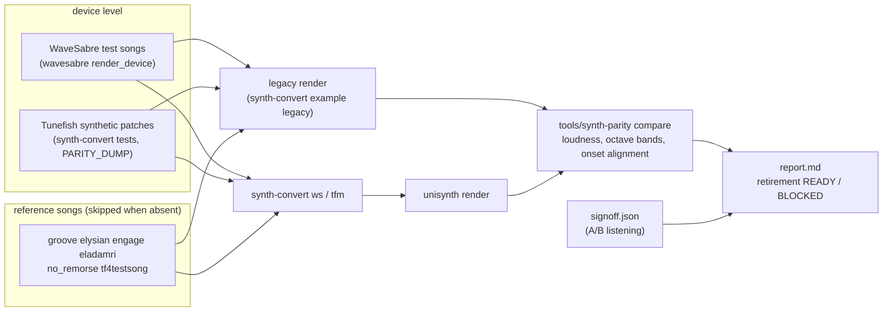

- **Metrics.** Integrated loudness ±1 dB (BS.1770-4), octave bands 63 Hz–16 kHz ±3 dB (bands more than 24 dB below the
  loudest reference band are not compared), onset timing within 100 frames (WaveSabre) or 512 (Tunefish), the last by
  the lag and correlation of the onset-strength curves (correlation ≥ 0.5) rather than by matching picked peaks.
- **Random draws.** Global Groove and the five unison patches are rendered with 8 seeds; the mean must agree within the
  tolerance plus twice the spread between seeds (the report lists the spreads).
- **Retirement.** `READY` only when every device and every reference song passes (songs that did not run block it) and
  `signoff.json` records an approved A/B listening; otherwise `BLOCKED`, naming the failing items.
- **Speed.** Timed on `[profile.fast]`, the release profile at opt-level 3, for the legacy engine and the converted song
  alike; the report also gives the shipped size profile (`release`, opt-level z). The unified synth is more generic
  than the legacy engines and depends more on the optimiser: at opt-level z it is slower relative to them.
- **Size.** `research/us-size-probe/measure.sh` builds the i686 probe for the all-modules build and for each song's
  feature list and writes `tools/unisynth-parity/size.md`, which the report includes (`V2_SONGS` adds V2 rows).
- **V2.** `bun tools/unisynth-parity/v2.ts [--renders]` runs the 15 V2 acceptance songs: v2redux renders against
  `synth-convert v2m` → unisynth, with the same song metrics and both renders cut to the shorter one. It writes
  `v2-report.md` (15 of 15 pass) and reads the listening decision from `v2-signoff.json`. Without songs it skips.
  V2 voice state sits in `v2::Opt` (zero-sized without a V2 voice feature, via the internal `us-mono-sum`), so a build
  without V2 does not carry it. A trusted build without a kind's V2 feature decodes that choice with the old law
  (`params::kinds::decode_in`). Songs without V2 now cost +180 to +470 B xz over the build before V2 (`size.md`,
  design D11).

What the first full run found and fixed (task 7.2), in the order it was found:

| Finding | Fix |
|---|---|
| WaveSabre noise is mono, ours was independent per channel: every band of Global Groove 3–5 dB low in a mono sum | `noise.width` (index 183), 0 for Slaughter |
| 2 ms envelopes sampled every 32 frames lose their peak: Global Groove −1.75 dB | 8-frame control grid for 256 frames after each note edge |
| Tunefish voices lived on in their exponential release: 33 voices against 19, half the speed | free a releasing voice that is inaudible |
| 10 reverbs ran all song long | a silent reverb sleeps |
| the mod matrix was scanned for every target of every segment (a quarter of the time) | one pass builds a table (`modmx::Tab`), bit-identical |
| band and onset checks written for near-identical renders failed on deep stopbands and on neighbouring hits | band floor, onset alignment, seed ensembles (above) |

