# Unified synth (`crates/unisynth`)

Status: **in progress** (change `add-unified-synth`). The chunk format, the parameter layout and laws, the voice
framework (allocation, control grid, envelopes, LFOs, mod matrix), all four oscillator types, the noise source, the four
filter slots and the nine effect kinds exist, and the converter has started (song structure and effects). The rest
follows the task list in `openspec/changes/archive/2026-10-26-add-unified-synth/tasks.md`. This page grows with each task group.

The unified synth replaces [`wavesabre`](wavesabre.md) and [`tunefish4`](tunefish4.md) with one slot-based instrument
(`synth-mix` kind 64) and one merged effect set (kinds 65–73), playing through the same [`synth-core`](synth-core.md)
mixer. Old songs convert with a host-only tool; the old crates stay as parity oracles until a parity report passes and
the A/B listen is signed off. Decisions and alternatives: `openspec/changes/archive/2026-10-26-add-unified-synth/design.md`.

## Where it sits

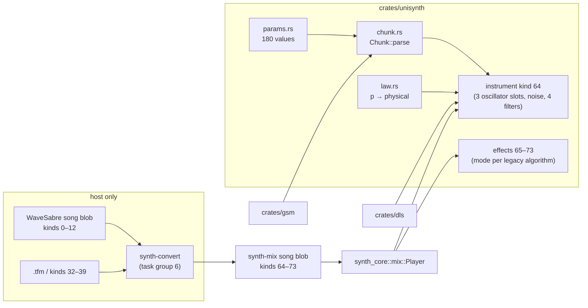

## The instrument

One voice has a fixed set of slots; every legacy sound is a configuration of them.

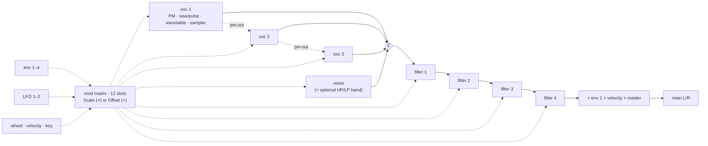

- **Oscillator types:** phase-mod operator (Falcon), band-limited saw/pulse (Slaughter), spectral wavetable (Tunefish,
  1–10 unison layers), sampler (GSM sample from the chunk, a GM.DLS wave or a GM.DLS instrument with its key/velocity regions).
- **Filter types:** state-variable LP/HP/BP/notch, ladder LP, RBJ HP/BP, resonator notch.
- **Envelopes:** each picks the WaveSabre curve (ms, linear attack, quadratic decay/release) or the Tunefish curve
  (rate steps with a slope); envelope 1 ends the voice.
- **Control** runs on a 32-frame block of absolute song frames, linearly interpolated (8 frames for the first 256 frames
  after a note-on and a note-off); audio runs per sample.
- Every module is a cargo feature `us-*`; a patch that uses a missing module fails at load, not at render.

## Parameters

260 values in groups: everything normalized (0..1) except the three sample indices (raw whole numbers). Indices
184–259 are the V2 part (change add-v2-import, below). A value outside its group's law is clamped, and NaN reads as
0.

| Group | Indices | Count | Fields |
|---|---|---:|---|
| voice | 0–15 | 16 | master, pan, capacity, steal, unison, uni-detune, uni-spread, mode, slide, glide, transpose, velocity, start-spread, one-shot, noise level, env1-at-output |
| oscillator ×3 | 16–81 | 22 each | type, tracking, coarse, fine, octave, ratio, ratio fine, fixed Hz, gain, mix, pan, pm-out, feedback, shape[9] |
| noise | 82–84 | 3 | band on, hp, lp |
| filter ×4 | 85–96 | 3 each | type, cutoff, resonance |
| envelope ×4 | 97–120 | 6 each | mode, attack, decay, sustain, release, slope |
| LFO ×2 | 121–128 | 4 each | shape, rate, depth, sync |
| mod slot ×12 | 129–176 | 4 each | source, target, amount, operation |
| sample index ×3 | 177–179 | 1 each | raw: the GSM sample number (1-based, 0 = none), DLS wave index or packed DLS instrument of oscillator slot 1–3 (`osc1.sample` …) |
| controllers | 180–182 | 3 | `ctl.wheel` (0..1), `ctl.bend` (0..1, centre 0.5), `ctl.bend_range` (0..24 semitones, default 2) |
| ext | 183 | 1 | `noise.width` |
| V2 voice | 184–188 | 5 | `v2.voice` (off/on), `v2.keysync`, `v2.era` (`count 0..6`, default 6), `v2.routing`, `v2.balance` |
| voice distortion | 189–192 | 4 | `vdist.mode/gain/p1/p2` |
| envelope amplify ×4 | 193–196 | 1 each | `envN.amplify` (V2 envelope mode) |
| LFO extras ×2 | 197–204 | 4 each | `lfoN.mode` (unisynth / V2 laws), `phase`, `polarity`, `eg` (one-shot) |
| mod slot 13–16 | 205–220 | 4 each | as slots 1–12 (`us-matrix-add`) |
| controllers 2–7 | 221–226 | 6 | `ctl.cc2` … `ctl.cc7` (breath, 3–6, volume; default CC7 = 127/128) |
| channel stage | 227–237 | 11 | `ch.on`, `volume`, `boost`, `fx_order`, `send_reverb/delay/aux_a/aux_b`, `recv_aux_a/b`, `speech` |
| free | 238–239 | 2 | |
| channel stage, two-byte | 240–259 | 20 | `ch.dist_*` ×4, `ch.chorus_*` ×7, `ch.comp_*` ×9 |

**V2 fields** store `V2 raw / 128` (`params::v2_raw`); the V2 code runs on the raw value plus its Add routes. That
holds for every appended V2 parameter and for the existing fields that a V2 type or mode reads: oscillator
coarse/fine/gain/shape, filter cutoff/resonance, envelope fields, LFO fields, and voice pan/transpose with `v2.voice`
on. The defaults are V2's initial patch values with the stage switches off, so an older patch is unchanged.

**Expanded choices.** Oscillator type, filter type, envelope mode, mod source and mod operation gained kinds without
moving stored values. A choice of `n` kinds is read as `choice(p, 2n − 1)` (`params::kinds`): the old kind `k`
(stored `k/(n − 1)`) lands on position `2k`, and the later kinds take the odd positions. Unused positions are off.
Ids in code are semantic (`osc_type::V2 = 5`, `filter_type::V2_LP..V2_MOOG_HP = 9..15`, `env_mode::V2 = 2`,
`source::CC2..CC2+5 = 10..15`, `source::V2_NOTE = 16`, `op::ADD = 2`). Use `decode`/`encode`, never `choice` on these
fields. `inv_choice(k, n_old)` still encodes an old kind. The song tables list one option per stored position (`—` for
unused positions).
`shape[9]` means different things per oscillator type:

| Type | shape[0..9] |
|---|---|
| phase-mod | waveform blend (sine + Square35) |
| saw/pulse | waveform (saw → pulse), pulse width |
| wavetable | bandwidth, harmonics, damp, scale, mod, drive, layers, layer detune, layer spread |
| sampler | start, loop mode, loop boundary, loop start, loop length, reverse, interpolation, source (GSM / DLS instrument / DLS wave), (unused: the sample index is the raw value 177–179) |

Structural parameters (voice capacity, each oscillator type, each sampler source, the three sample indices) are read from the chunk
only; `set_param` ignores them, so automation cannot change what was sized at load.

### Laws

Module parameters keep the law of the legacy code they come from; only the places where the two engines meet got new
laws. Constants live in `crates/unisynth/src/law.rs`; the inverses (for the converter) are host-side.

| Law | Formula | Range | Notes |
|---|---|---|---|
| `cutoff` | `20 + 19 980·p²` Hz | 20–20 000 | WaveSabre's law, every filter type |
| `gain` | `16·p²` | 0–16 | unity at p = 0.25 |
| `lfo_rate` | `0.01·10^(4p)` Hz | 0.01–100 | ≤ 4 % per byte |
| `time` | `10·p⁴` s | 0–10 | slide / glide |
| `transpose` | `(2p − 1)·24` st | ±24 | continuous |
| `start_spread` | `10^(6p − 2)` samples of the slot's period, whole turn at `p = 1` | 0.01–10 000 | reach of the random start phase of phase-mod and saw/pulse slots (a saw/pulse takes it at its first note only); default 1 |
| `coarse` / `fine` / `octave` | whole st / `2p − 1` st / whole octaves | ±24 / ±1 / ±4 | |
| `ratio`, `ratio_fine` | `1 + floor(32.99p)`, `(2p − 1)³` | 1–33, ±1 | Falcon |
| `fixed_hz` | `1000·p²` Hz | 0–1000 | Tunefish |
| `feedback`, `pm_out` | `8p²`, `4p²` | | radians per unit of the slot's output |
| `pan` | `(√(1 − p), √p)` | | equal power |
| `env_ms` | `p²·5000 + 1` ms | 1–5001 | timed envelope mode (WaveSabre) |
| `scale_amount` | `2p` ≤ .5, else `1 + 9(2p − 1)²` | 0–10 | Tunefish mod amount |
| `offset_amount` | `sign(x)·x²·range`, `x = 2p − 1` | ± target range | fine steps near 0 |
| `choice`, `count`, `index` | `round(p·(n − 1))`, `lo + round(p(hi − lo))`, `round(255p)` | | stored as `i/(n − 1)` |

Resolution rule: a law that *is* a legacy law (cutoff, envelope time, slide time) is exactly as fine as the legacy
byte. New laws carry perceptual bounds (rate ≤ 4 %, gain ≤ 0.7 dB above −40 dB, transpose ≤ 0.2 semitone, vibrato
amount ≤ 0.1 semitone per byte). Tests: `crates/unisynth/src/params/tests.rs`.

## Chunk v1

```text
u8 version = 1 (2: + speech text)
count n, n × { index, f32 value }        only values that differ from the defaults, indices strictly increasing
u8 s,  s × { u32 size, GSM sample chunk } header + WAVEFORMATEX + blocks, nothing after the blocks
version 2 only: u16 len ≥ 1, len bytes    Ronan speech text
(end)
```

Escapes (change add-v2-import), like UTF-8 lead bytes. A count byte `c < 0xFF` is the count, and `0xFF` is followed
by a `u16` count of 255 or more. An index byte `b < 0xF0` is the index, and `0xF0 + k` is followed by a byte `x`:
index `240 + 256k + x` (up to 4335). Chunks written before the escapes have the same bytes and the same meaning. The
encoder writes the shortest form, and the reader rejects an escaped count below 255. A two-byte index is always 240 or
more, so every index has one form. A version 2 chunk without `us-speech` fails with `UnsupportedModule(SPEECH)`. Reading
escapes is module `us-chunk-wide` (implied by `us-chan`). Without it, an escape fails with
`UnsupportedModule(CHUNK_WIDE)`, and the reader steps through 5-byte pairs as before, so a song without V2 pays
nothing here (design D4, D11).

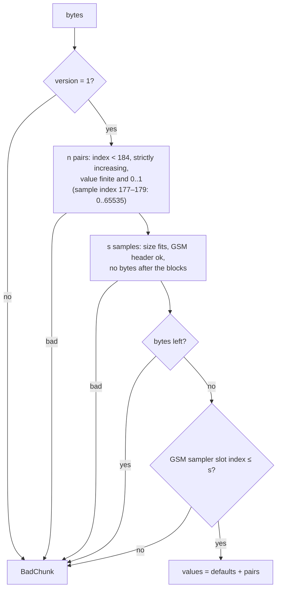

- The encoding is canonical (sorted, defaults omitted): the same patch gives the same bytes. The worst case is 923
  bytes (all 184 values differ); a Slaughter-like patch is about 100 bytes.
- The three sample indices (177–179) are the only raw values. Each is not a shape value: `shape[8]` is the wavetable's layer spread, a normal 0..1 value. It reads like the legacy `(int)v`, 1-based, 0 = none; DLS uses the legacy
  `(int)v − 1`. A GSM index beyond the section is an error, a DLS index is checked against the bank at render.
- Without `us-sample-gsm`, a chunk with samples fails with `UnsupportedModule(SAMPLE_GSM)`.
- Sizes are `u32` and `usize` is 32-bit on i686: every offset uses checked arithmetic, so hostile sizes cannot wrap.

The format went through a cross-model adversarial review (task 1.4); the decisions are recorded in design D3.

## Voice framework

`UInstrument` (`instrument.rs`) is a `synth_core::device::Device`. Notes arrive as `Events<256>` (offsets inside the
next `run` call, dropped when full), voices live in a `VoicePool<Voice>` of 1–64 slots, and everything that changes with
time runs on the **absolute 32-frame control grid**.

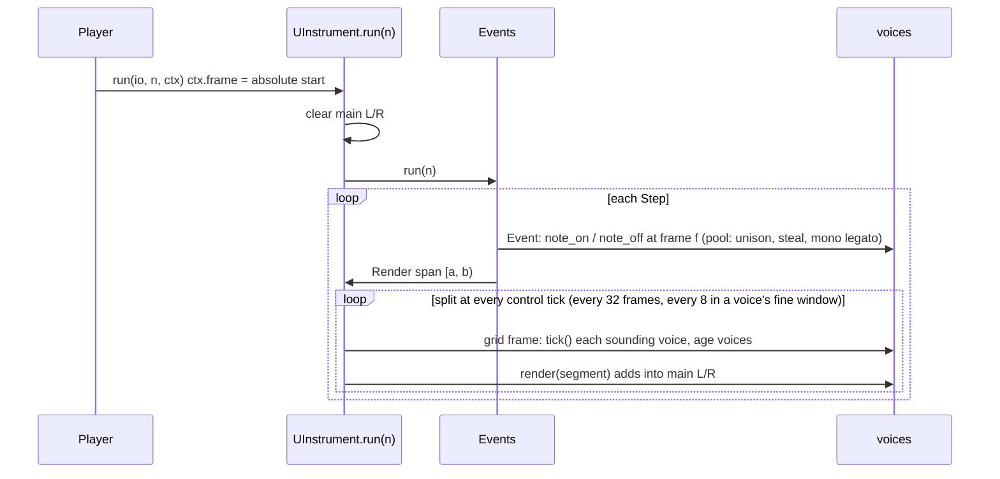

Rules that make the output independent of how the caller splits its calls (checked by the tests with calls of 1, 7,
32, 33, 100, 511 frames and player sub-blocks of 1, 37, 100, 512):

- The grid is `absolute frame mod 32`, never the call start. Events fire on their exact frame.
- Every random draw comes from the instrument's own xorshift, seeded from **one** draw of the song random source at
  load; each voice takes a seed from it at note-on. Nothing depends on other tracks' render order.
- Free-running LFOs use `rate · frame / sample rate`, so every voice shares one phase without instrument state.
- `reset()` restores the seed, voices and queues; parameters stay as loaded or automated.

### Fine window and inaudible releases

Two rules came out of running the parity tool (`tools/unisynth-parity`), and both keep the output independent of the
call split because they depend only on absolute frames and the voice's own state.

- **Fine window.** WaveSabre's envelopes run per sample, and a 2 ms noise hit sampled every 32 frames and interpolated
  loses its peak and gains a tail (Global Groove, nothing but such hits, read 1.75 dB quiet). For `FINE_SPAN` = 256
  frames after a note-on or note-off a voice ticks on the absolute 8-frame grid (`FINE`). `render_span` runs each span up
  to the shortest segment left in any voice (`Voice::left`) or the next 32-grid frame, whichever is first, so voices on
  different grids share one loop. A hit then keeps its energy within about 6 %; it costs under 1 % of a song.
- **Inaudible releases.** A voice in the release stage whose mean output magnitude stays under `QUIET` = 2.5e-4
  (−72 dBFS) over 256 frames is freed, as the legacy Tunefish engine frees a voice whose block level falls under a
  threshold. Without it no_remorse held 33 voices on average (the exponential release reaches the envelope's own end,
  1e-5, seconds after it is inaudible) against 19 for the legacy engine, and rendered at half the speed.

### Voice control segments

A voice holds two copies of its control state: `start` (segment start) and `end` (one segment later). Control outputs
(pitch increment, gain, pan, ...) are `Ramp`s that move linearly from the values at `start` to the values at `end`.

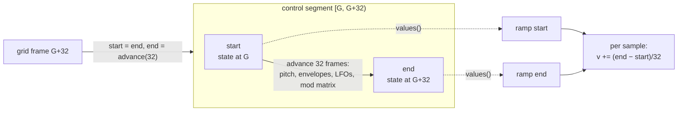

- **Note-on mid-block** (frame `G + k`): the first segment is `32 − k` frames long and ends on the grid. A note-on
  exactly on a grid frame lets the grid tick start the first segment.
- **An event inside a segment** (note-off, slide): `start` is advanced to the event frame, changed, and `end` is
  recomputed for the rest of the segment; the ramps retarget from their current value. So a release begins on its
  exact frame even though control runs every 32 frames.
- A voice whose envelope 1 reaches `Finished` switches itself off at the next grid frame, after its output has ramped to
  zero.
- Pitch has three movements: snap, **slide** (mono legato, linear over `time(slide)` seconds), **glide** (exponential
  towards the new note from the voice's last pitch, time constant `time(glide)`).
- Gain is `master · mod · velocity sensitivity · envelope 1`, velocity sensitivity `1 − s + s·vel/128`. With
  `env1-at-output` off, envelope 1 only ends the voice and the patch routes it through the matrix.

### Envelopes

Each of the four envelopes snapshots its parameters at note-on and advances by elapsed seconds.

| Mode | Attack | Decay | Release |
|---|---|---|---|
| WaveSabre | linear, `p²·5000 + 1` ms | `(1 − t/T)²` towards the sustain level | `(1 − t/T)²` from the value at note-off |
| Tunefish | rate `−log₁₀(0.94a³)·STEP` | `¼·log₁₀(0.94(dM)³)·STEP·((0.01 + v − S)/(1 − S))^slope` | `¼·log₁₀(0.94r³)·STEP·v^slope`, ends below 1e-5 |

Tunefish rates are the legacy per-512-block steps expressed per second (`STEP = 0.256`, 86.13 blocks/s) and integrated
with one Euler step per segment. Two deliberate deviations: a decay that would rise (`d·M` above ≈ 1.02) holds at the
peak instead of growing past 1, and the sustain level is fixed at note-on (no chase).

### LFOs

Five shapes on a phase in turns (sine `(sin + 1)/2`, ramp up, ramp down, square, stepped random: 256 hashed steps per
cycle). `sync` on restarts the phase at note-on, off joins the free-running phase. A Scale slot sees
`1 − d + d·shape`, an Offset slot `d·(2·shape − 1)`, with `d = (depth · M(depth))²`.

## Mod matrix

16 slots `(source, target, amount, operation)`; `modmx.rs`. Slots 13–16, the Add operation and the sources added after
chunk v1 need `us-matrix-add` (change add-v2-import).


| Target ids | Meaning | Scale works on | Offset range |
|---|---|---|---|
| 0 | none (slot inert) | | |
| 1 pitch | all oscillators | frequency | ±36 semitones |
| 2 gain, 3 pan | voice | linear gain / normalized pan | ±4 / ±1 |
| 4–48 | oscillator slot `i` (`4 + 15i + f`): pitch, gain, mix, pan, pm-out, feedback, shape 0–8 | pitch and gain physical, rest normalized | ±36 / ±4 / ±1 / ±1 / ±4 / ±8 / ±1 |
| 49–51 | noise level, HP, LP | level physical, cutoffs normalized | ±4 / ±19 980 Hz |
| 52–59 | filter `i` cutoff and resonance | normalized | ±19 980 Hz / ±1 |
| 60–63, 64–65 | envelope decay, LFO depth | normalized | ±1 |
| 66–77 | mod slot `i` own amount | physical (multiplies the slot result) | ±1 |
| 78–141 | parameter targets (Add only): `target::PARAMS[t − 78]`, the 64 V2 parameters `sounddef.h` marks as destinations, in V2's order; 118–141 (`ch.*`) are channel targets | | |

**Add** (V2's rule, design D3). The amount is `2p − 1` (V2's `(val − 64)/64`), and the sources are 0..1 (V2's value /
128). Each Add slot adds `amount · source` to the normalized value of its parameter target and clamps to 0..1, in slot
order, as V2's `storeV2Values` does per entry. Voice targets are applied where the voice reads its parameters
(`voice::added`, before laws, envelopes and LFOs). Channel targets are applied by the channel stage from the newest
voice. An Add slot on a target below 78, and a Scale or Offset slot on a parameter target, do not route.

Sources: 0 none, 1–4 envelopes, 5–6 LFOs, 7 wheel (live input via `UInstrument::mod_wheel`), 8 velocity, 9 key
(`note/127`), 10–15 controllers 2–7 (`ctl.cc2..7`), 16 V2 note (`2·(note − 48)/128`). An Add slot reads an LFO as
`depth · shape`, or as a V2-mode LFO's own output. Evaluation order matters and mirrors Tunefish: slots run in order; a slot sees this pass's results of
earlier slots and the previous pass's results of later ones (the one-segment slot delay), which makes self-modulation
and slot-to-slot depth modulation possible. The target ids are frozen with chunk v1 (78–141 with change add-v2-import).

## Oscillator slots

Each of the 3 slots has a type fixed at load (`o::TYPE` is structural); a type whose module is not in the build fails
the load with `UnsupportedModule(module)`. Slots run in order and are summed into the voice: a slot's **mix** level
scales what reaches the output, its **pm-out** scales what it sends into the *next* slot's phase, independently, so a
slot can be a pure modulator (mix 0). An `Off` slot sends nothing.

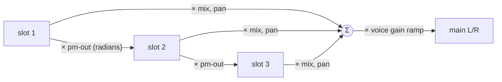

Every slot shares the pitch path (voice note + unison detune + transpose + mod pitch offset, then the slot's coarse,
fine, octave and Offset route, then `ratio` or a fixed frequency, then the Scale routes) and the gain, mix, pan
laws; only `shape` changes meaning with the type.

### Phase-mod operator (`us-osc-pm`)

Falcon's operator. Output `y = (sin 2πt + w·(sin 6πt/3 + sin 10πt/5))·gain` with `t = φ + (fb·y₋₁ + in)/2π`, where `w`
is the waveform shape value (0 sine .. 1 full `Square35`), `fb` the feedback law (`8p²`), `in` the previous slot's send
and `y₋₁` this slot's last output. At note-on every phase-mod slot restarts at one common random phase (Falcon draws a
single value per note).

### Band-limited saw/pulse (`us-osc-blit`)

Slaughter's integrated BLIT, run in phase units instead of samples so the pitch can change every sample:

- impulse train: a sinc `sin(πx)/(πx)` with `x = (phase − ½)/increment` samples, one per period; the pulse subtracts a
  second one `pw` later, scaled by the waveform value `w` (0 saw, 1 pulse);
- `integral = leak·integral + dc·(1 − w) + impulse₁ − w·impulse₂`, with `dc = −0.996·increment` removing the saw's DC;
- output = `−integral · gain`: Slaughter's output stage is `−16·…`, and the gain law cannot be negative, so the sign
  lives here;
- the leak is `0.998` at 44.1 kHz and `0.998^(44100/rate)` elsewhere, which keeps the integrator's corner at about
  14 Hz;
- phase and integrator are **not** reset at note-on: they run on across notes, as Slaughter's do, and every voice and
  slot starts from its own random phase drawn once from the instrument's stream when the voice is built (so `reset`
  repeats them).

Measured against its spec: the harmonics of a note-45 saw (110.25 Hz) stay within 8 % of `1/n` up to the 45th (4.96 kHz);
a square has no even harmonics; a quarter pulse has none at multiples of 4.

### Spectral wavetable (`us-osc-wt`)

Tunefish's generator: a single cycle of 512 samples is built from a parametric partial spectrum, played back by up to
10 unison layers. It needs a table per voice and slot (`Wt`, about 10 KB: spectrum, work buffer, cycle and the layers'
phases), taken from the pool at load; `need` counts capacity × wavetable slots, so a patch without wavetable slots costs
nothing.

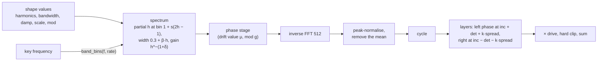

- **Rebuild cadence.** The cycle is built at note-on and the inputs are checked again every 2048 frames of the voice's
  age (Tunefish: every 4th block of 512). The spectrum is recomputed only when an input changed (counts exactly, floats
  beyond 1e-5); the phase stage and the inverse FFT run at every check, which advances the drift value `μ` by `g³/100`.
- **Band limit.** `K = max(4, trunc(512·(1 − r)³))`, `r = clamp((f − 8)/2000)` with `f` the key frequency scaled to
  44.1 kHz, so the band follows the Nyquist frequency at other rates. Octave and fixed-frequency modes can still alias.
- **Phase-stage quirk.** The 4096-period sine is indexed modulo 512, so the multipliers stay within `[0, sin π/4]`; a
  one-partial table has an amplitude of about 0.2. It is kept so the converted Tunefish patches sound the same, and
  drive and the slot gain make up for it.
- **Unison.** Layer `k` plays at `|inc ± det ± k·spread|` (left `+`, right `−`). Detune is `10p³` Hz, spread `10p⁴` Hz
  per layer (divided by the sample rate), drive `1 + 32p`; detune scales with the frequency routes, spread does not.
  Layer phases start random (the right phase up to 0.1 turn ahead of the left) and read the table without
  interpolation, as Tunefish does.
- The shape values go through the mod matrix like every other shape value; the unison layer count does not (it is an
  integer).

### Sampler (`us-osc-sample`)

Plays a **GSM 6.10 sample** from the chunk's sample section (decoded into the pool at load, once per distinct sample)
or a **GM.DLS wave** of the caller's bank (read in place, 8 or 16 bit). `source` and `index` are structural: the index is
1-based, 0 is none, and the DLS wave is `index − 1` as in WaveSabre's `Adultery`. No bank, an unreadable bank or an
index past the bank leaves the slot silent while the rest of the voice sounds.

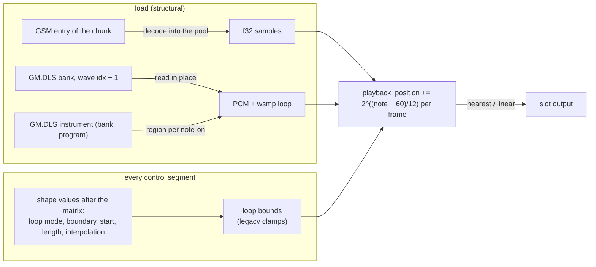

- **Pitch.** The step is `2^((note − 60)/12)` sample units **per output frame**, so at the root note the data plays one
  sample per frame at any song rate (a sample lasts the same number of frames at 22 and 96 kHz, as in the legacy
  samplers); coarse, fine, octave, ratio, pitch routes and the voice's transpose add as for the other types. The fixed
  frequency is relative to note 60 (`hz / 261.6256`).
- **Start and direction.** Note-on places the position at `start·(len − 1)`, or at `(1 − start)·(len − 1)` playing
  backwards with `reverse`.
- **Loops.** `off` ends the slot past the data; `repeat` wraps by the loop length (linear interpolation reads the loop
  start across the seam); `ping-pong` reflects at the bounds and plays each edge sample twice. Bounds come from the
  sample (the whole GSM sample, or the DLS wave's own `wsmp` loop) or are set by hand as fractions of the length; the
  legacy clamps apply (length at least 1, start inside the data, end at most the length).
- **One-shot.** With `one-shot` set the voice ignores note-off and ends when every sampler slot has run out, except that
  all-notes-off still releases it. A repeat-looped one-shot therefore sounds until it is stolen or all notes are turned
  off; the converter never emits one.
- The sampler has no phase input; its output can still be sent into the next slot (`pm-out`).

### Controllers: wheel, bend and bend range

`ctl.wheel`, `ctl.bend` and `ctl.bend_range` (indices 180–182) are ordinary automatable parameters, so a song carries
wheel and bend as automation lanes. The wheel feeds mod source 7 (the live input `UInstrument::mod_wheel` writes the
same parameter). Bend shifts every voice by `(bend − 0.5) · 2 · range` semitones: it is added to the voice's transpose, so
held and releasing voices follow it and, like transpose, a fixed-frequency oscillator does not. The defaults (wheel 0,
bend 0.5, range 2) leave a song that never sets them unchanged; a seek restores the values the chunk loaded.

### DLS instruments (`us-sample-dls`)

The sampler's `source` is a choice of three: **GSM** sample of the chunk (0.0), **DLS instrument** (0.5) and **DLS wave**
by index (1.0, Adultery's way). An instrument is named by `index = 1 + drums·16384 + bank·128 + program` (0 = none), so
the same index finds "Piano 1" (bank 0, program 0) in Windows `gm.dls` and in macOS `gs_instruments.dls`, and 16385 the
Standard kit.

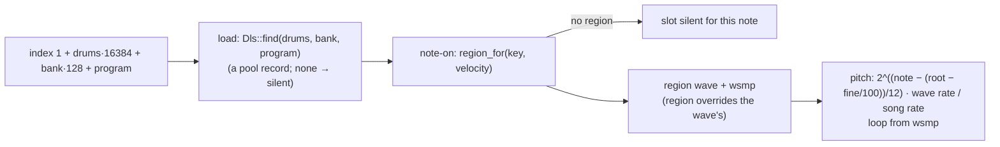

The region is picked at note-on and kept for the life of the voice, so a chord uses one region per note and a velocity
layer cannot change mid-note. The wave plays at the region's (or wave's) root key and fine tune, at the rate its own
sample rate implies (a 22.05 kHz wave at a 44.1 kHz song steps half a unit per frame), with its `wsmp` loop when the
loop boundary is "from the sample". A missing bank, a missing instrument or a key with no region is silence for that
slot, never a load error. Not applied: the bank's articulation (envelopes, LFOs) and the `wsmp` gain, which Apple's bank
stores as −20 dB (kit) to −113 dB (piano) and makes up for in the articulation; the patch's own envelopes and gain
shape the sound. Checked against the real macOS bank (skipped when absent): Piano 1 note 36 plays wave 289 (region
0–38) and note 72 wave 294 (region 68–74); the Standard kit's 36 and 38 play waves 376 and 161, each at its own root.

## Noise and filters

After the oscillators the voice adds the noise source, runs the sum through the four filter slots in series, and only
then applies the voice gain (master, matrix gain, velocity, envelope 1).

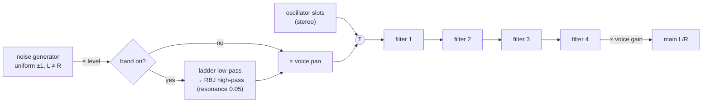

### Noise (`us-noise`)

A per-voice stereo generator, uniform in ±1, seeded at note-on from the voice's own stream
(so a retriggered voice sounds different, and the sequence does not depend on other tracks or the call split). Level
is `gain(p)` through the matrix (Scale on the physical level, Offset in linear gain); the voice pan places it
(equal-power: the centre is −3 dB per channel, which the converter compensates). The optional band is Tunefish's: a
ladder low-pass at the `lp` cutoff and an RBJ high-pass at the `hp` cutoff, both at resonance 0.05. A patch that sets
or routes the level in a build without `us-noise` fails at load naming the module.

The width parameter `noise.width` (index 183, default 1) sets how far the channels differ: at 1 each has its own noise
(Tunefish's), at 0 both carry the same noise (WaveSabre's Slaughter, which the converter sets), between them
`(w·r + (1 − w)·l)/√(w² + (1 − w)²)`, so each channel keeps its power. Independent channels read 3 dB lower in a mono
sum, which showed in every octave band of Global Groove's hi-hats while the per-channel level was already right.

### Filter slots

Each slot is off or one of nine types; the type is an ordinary parameter (it can be automated, and a change between
types with the same state layout, e.g. SVF low-pass to high-pass, keeps the state). `us-flt-svf`, `us-flt-ladder`,
`us-flt-rbj`, `us-flt-notch` gate the types: a patch that loads with a missing one fails at load; a type automated
to a missing one bypasses.

| Type | Structure | Cutoff | Resonance `p` |
|---|---|---|---|
| SVF low/high/band/notch | WaveSabre's Chamberlin filter, 2× oversampled (linear midpoint) | `f = 1.5·sin(π·fc/2/rate)`; the corner is therefore 3/4 of the cutoff parameter (WaveSabre's coefficient, kept for parity) | `q = 1 − p`; the input is scaled by `q`, so the passband level falls with resonance |
| Ladder low-pass | Tunefish's 4 two-tap one-pole stages, global feedback, cubic output saturation | `f = 2·fc/rate` | `q = clamp(p, 0, 0.85)`, feedback `q·e^((1 − k')·1.386249)` |
| RBJ high/band-pass | biquad with the reference's `log₁₀2` bandwidth law | `w0 = 2π·fc/rate` | `clamp(p, 0, 0.85)` |
| Resonator notch | zeros on the unit circle, poles at radius `q`, one sample of input latency | `z = cos(2π·fc/rate)` | `clamp(p, 0, 0.85)`; pole radius does not scale with the rate, so its width grows with it |

The cutoff is `cutoff(p) = 20 + 19 980·p²` Hz for every type (Tunefish's own `30 + 20 000p²` / `30 + 10 000p²` laws
are re-mapped by the converter). The matrix reaches it as Scale (on the normalized value) or Offset (in Hz), clamped
to `0..19 980` Hz after the sum, as Slaughter does. All coefficients are computed for the song rate (cutoff clamped to
0.49 · rate) once per control segment and ramp linearly across it.

## V2 voice (change add-v2-import)

`v2.voice` on switches a kind-64 instrument to Farbrausch V2's voice: its laws, its 128-frame control frame and its
mono-then-pan output. The code ports V2's `synth_core.cpp` (public domain) and follows v2redux's `v2core.cpp` where the
x87 assembly's rounding and bugs matter (fast sine below −π, the atan table path, `fistp` round-to-nearest, the
integer-indefinite FM collapse). Every field below stores `V2 raw / 128`. `v2.era` holds the song's format version
(0–6, 7 = the 2004 kkrieger build). Behaviour that changed between V2 builds is chosen from it, following v2redux's
`v2eras.h` ledger.

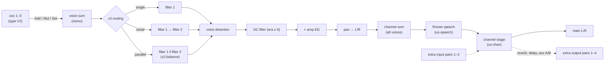

| Module | Feature | What it is |
|---|---|---|
| oscillator type `V2` | `us-osc-v2` | modes tri/saw (`shape` morphs), pulse (`shape` = width), sine, noise (LRC-filtered; `v2.color`), FM (from the previous slot), aux A/B; `v2.mode` Add/Mul/Set into the sum; `v2.ring` multiplies by the running sum. Coarse/fine as V2 transpose/detune. Format < 3: 4× box-averaged tri/saw and pulse; < 5: the MSVC LCG noise and the native-sine FM |
| filter types `V2_LP`…`V2_MOOG_HP` | `us-flt-v2` | V2's state-variable low/band/high/notch/all-pass and the 4-pole Moog low/high (bypass below format 6, as V2 then) |
| `v2.routing`, `v2.balance` | `us-flt-route` | single, serial, parallel with V2's balance law |
| voice distortion | `us-vdist` | V2's dist modes: off, overdrive (atan), clip, bitcrusher, decimator, LP/BP/HP/notch/all-pass/Moog; `vdist.*` in/out gain, param 1/2 |
| envelope mode V2 | `us-env-v2` | per-frame (344.5 /s) attack/decay/sustain/release in V2's 0..128 space, sustain time slope, `envN.amplify`; format < 2: the year-2000 laws and 256-frame frame |
| LFO mode V2 | `us-lfo-v2` | saw/tri/pulse/sine/S&H, `lfoN.polarity` (+, −, ±), `eg` one-shot hold, phase, keysync reseed |
| V2 voice | `us-v2-voice` | the voice path above (sum, DC filter, keysync, pan after distortion) |
| channel stage | `us-chan` | see below; needs `synth-core/pairs` |
| speech | `us-speech` | Ronan; text in chunk version 2 |
| matrix Add | `us-matrix-add` | V2's mod rule, CC2–CC7 and V2 note sources, slots 13–16 |

`us-v2` enables them all. A V2 oscillator outputs the same mono signal to both channels and ignores the slot pan; the
voice pan applies after the distortion, as V2 does. A patch can still mix V2 and unisynth slots; only the V2 path is
checked against V2.

### Channel stage

The channel stage runs once per instrument on the sum of its voices, in V2's order: aux receive, DC filter, compressor
(peak or RMS, 5700-frame lookahead, shared body with compressor `v2`), bass boost (150 Hz shelf), then distortion and
chorus/flanger in `ch.fxroute` order, DC filter, ×0.6 · volume. The reverb, delay and aux A/B sends leave on extra
output pairs 1–4 (reverb and delay mono, copied to both sides). The aux receives come in on extra input pairs 1–2.
Channel parameters (`ch.*`, targets 118–141) are modulated from the newest voice. A muted V2 channel still renders
but feeds no bus. Without sends, `run` behaves as before and writes no extra pair.

### Speech (Ronan)

`us-speech` ports V2's Ronan formant speech synth (`ronan.cpp`, public domain). The chunk's text section (version 2)
holds V2's speech texts, separated by NUL. The phoneme strings use V2's syntax (phoneme names, durations, `!` waits for
a note-on, `_` for a note-off). Ronan runs on the voice sum before the channel stage. `speech_ctl4` selects the text
and sets the rate (V2 CC4), and `speech_ctl5` sets the pitch (CC5). Note-ons and note-offs advance the waits. The table is V2's 69
phonemes and 52 syllables, decoded at build time.

## Module features

Every module sits behind a Cargo feature, so a build carries only what its songs use. A patch that needs a module the
build lacks fails at load with `UnsupportedModule(id)` (`module.rs` names the id); nothing is silently dropped.

| Feature | Module | Load check |
|---|---|---|
| `us-osc-pm`, `us-osc-blit`, `us-osc-wt`, `us-osc-sample` | the four oscillator types | the slot's type |
| `us-sample-gsm`, `us-sample-dls` | sampler sources (imply `us-osc-sample`) | the sampler's source, at chunk parse |
| `us-noise` | noise source | level set above 0, or any matrix slot targeting the noise level |
| `us-flt-svf`, `-ladder`, `-rbj`, `-notch` | filter families | each filter slot's type |
| `us-env-timed`, `us-env-rate` | timed (WaveSabre) and rate (Tunefish) envelope modes | the mode of envelope 1, and of any envelope a matrix slot reads |
| `us-voice-lfo` | the two voice LFOs | any matrix slot whose source is LFO 1 or 2 |
| `us-voice-glide` | glide and mono slide (pitch moves) | glide above 0, or slide above 0 in mono-legato mode |
| `us-voice-mono` | mono-legato mode (the pool's note log) | mode is mono-legato |
| `us-voice-unison` | more than one voice per note | unison above 1 |
| `us-voice-oneshot` | one-shot voices (sampler runs out, note-off ignored) | one-shot is on |
| `us-matrix` | the mod matrix | any slot with a source and a target |
| `us-automation` | the mixer's automation walk (song-level) | any track with an automation lane (refused by `Player::new`) |
| `us-chunk-wide` | chunk escapes (index ≥ 240, ≥ 255 pairs); implied by `us-chan` | a chunk that uses an escape, at parse |
| `us-matrix-add`, `us-speech`, `us-osc-v2`, `us-flt-v2`, `us-flt-route`, `us-vdist`, `us-env-v2`, `us-lfo-v2`, `us-v2-voice`, `us-chan` | the V2 modules ([V2 voice](#v2-voice-change-add-v2-import)) | an Add or controller route; non-empty speech text; the slot, filter, routing, distortion, envelope, LFO mode; `v2.voice`; any channel field off its default |

Automating a parameter to a module the build lacks does not fail (the song is already loaded): a filter bypasses, an
envelope runs the mode it has, an LFO reads 0, glide and slide snap, mono and unison play one poly voice, one-shot is off,
a route created without `us-matrix` does nothing. Groups `us-osc`, `us-flt`, `us-env`, `us-voice` and `us-all` exist for convenience.
`tools/check-unisynth-features.sh` builds every single-module set for i686 core-only and wasm32 and runs its tests.

**A feature removes the module's code.** The match arms that run an oscillator, the noise source and each filter family
read `Kind::X if cfg!(feature = "us-…")` with a bypass arm, so the compiler drops the code of a module the build lacks
(before this, those features only made the load fail: a noise-only song still carried every oscillator and filter).

**Voice paths.** The voice switches are features too (shrink-unified-synth 4.2). An ablation build that stubbed each optional
path out (`research/us-size-probe/ablate.sh`, `--cfg us_ablate=…` stubs, not committed) measured, compo configuration, raw / xz:
LFOs 1–1.5 K / 0.4–0.8 K, glide/slide 1 K / 0.5 K, mono-legato 0.5–1 K / 0.3–0.4 K, unison 0.5 K / 0.1–0.2 K, one-shot 0–0.5 K /
0.2 K; pitch bend and wheel, start-phase spread, the fine control grid and voice stealing under 0.5 K raw each, so those stay
in every build. Mono and unison live in `synth_core::voice::VoicePool`, shared with the legacy engines: the `Voice` trait carries
`const MONO` and `const UNISON` (default `true`), which `unisynth` sets from its features, so the pool's note log and unison
loop fold away without a `synth-core` feature. Songs that use none of a path play bit for bit as before (the golden test plays
every patch a reduced build can load and compares it with the full build's hash).

**The matrix.** Gating groups of matrix targets (pitch, gain/pan, oscillator fields, noise, filter, envelope decay, LFO depth,
slot amounts) made the player *bigger* (+0–0.5 K raw): most target ids are computed in loops, so the check stays in the code.
Even every target no reference song uses, cut at its call site, saves only 0.5 K raw / 0.3 K xz. The whole matrix is
2–2.5 K raw / 1.2–1.4 K xz: `us-matrix` (shrink-unified-synth 4.3), needed by any slot with a source and a target
(`modmx::routes`) or a lane on a routing parameter. Without it `Matrix::eval` does nothing and every query reads neutral.
Of the reference songs only Global Groove routes nothing (−1 KB packed).

**Automation and other song-wide facts** (shrink-unified-synth 4.5). Specializing the voice per instrument (patch values
as `const`) would need one copy of the ~9.5 K voice per instrument (16–20 in the Tunefish songs): not pursued. Song-wide
facts were checked instead: fewer used slots changes nothing (a loop's code is there once whatever its count), the
sample rate is a struct field read at run time (folding it would mean rewriting every use for a few divisions). What
pays is a song without automation lanes: `us-automation`. `Device::automation()` (default `Ok`, a method so `Device`
stays dyn-compatible) returns a constant `Err(module::AUTOMATION)` in a `unisynth` build without the feature, so the
mixer's `automate` call folds away and `Player::new` refuses a song with a lane with `UnsupportedModule(37)`. The legacy
engines keep the default. Packed (baked, compo configuration): Global Groove 13,824 → 13,312, no_remorse 22,528 → 22,016,
tf4testsong 20,992 → 20,480, turtles 25,088 → 24,576 (−364 to −464 xz); songs with lanes link the same code as before.
The parallel path (`mixer/par.rs`, feature `threads`) still calls `automate`; it has nothing to walk, since such a song is
refused at load.

### Open filters are not run

A filter slot set so that the signal comes out as it went in is passed through (`flt::transparent`): a low-pass or ladder with the
cutoff at the top of its range (19 980 Hz), or a high-pass with it at the bottom (1 Hz), with no resonance. The slot's
coefficients and state are left alone while it is open (`Slot::pass`); the voice only remembers the last frame that went past. When
the cutoff leaves the open position the state starts as the steady state of that signal (a low-pass or ladder holds it, a
high-pass, band-pass or notch has none of it at rest), so the change does not click. The decision is taken per control segment
on the effective cutoff, so a modulated cutoff is bypassed exactly while it sits at the end of its range.

The open end is a position, not a gain of 1, so the sound changes a little. Measured at 44.1 kHz:

| Filter at its open end | 1 kHz | 5 kHz | 10 kHz | 16 kHz |
|---|---:|---:|---:|---:|
| state-variable low-pass | −0.02 dB | −0.4 | −1.6 | −4.0 |
| state-variable high-pass (1 Hz) | −0.02 | −0.4 | −1.7 | −4.2 |
| ladder (small signal / full scale) | 0 / −1.15 | | | |
| RBJ high-pass (1 Hz) | 0 | 0 | 0 | 0 |

The state-variable filter rolls the top off at any cutoff (its 2× oversampling), which the legacy filter also did; a song that
leaves it open therefore comes out brighter: Eladamri +1.9 dB in the 16 kHz octave, Global Groove +2 dB loudness (it is nothing
but noise through such a filter). The parity report lists Global Groove under *Accepted differences* (loudness ±2.5 dB, bands ±4 dB)
and the converter's sampler tests allow 4 dB in the top band. In return a rendered song needs 1–6 % less time (Eladamri 6 %, Elysian
1.6 %, Engage 1 %); the Tunefish songs leave no filter open.

### The map of a song

`synth-convert features <song>` prints the features the song needs: every module its devices use, plus every module its
automation can reach (a lane on a filter type, on the noise level, on a voice switch, or on a routing parameter, which can create any
route and so needs the matrix). The build links exactly these.

```text
$ synth-convert features song.song --explain --cost research/us-size-probe/out/marginal.csv
us-noise   +0.5 K raw, +0.2 K xz
    instrument device 0: noise_level is above 0
    instrument device 0: mod3 routes to the noise level
    instrument device 3: noise_level is above 0
    … and 19 more (`--json` lists all)
us-flt-rbj   +1.0 K raw, +0.4 K xz
    instrument device 3: filt2.type can be an RBJ filter
marginal cost of the listed features (each measured with every other module present): +… K raw, +… K xz
```

`--explain` names, per feature, what calls for it (device, parameter by its `osc1.type` name, automation lane); the cost
column is what `research/us-size-probe/marginal.sh` measured when the feature was removed from the all-modules build
(compo configuration: core rebuilt with `optimize_for_size`, opt-level z), so it is the size of the module as it stands
in the linked player, not a guess. `--json` prints the same as `[{"feature", "why": […], "raw", "xz"}]`. Without
`--explain` the output stays one comma list, which the build and `tools/check-song-features.sh` read.

`research/us-size-probe/attr.sh <song>` shows where the rest goes (function groups from the linker map of a no-LTO,
no-inline build: ranks, not totals).

### Songs as Rust (`synth-convert rust`)

`synth-convert rust <song> <out.rs> [bank.dls]` writes a unified song as Rust for a compo build. It first loads the song
with the real player on the host (every module, the given bank), so every check the player makes at load runs once there:
the song layout, each instrument and effect chunk, the modules, automation targets, receive cycles. A song the player would
refuse is refused. The file holds:

```rust
// Generated by `synth-convert rust` from turtles.song. Do not edit: regenerate from the song.
// unisynth features: us-osc-wt,us-noise,…
const _: () = assert!(unisynth::module::compiled_all(&[3, 7, 9, …]), "the build lacks a unisynth module this song needs");
static S0: [u8; 4021] = [...];   // devices, lanes, tracks: the blob's own bytes
pub static SONG: synth_core::mix::Song<'static> = synth_core::mix::Song::from_sections(230, 44100, f64::from_bits(0x…), [(41, &S0), (20, &S1), (21, &S2)]);
```

The sections are byte for byte the blob's (`Song::sections`), so the player's iterators decode them unchanged and the data
is no larger; the length is written as bits, so the frame count is exact. The assert makes a build that lacks a module
the song needs fail to compile (`module::compiled_all`; ids, features and `cfg!` come from one table in `module.rs`).
With that guarantee the build can take `unisynth/us-trusted`: `Chunk::parse` only locates the sections and
`check_modules` returns at once. `Song::parse` is not linked. Never use `us-trusted` with songs that were not generated:
an invalid chunk then indexes out of range instead of failing with `BadChunk`.

Size (compo configuration, squishy): blob → baked Global Groove 14,848 → 13,824 (below the legacy 14,336), Elysian
45,568 → 44,544, Engage 38,400 → 37,888, Eladamri 31,232 → 30,720, no_remorse 23,040 → 22,528, tf4testsong 21,504 →
20,992, turtles 25,600 → 25,088 (−1.0 to −1.6 K xz each). `research/us-bake-check/check.sh` renders every reference
song from the blob (full build) and from the generated file (its features + `us-trusted`): f32 from frame 0 and i16 after
two seeks, sub-blocks 100 and 77, hashes identical. The probe builds it with `--features baked`.

### Elementary functions (`fm.rs`)

`libm` was 11.8 KB of the i686 player (no_remorse), more than any module: general `pow` twice (f64 and f32), `sin`/`cos`
with a large-argument range reduction (`rem_pio2_large` alone 2.3 KB), a software `sqrt`. The synth's arguments are
bounded, so `fm.rs` has `exp2`/`log2`/`pow` (exponent split, polynomial for `2^f`, `atanh` series for the logarithm), `sin_cos`
(π/2 reduced in three parts, exact for `|x| < 1e6`) and the hardware `sqrt` on x86, all in f64 with the f32 functions
as wrappers. Errors are under 2e-15 relative (f64) over the ranges tested against `libm`, 2 ulp at most in f32.
Only `floor` and `fabs` (and `atan2` in the formant effect's host build) still come from `libm`: 0.3 KB. The player
shrank by 8–9 KB raw, 3–4 KB packed. Consequences: the effect parity tests that demanded bit-equality with the legacy
crates (which use `libm`) now allow 1e-5 (the crusher, which quantizes, 1e-4: a last-bit difference before a rounding
moves one sample by a step); the self-goldens were regenerated.

## Goldens

`tests/golden.txt` holds, for 32 synthetic patches (one per oscillator type and voice feature, one per filter type, series filters, a modulated cutoff), an FNV-1a hash of the stereo f32 output of a fixed phrase (two
overlapping notes, releases, a late note). It pins the numbers: a changed law constant or rendering detail changes a
hash. After an intended change run `UPDATE_GOLDEN=1 cargo test -p unisynth golden` and review the diff. The same patches
are rendered at two caller block sizes and must match bit for bit.

### Editor probe (`probe`, host only)

The DAW's live view reads the instrument through the feature `probe` (implies `std`; never enabled in a player or
size build): `UInstrument::probe()` returns each sounding voice (`VoiceSnap`: note-on id, note, amplitude, released,
age, envelope levels and stages, LFO phases, sampler positions, cutoffs as normalized value + Offset Hz, see
`probe::cutoff_hz`) and, after `set_taps(true)`, each active filter slot's mono input and output summed over the voices
and scaled by each voice's amplitude (`probe::Ring`, the last 2048 frames). It only reads: with the feature on, the
goldens run with taps on and must match. The tap code sits behind `cfg(feature = "probe")` in `Voice::render`, so the
player's loop is unchanged (same i686 size); in the DAW build it is one branch per filter slot per frame (about 5 %
render time with nothing watched). Change: `add-device-live-view`.

## Memory

The instrument allocates nothing: the caller gives it a pool, and `UInstrument::need(chunk)` (also
`UDevice::need`) reports a size from the chunk alone.

| Part | Bytes |
|---|---|
| voices | `capacity` × one voice (about 2.3 kB each: four envelopes, two LFOs, the matrix, four filter slots, noise) |
| wavetable tables | `capacity` × the number of wavetable slots × one table (about 10 kB) |
| GSM samples | each *distinct* sample index in a sampler slot, decoded once to f32 (4 bytes per sample), however many slots use it |
| DLS waves | nothing: read in place from the caller's bank |

Because the slot type, the capacity and the sampler source and index are structural (chunk-only, `set_param` ignores
them), automation cannot ask for memory that was not sized. A phase-mod-only patch carries no tables, so it needs under a
fifth of the same patch with a wavetable slot (16 voices: 37 kB against 203 kB), and the difference is exactly one table
per voice.

`need` is an upper bound that includes worst-case alignment padding; loading consumes no more than it, at any start
alignment. A pool one byte short of what loading consumes fails with `OutOfMemory`. Sizing is overflow-checked: a chunk
declaring 255 samples of 4 GiB, or one entry of nearly 4 GiB, is a `BadChunk` before anything is allocated, and a GSM
entry's decoded length is bounded by the data it carries.

## Effects (kinds 65–73)

The nine effect kinds replace the fifteen legacy effects. Each legacy algorithm is kept whole as a *mode* of its kind;
the first parameter selects the mode (`choice(p, n)`), and the parameters after it are the legacy effect's own, in its
order and with its normalized ranges and curves. A legacy effect chunk therefore converts by putting the mode in front,
and its automation converts by shifting the parameter index by one.

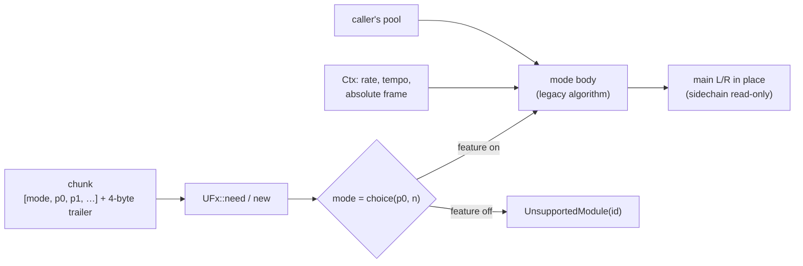

| Kind | Mode 0 | Mode 1 | Mode 2 |
|---|---|---|---|
| 65 distortion | shaper (6): drive, threshold, foldover, dry/wet, shaper, oversampling | curve (8): x1, y1, x2, y2, power1–3, dry/wet (QM Screwdriver, qm210 WaveSabre fork) | power (1): amount |
| 66 crusher | crusher (3): vertical, horizontal, dry/wet | | |
| 67 EQ | parametric (14): low cut f/Q; peaks 1–3 f/gain/Q; high cut f/Q; master | 3band (3): low, mid, high | |
| 68 delay | tempo (9): L/R coarse + fine, low cut, high cut, feedback, cross, dry/wet | ms (3): left, right, decay | |
| 69 chorus | chorus (3): rate, depth, gain | | |
| 70 flanger | phaser (9): type, amount, feedback, spread, vibrato f/amount, low cut, high cut, dry/wet | ring (4): lfo, freq, amp, wet | |
| 71 reverb | freeverb (8): freeze, room, damp, width, low cut, high cut, dry/wet, pre-delay | compact (4): room, damp, wet, width | rooms (6): room size, feedback, low cut, high cut, dry/wet, pre-delay |
| 72 compressor | compressor (7): sidechain key, input gain, threshold, ratio, attack, release, output gain | | |
| 73 formant | formant (2): vowel, wet | | |

V2 modes (change add-v2-import, features `us-fx-eq-cut`, `-delay-v2`, `-reverb-v2`, `-compressor-v2`) port V2's global
effects. Their parameters store `V2 raw / 128` in V2's order, with `era` (format version) last. Their mode values
sit between the old ones (`fx::mode_value`), so old stored modes are unchanged.

| Kind | V2 mode |
|---|---|
| 67 EQ | cut (3): low cut, high cut, era (V2's post filters) |
| 68 delay | v2 (8): volume, feedback, delay L, delay R, mod rate, mod depth, mod phase, era |
| 71 reverb | v2 (5): time, high cut, low cut (no effect below format 4), volume, era; wet only, mono input |
| 72 compressor | v2 (10): detect (off/peak/RMS), couple (stereo link), auto gain, lookahead, threshold, ratio, attack, release, out gain, era |

Properties that hold for every mode:

- **Chunk.** Little-endian f32 values `[mode, p0, …]` and a 4-byte trailer that is ignored; missing parameters keep the
  legacy defaults. The mode is chunk-only (`set_param(0, …)` is ignored) because it sizes the memory.
- **Close to the legacy effect.** At 44.1 kHz and tempo 120 every mode renders bit-identically to its legacy effect
  (WaveSabre's biquad and SVF keep its 512-entry sine table, whose error shifts low resonant corners audibly).
- **Rate and tempo from the context.** The WaveSabre effects always did this. The modes taken from Tunefish (power, 3band, ms, chorus, ring, compact, formant) assumed 44.1 kHz and
  now take the song's rate: the delay is in milliseconds, the EQ corners (880 Hz, 5 kHz) and the flanger's sweep speed
  and delay range are in Hz and seconds, the chorus's LFO rate is per second, the Freeverb tunings scale with the
  rate, and the formant filter's poles are mapped (`z → z^(44100/rate)`, DC gain kept) so the vowels keep their
  formant frequencies (A 800/1150 Hz, E 350/2000, I 260/2140, O 450/800, U 320/700). All are unchanged at 44.1 kHz.
- **Call size independence.** The output does not depend on how a render is split into calls. The chorus's 512-frame
  control grid counts the song's absolute frames (`Ctx::frame`).
- **Buffers.** Main L/R are transformed in place; the sidechain pair is read (compressor key) and never written.
- **Memory.** Delay lines and reverb buffers come from the caller's pool, sized at load from the rate, the tempo and
  the chunk's parameters (tempo delay: 16 eighths + 200 ms at the song tempo; ms delay and phaser: 1 s; reverb: the Freeverb
  lines at the rate; pre-delay: 500 ms).
- **Features.** `us-fx-distortion-shaper`, `-curve`, `-power`, `us-fx-crusher`, `us-fx-eq-parametric`, `-3band`, `us-fx-delay-tempo`,
  `-ms`, `us-fx-chorus`, `us-fx-flanger-phaser`, `-ring`, `us-fx-reverb-freeverb`, `-compact`, `-rooms`,
  `us-fx-compressor`, `us-fx-formant`. A chunk that selects a mode the build lacks fails at load with
  `UnsupportedModule` naming the (kind, mode) (`module::FX_*`).

Goldens: `tests/golden_fx.txt` holds a hash of every mode's output on a fixed input at 44.1 kHz / 120 BPM and at
48 kHz / 90 BPM (`UPDATE_GOLDEN=1 cargo test -p unisynth golden` rewrites it).

## Converter (`crates/synth-convert`)

Status: song structure, effect devices, the WaveSabre and Tunefish instruments, `.tfm` songs, loose patches and the feature list (tasks 6.1–6.4).

```text
synth-convert ws    <in.song> <out.song>                   synth-mix song, legacy kinds → unified kinds
synth-convert tfm   <in.tfm> <out.song> [tail-seconds]     .tfm song → unified song (tail after the last event, default 4)
synth-convert patch <patch.txt> <phrase.txt> <out.song>    one Tunefish patch (112 numbers) played by `block note velocity` lines
synth-convert features <unified.song>                      the cargo features of `unisynth` the song needs, comma separated
```

`ws` reads a `synth-mix` song with legacy kinds, maps each device **in place** (same device index, so tracks, lanes,
receives and volumes need no renumbering) and writes a song with only unified kinds.

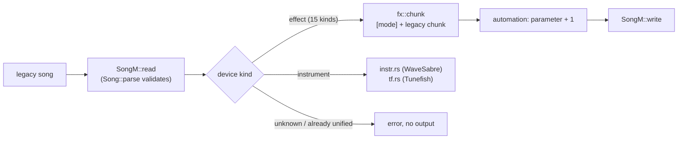

| Legacy effect | Unified kind | Mode |
|---|---|---|
| WaveSabre Scissor / fork Screwdriver (kind 13) / Tunefish distortion | 65 distortion | 0 / 1 / 2 (stored 0 / 0.5 / 1.0; power keeps 1.0) |
| WaveSabre Crusher | 66 crusher | 0 |
| WaveSabre Leveller / Tunefish EQ | 67 EQ | 0 / 1 |
| WaveSabre Echo / Tunefish delay | 68 delay | 0 / 1 |
| Tunefish chorus | 69 chorus | 0 |
| WaveSabre Twister / Tunefish flanger | 70 flanger | 0 / 1 |
| WaveSabre Cathedral / Tunefish reverb / WaveSabre Chamber | 71 reverb | 0 / 1 / 2 |
| WaveSabre Smasher | 72 compressor | 0 |
| Tunefish formant | 73 formant | 0 |

An effect's parameters keep their legacy meaning, so its chunk is the legacy chunk with the mode value in front, and
its automation keeps the points and moves to parameter index + 1 (index 0 is the mode). Everything outside the devices
is copied: tempo, rate, length, lanes, track volumes, receives with their channel (main or sidechain) and volume,
device order and automation timing. The output is written only when every device converted, so an error never leaves a
partial file.

### V2 songs (`.v2m`, change add-v2-import)

Farbrausch's V2 synth (kb, 2000–2008; public domain) stores songs as `.v2m`. "v1/v2/v3" are its **format versions
0–6**. Each version adds patch or global parameters: v1 compressors and boost, v2 transpose and ring mod, v3 filter
balance, v4 reverb low cut, v5 LFO polarity, v6 aux sends. `src/v2m.rs` reads every version. It finds the version
from the globals size and the patch sizes, and upgrades the file to the version 6 layout exactly as V2's own
`ConvertV2M` does. The output is byte-identical to the v2redux loader on all 359 local songs.

```text
u32 timediv, u32 maxtime, u32 gdnum, gdnum × {time 3 planes, usecs u32, num, den, tpq}  (planar)
16 × channel: u32 notes [+ notes 5 B, u32 pcs + 4 B, u32 bends + 5 B, 7 × (u32 ctls + 4 B)]   (3 delta-time planes, then
              one plane per value, each value a wrapping delta of the previous one)
u32 23 + globals, u32 size + patch block (u32 offsets, patches: 89 params, modnum, modnum × (source, amount, dest))
u32 size + speech block (u32 n, n × u32 offset, zero-terminated phoneme strings)
```

`V2m::timeline(rate)` replays V2's sequencer: one tick per distinct event time, per channel in the order program,
controllers 1–7, bend, notes. The first tick is at frame 0, and frames advance by V2's integer `UpdateSampleDelta`.
Its remainder carries only on u32 overflow, so each segment is in effect truncated. The test against v2redux's
sequencer is event-identical on the 15 acceptance songs. V2 reads bend values at the *program-change* plane width, so
bends decode correctly only when a channel has as many program changes as bends. The timeline keeps this, because
it is what the songs play.

Songs, references and oracles live outside the repo: `tools/v2-extract` and `research/v2-intros.md`. The songs are
© their authors and never committed.

### WaveSabre instruments

Each instrument becomes one kind-64 device. Its patch is a pure function of the legacy parameters, built through their
physical values (`crates/synth-convert/src/instr.rs`), so a legacy parameter maps to a unified value by the legacy law
and the unified inverse, never by copying the normalized number unless the two laws are the same.

| Legacy | Unified |
|---|---|
| Falcon | slots 1–2 phase-mod: ratio/fine/blend copied, slot 1 gain 13.25 (`16p²` law), mix 0, feedback `fb²/2`, send `ff²`; slot 2 gain 1, feedback `13.25·fb²/2`. Envelope 1 = operator 2 (Scale route to its gain, ends the voice), envelope 2 = operator 1 (Scale route to slot 1 gain), envelope 3 = pitch (Offset routes `±36·(2a − 1)` st to each slot's pitch). Envelope 1 at output off, velocity 0, master `(0.4m)²` |
| Slaughter | slots with volume > 0 (or automated) saw/pulse: gain volume², coarse `floor(24.99d)`, fine 0..1 st, blend, width `1 − v`; noise level `v²`; filter 1 SVF (type `(int)3p`), cutoff and resonance copied; envelope 1 amp, 2 mod (Offset `19 980·(2m − 1)` Hz to the cutoff), 3 pitch (Offset `36·(2a − 1)` st); master `16·(0.4m)²`; rise → transpose `24·rise`; velocity 0 |
| Vibrato (Falcon, Slaughter) | LFO 1 sine at `((v² + 0.1)·70)/2π` Hz (upstream's phase is in radians), Offset on pitch of `amount` st; left out when the amount is 0 and never automated |
| Specimen, Adultery | slot 1 sampler (GSM entry 1 or DLS wave `index`), start/loop mode `(int)2v`/bounds/reverse/interpolation as choices, coarse `floor((2c − 1)·12)`, fine `2f − 1`; filter 1 and the mod-envelope route as Slaughter; envelope 1 amp, 2 mod; master `(0.4m)²`; velocity 1 (`vel/128`) |
| Thunder | slot 1 sampler, fixed pitch at middle C, one-shot, gain ×√2 (equal-power pan), no filter, velocity 0, 1 ms attack (upstream has none) |
| Common | unison `(int)(15p) + 1`, detune and spread copied, mono legato `(int)v == 1`, slide copied; capacity from the song; start-phase spread 12.57 samples (Slaughter) or minimum (Falcon) |

**Capacity.** The most voices that sound at once: overlapping notes of every lane the device hears (note-on to
note-off plus the amp release at its largest in the chunk and its automation) times the unison count, 1–64. A song that
needs more gets a warning (WaveSabre's 256 voices never steal, the unified instrument steals the oldest).

**Automation.** A legacy parameter's byte lane is re-mapped to every unified parameter that parameter changes, found by
evaluating the mapping at all 256 byte values. Continuous laws keep the legacy points (same frames) at the unified
values and gain points where linear interpolation would be more than one byte step from the unified value of the legacy
interpolation at a 100-frame sub-block start. Discrete decodes (filter and sampler choices, unison, coarse, ratio) are
read at every sub-block start and written as steps (two points at one frame) where the decoded value changes. Lanes of
structural parameters (capacity, oscillator type, sampler source and index) are not written.

**Known differences.** The mapping is checked by rendering the same songs with the legacy crate and, converted, with
`unisynth` (`crates/synth-convert/tests/parity.rs`): loudness within 0.3 dB and every octave band within 1 dB for all
synthetic songs, 0 dB for Thunder, Specimen and Adultery. What does not match: a Slaughter filter envelope that drives the
cutoff below 0 Hz (the state-variable filter freezes upstream and passes a little of the transient here, up to 0.8 dB
and 5 dB in the lowest band), and Thunder's first millisecond (the envelope's minimum attack).

### Tunefish instrument and `.tfm` songs

The Tunefish instrument (kind 32, or one `.tfm` instrument) becomes one kind-64 device plus its insert effects. The
patch is again a pure function of the 112 values (`crates/synth-convert/src/tf.rs`).

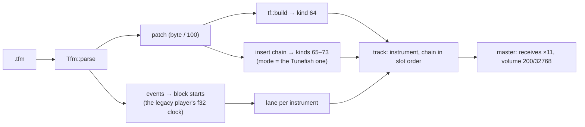

| Tunefish | Unified |
|---|---|
| generator `Gen*` | oscillator slot 1, wavetable: every shape value copied, unison `round(9p) + 1` layers, octave `4 − round(8p)`, fixed frequency from 0.00001 up (no left/right detune then) |
| `Gain` | voice master, `gain_curve` (`(2g)²` to 0.5, then `1 + 20(g − 0.5)`) through the unified gain law |
| `GenVol`, `GenPan` | slot gain `0.4·vol·k` and the equal-power pan that gives the same left and right levels as Tunefish's linear balance (`k = √(1 + r²)`, √2 at the centre, `r = 2·min(p, 1 − p)`) |
| noise | level `NoiseOn·√2`; band on below `NoiseBw` 0.99, low-pass ladder at `f + bw`, high-pass RBJ at `f − bw` |
| filters | slots 1–4 = ladder low-pass, RBJ high-pass, RBJ band-pass, notch; on above 0.5; the cutoff is the same Hz (`30 + 20 000f²`, RBJ `30 + 10 000f²`) through the unified cutoff law |
| LFOs | rate `50p²/2π` Hz, same five shapes, key sync from 0.5 up |
| ADSRs | rate-mode envelopes (Tunefish) with the same curve values. The ADSR routed to volume is envelope 1 (ends the voice); without one, envelope 1 is the **organ gate** |
| mod slots 1–8 | Scale slots at the same index with the same source, amount and target (destination ids map one to one; `LFO`/`ADSR`/wheel sources become ids 5–7/1–2/7); slots 9 and 10 never ran in Tunefish and are dropped; velocity (`vel/128`) gets two more Scale routes, to the generator gain and to the noise level |
| `GenPoly` | capacity (1–16), stealing the oldest |
| `GenGlid` | exponential glide of `10g + 1` blocks (a time constant of that many 512-frame blocks) |
| effect slots 1–10 | one effect device each after the instrument, in slot order: kind `round(10p)` 1–7 → kinds 65 (power), 68 (ms), 69 (chorus), 70 (ring), 71 (compact), 73 (formant), 67 (3band), parameters from the patch |

**Organ gate.** A Tunefish voice sounds while its key is held and until every envelope that a mod slot reads has
finished, then gates at once (its volume ramps to 0 within that block). With no ADSR on volume, envelope 1 holds the
note: instant attack, sustain 1, a release equal to the longest release among the envelopes in use (simulated from their
sustain level, in whole blocks, up to 5 s), plus a third of a block, the point where an abrupt cut carries the energy of
Tunefish's linear fade. It does not scale the output (`env1-at-output` is off).

**`.tfm` songs.** One track per non-empty instrument (the instrument, then its inserts), a master track last. An event
at row `r` lands at the start of the 512-frame block that contains `r · 60/(tempo·4)` s, found with the legacy
player's own `f32` clock (tempo 125, row 1 → block 10). Note 0 is dropped, velocity 0 becomes a note-off, notes keep
their low 7 bits. The master receives every instrument at ×11 and has volume `200/32768`, so the unified 16-bit output is
the legacy one.

**Songs with kind 32 devices.** The device converts in place; its insert effects become devices appended to the song and
listed after it in every track that lists the instrument. Automation of effect parameters (patch indices 84–103) moves
to those effect devices at parameter index + 1 in the effect's own order; automation of instrument parameters follows
the rules above (`GenUnis` and the octave step, the filter switches step, the voice limit is structural). Automating an
effect slot's kind (74–83) or a mod slot's source or target is an error, because the unified patch cannot change its
routing during a song; a slot's amount may move. Lane events keep their frames (the unified instrument starts a note at
its exact frame, not at the block start).

**Known differences.** `GenSlop` (a random detune of up to ±8 Hz per voice) has no unified counterpart; the converter
warns above 1 Hz. Stepped-random LFO shapes draw their own sequence. The wavetable's random phases, its random
phase-stage drift and the unison layers' start phases are drawn from different generators, so a short passage differs by
a few dB between engines while a song of a few dozen notes agrees on loudness (two-instrument `.tfm`, 48 notes: 0.2–0.7 dB
over seven seeds; every synthetic patch in `tests/tunefish.rs`, single layer: ≤ 1 dB, bands ≤ 3 dB). The pan matches at
rest; a pan modulated through the matrix scales the equal-power value instead of the linear balance.

### Walkthrough

Every command below runs as written from the repository root (the legacy songs come from the WaveSabre test suite;
`song.tfm` is any Tunefish module, here the one the size probe builds).

```sh
cargo build -q --release -p synth-convert
SC=target/release/synth-convert
mkdir -p /tmp/uni && FEATURES_DUMP=/tmp/uni cargo test -q -p synth-convert --test features dump   # legacy/*.song and converted *.song

# a legacy song → unified kinds; warnings (voice cap, unison > 16, GenSlop) go to stderr
$SC ws /tmp/uni/legacy/slaughter_automation.song /tmp/uni/slaughter.song
$SC features /tmp/uni/slaughter.song                    # → us-osc-blit,us-noise,us-flt-svf,us-env-timed
tools/check-song-features.sh /tmp/uni/slaughter.song --minimal   # exactly that list builds, loads, and each feature is needed

# a .tfm song (tail = seconds after the last event, default 4)
$SC tfm "$(find research/tf-size-probe -name song.tfm | head -1)" /tmp/uni/tf.song 2
$SC features /tmp/uni/tf.song

# one Tunefish patch + a phrase (examples/patch.txt: 112 numbers, examples/phrase.txt: block note velocity)
$SC patch crates/synth-convert/examples/patch.txt crates/synth-convert/examples/phrase.txt /tmp/uni/pad.song
cargo run -q --release -p unisynth --features std --example render -- /tmp/uni/pad.song /tmp/uni/pad.wav   # listen

# a V2 song (no songs in the repo: `bun tools/v2-extract/v2.ts gather` fills $V2_SONGS); tail seconds, then
# --channels <hex mask> / --era auto|kkrieger2004 for debugging
V2=${V2_SONGS:-$HOME/Downloads/64k-tools/synth-lab/v2songs}/acceptance/fr08.v2m
[ -f "$V2" ] && $SC v2m "$V2" /tmp/uni/fr08.song 4 && $SC features /tmp/uni/fr08.song

# errors name the problem, exit non-zero and write nothing
$SC ws /tmp/uni/slaughter.song /tmp/uni/again.song; echo "exit $?"      # already unified
```

### Feature list (`features`)

A compo build links only the modules its song uses (`default-features = false`). `synth-convert features song.bin`
prints them, ready for `--features`:

```text
$ synth-convert features slaughter.song
us-osc-blit,us-noise,us-flt-svf,us-env-timed
```

The analysis (`unisynth::needs`, `crates/synth-convert/src/features.rs`) reads the **unified** song (a legacy device is an
error: convert first) and mirrors the load-time checks, so the build it describes loads the song:

| Module | Needed when |
|---|---|
| `us-osc-pm`, `-blit`, `-wt`, `-sample` | an oscillator slot has that type (the type is structural: it comes from the chunk) |
| `us-sample-gsm` | the chunk carries a sample section (a GSM index must name one of its entries) |
| `us-sample-dls` | a sampler slot's source is the GM.DLS bank |
| `us-flt-svf`, `-ladder`, `-rbj`, `-notch` | a filter slot has such a type, **or a lane can step it to one**: the span of the lane's values is read, and every type between its lowest and highest value counts |
| `us-env-timed`, `-tf` | envelope 1 always; the others when a mod slot reads them; the mode is the chunk's or any a lane reaches |
| `us-noise` | the noise level is above 0, a mod slot routes to it, or a lane can raise it |
| `us-fx-<kind>-<mode>` | an effect device of that kind and mode |

A lane on a mod slot's source or target can create any route, so it counts as reading every envelope and reaching the
noise (the converter never writes one: Tunefish's routing automation is rejected and WaveSabre has none). The instrument
itself and its voice framework have no feature. `us-osc-sample` is implied by the two sample sources.

**Compo-build check.** `tools/check-song-features.sh song.bin [--minimal] [bank.dls]` takes that list and builds
`unisynth` with exactly those features twice: on the host (`--example render` loads and renders the song, exit 1 names
the missing module) and for the i686 core-only target (`-Zbuild-std=core`, no std). `--minimal` then drops each listed
feature and requires the song to fail to load or to sound different. Checked on the converted WaveSabre test songs
(Falcon `us-osc-pm,us-env-timed`; the showcase 16 features including both sample sources) and on a `.tfm`
(`us-osc-wt,us-noise,us-env-timed,us-env-rate` and the seven Tunefish effect modes): every list builds and loads, and every
feature in every list is needed.

### Demo songs

The six reference songs (WaveSabre Global Groove, Elysian, Engage, Eladamri; Tunefish no_remorse, tf4testsong) are the
songs the A/B renders play. `tools/demo-songs/build.ts` converts them and saves them as `song/1` in `project/music`
(`WS_SONG_DIR=<dir with elysian.bin …> TF_SONGS=<dir with *.tfm> bun tools/demo-songs/build.ts`; a missing source is
skipped). Each file starts with a `meta` block:

```json
"meta": {
  "title": "Elysian",
  "author": "logicoma (the composer is not named in the repository)",
  "description": "Elysian, an Ableton Live project … This is an adapted version, not the original recording: The project was converted to a WaveSabre song …, then by `synth-convert ws` to the unified synth …, then imported to song/1 … sound close to, not identical with, the original …",
  "copyright": "Copyright 2012-2021 WaveSabre Team",
  "license": "MIT",
  "url": "https://github.com/logicomacorp/WaveSabre/blob/9245fb8…/Tests/WaveSabreConvertTests/Tests/Elysian.als",
  "adapted_from": "Elysian.als (https://github.com/…)"
}
```

The description of an adapted work must say so (`song check` enforces it); the licence is the one of the original code
(MIT for WaveSabre, GPL-3.0-or-later for Tunefish), and `project/music/NOTICE.md` lists all six. The blob carries no
metadata: the JSON is the record. Measured when they were built, against the legacy engines' renders: Elysian +0.06 dB,
Engage 0.00 dB, Eladamri −0.24 dB, no_remorse −0.04 dB, tf4testsong +0.13 dB; Global Groove −1.9 dB, which task 7.2
closed (noise width and the fine window: it now reads 0.00 dB). The current figures are in
`tools/unisynth-parity/report.md` (see Parity, speed and size).

## Parity, speed and size

`tools/unisynth-parity` (`bun tools/unisynth-parity/parity.ts`, opt-in; `WS_SONG_DIR` and `TF_SONGS` name the synth lab
songs) decides whether the unified synth may replace the legacy engines. Its report, `tools/unisynth-parity/report.md`,
is committed and holds metrics only.

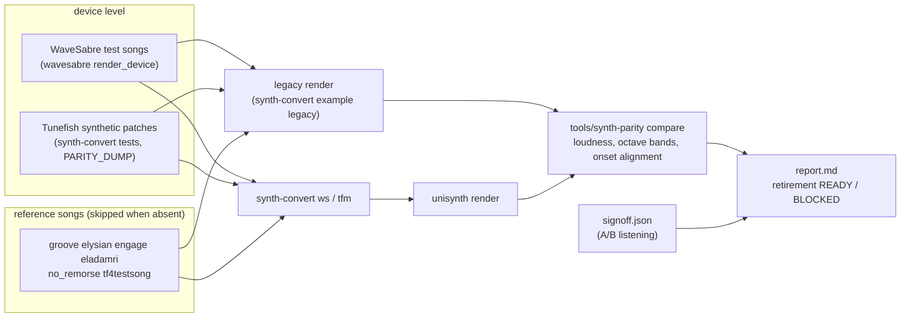

- **Metrics.** Integrated loudness ±1 dB (BS.1770-4), octave bands 63 Hz–16 kHz ±3 dB (bands more than 24 dB below the
  loudest reference band are not compared), onset timing within 100 frames (WaveSabre) or 512 (Tunefish), the last by
  the lag and correlation of the onset-strength curves (correlation ≥ 0.5) rather than by matching picked peaks.
- **Random draws.** Global Groove and the five unison patches are rendered with 8 seeds; the mean must agree within the
  tolerance plus twice the spread between seeds (the report lists the spreads).
- **Retirement.** `READY` only when every device and every reference song passes (songs that did not run block it) and
  `signoff.json` records an approved A/B listening; otherwise `BLOCKED`, naming the failing items.
- **Speed.** Timed on `[profile.fast]`, the release profile at opt-level 3, for the legacy engine and the converted song
  alike; the report also gives the shipped size profile (`release`, opt-level z). The unified synth is more generic
  than the legacy engines and depends more on the optimiser: at opt-level z it is slower relative to them.
- **Size.** `research/us-size-probe/measure.sh` builds the i686 probe for the all-modules build and for each song's
  feature list and writes `tools/unisynth-parity/size.md`, which the report includes (`V2_SONGS` adds V2 rows).
- **V2.** `bun tools/unisynth-parity/v2.ts [--renders]` runs the 15 V2 acceptance songs: v2redux renders against
  `synth-convert v2m` → unisynth, with the same song metrics and both renders cut to the shorter one. It writes
  `v2-report.md` (15 of 15 pass) and reads the listening decision from `v2-signoff.json`. Without songs it skips.
  V2 voice state sits in `v2::Opt` (zero-sized without a V2 voice feature, via the internal `us-v2-any`), so a build
  without V2 does not carry it. A trusted build without a kind's V2 feature decodes that choice with the old law
  (`params::kinds::decode_in`). Songs without V2 now cost +180 to +470 B xz over the build before V2 (`size.md`,
  design D11).

What the first full run found and fixed (task 7.2), in the order it was found:

| Finding | Fix |
|---|---|
| WaveSabre noise is mono, ours was independent per channel: every band of Global Groove 3–5 dB low in a mono sum | `noise.width` (index 183), 0 for Slaughter |
| 2 ms envelopes sampled every 32 frames lose their peak: Global Groove −1.75 dB | 8-frame control grid for 256 frames after each note edge |
| Tunefish voices lived on in their exponential release: 33 voices against 19, half the speed | free a releasing voice that is inaudible |
| 10 reverbs ran all song long | a silent reverb sleeps |
| the mod matrix was scanned for every target of every segment (a quarter of the time) | one pass builds a table (`modmx::Tab`), bit-identical |
| band and onset checks written for near-identical renders failed on deep stopbands and on neighbouring hits | band floor, onset alignment, seed ensembles (above) |

