# WaveSabre engine (`crates/wavesabre`)

A `no_std` f32 Rust port of the 13 WaveSabre devices (Logicoma, logicomacorp/WaveSabre @ 9245fb8, MIT; the upstream
notice is kept in `crates/wavesabre/LICENSE-WaveSabre`). It runs on [`synth-core`](synth-core.md): devices implement
`Device`, instruments use `VoicePool` and `Events<256>`, and songs play through `synth_core::mix::Player`.

The port reproduces upstream numerics on purpose: the 512-entry FastSin table, the `RandFloat` random law, the
`2^(dB/6)` "dB" law, the f32/f64 mix and the expression order. Upstream undefined behaviour (unchecked indices, empty
sample chunks, under-sized chunks) is guarded instead of reproduced. 12 of 16 parity songs are bit-identical with a
native upstream build; the rest are ≥ 100 dB SNR (`research/softsynth-research.md`).

Per-file record: `crates/wavesabre/AGENTS.md`. Spec: `openspec/specs/ws-synth/spec.md`.

## Device set

| Kind | Device | Type | Params | Feature | One line |
|---:|---|---|---:|---|---|
| 0 | Falcon | instrument | 32 | `ws-falcon` | 2-operator phase-modulation synth |
| 1 | Slaughter | instrument | 42 | `ws-slaughter` | 3 BLIT saw/pulse oscillators + noise → SVF |
| 2 | Thunder | instrument | 0 | `ws-thunder` | Deprecated: plays a GSM sample once at unity pitch |
| 3 | Scissor | effect | 6 | `ws-scissor` | Waveshaper with oversampling |
| 4 | Leveller | effect | 14 | `ws-leveller` | 5-band EQ |
| 5 | Crusher | effect | 3 | `ws-crusher` | Bit depth + sample-rate reduction |
| 6 | Echo | effect | 9 | `ws-echo` | Tempo-synced stereo delay |
| 7 | Smasher | effect | 7 | `ws-smasher` | Peak compressor with sidechain |
| 8 | Chamber | effect | 6 | `ws-chamber` | 8-line cross-fed delay reverb |
| 9 | Twister | effect | 9 | `ws-twister` | Flanger / phaser |
| 10 | Cathedral | effect | 8 | `ws-cathedral` | Freeverb |
| 11 | Adultery | instrument | 28 | `ws-adultery` | Sampler over GM.DLS waves |
| 12 | Specimen | instrument | 26 | `ws-specimen` | Sampler over a GSM 6.10 sample in the chunk |

`ws-all` (default) enables everything. Every single-device build compiles warning-free, so a compo build links only the
devices its song uses.

## Crate structure

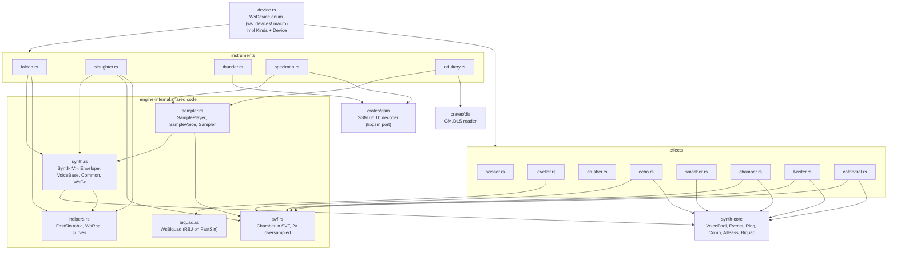

## Loading a device

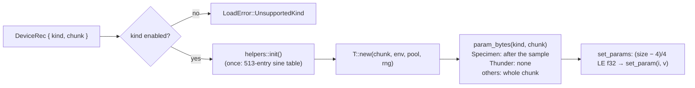

A chunk shorter than the parameter count leaves the rest at defaults; a chunk under 4 bytes sets nothing.

## Shared numerics (`helpers.rs`)

| Helper | Definition |
|---|---|
| `fast_sin(x)` | 512-entry table + linear interpolation. Index = 9 bits of the mantissa of `frac(x/2π) + 1`, fraction = the next 23 bits |
| `square35(φ)` | `sin(3φ)/3 + sin(5φ)/5` (Falcon's waveform blend) |
| `WsRng` | `seed = seed·0x15A4E35` (wrapping i32), output `(seed % 255)/255`, seed 1, range ≈ [−1, 1] |
| `note_to_freq(n)` | `440 · 2^((n − 69)/12)` |
| `scalar_to_env_value(p)` | Envelope time in ms: `p²·5000 + 1` |
| `volume_to_scalar(v)` | `(0.4v)²` |
| `db_to_scalar(db)` | `2^(db/6)` (not `10^(db/20)`) |
| `param_to_frequency(p)` | `20 + 19980·p²` Hz |
| `param_to_q(p)` | `p < .5`: `0.33 + 0.67·2p`; else `1 + 11·(2p − 1)` |
| `param_to_db(p, range)` | `(2p − 1)·range` |
| `param_to_unisono(p)` | `trunc(15p) + 1` (1..16) |
| `param_to_vibrato_freq(p)` | `(p² + 0.1)·70` Hz |
| pan | `L = √(1 − pan)`, `R = √pan` |

## Instrument core (`synth.rs`)

Falcon, Slaughter, Specimen and Adultery all build on `Synth<V>`: a 256-voice `VoicePool` (`Steal::None`) plus
`Events<256>` and the `Common` settings.

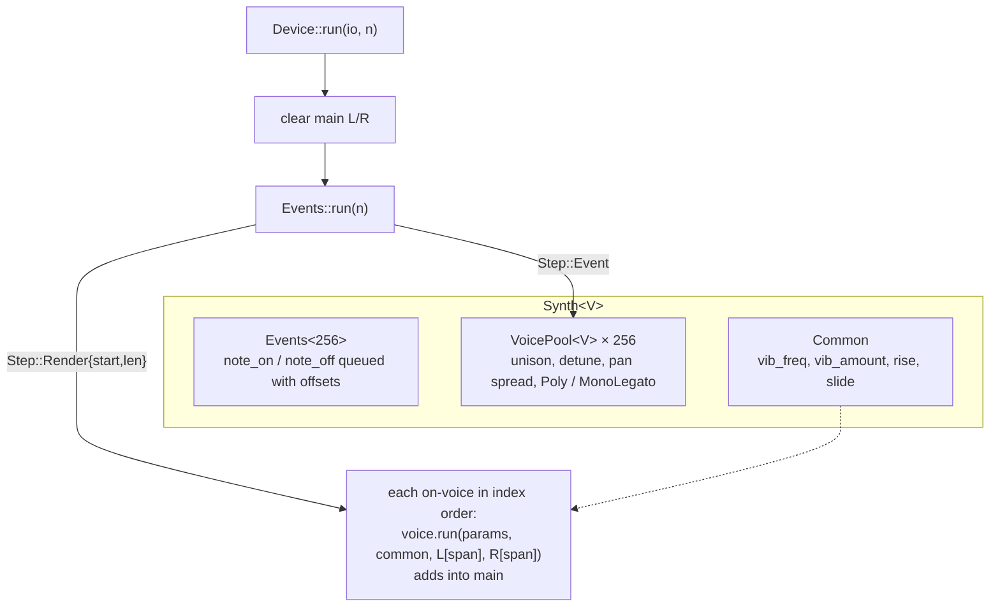

### Common parameters

Every instrument maps these from its own indices: `Unisono` (1–16 voices per note), `Detune`, `Pan` (unison pan
spread), `VibratoFreq`, `VibratoAmount`, `Rise` (`+24·rise` semitones), `VoiceMode` (`(int)v == 1` → mono legato; a
change kills all voices) and `Slide` (legato glide time `10·slide⁴` s).

### Envelope

Times in ms, advanced once per sample by `1000/rate` ms.

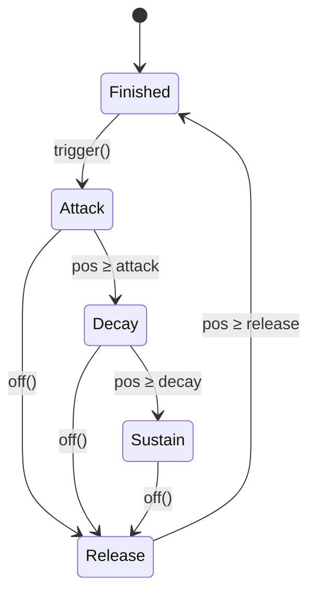

| Stage | Value |
|---|---|
| Attack | `pos / attack` (linear) |
| Decay | `f = (1 − pos/decay)²`; `f + sustain·(1 − f)` |
| Sustain | `sustain` |
| Release | `(1 − pos/release)² · value_at_off` |

A voice turns off when its amplitude envelope reaches `Finished`.

### Voice pitch

`VoiceBase::get_note()` returns the current (possibly sliding) note; the slide moves linearly in semitones over
`rate·10·slide⁴` samples. Each instrument then adds unison detune, rise, vibrato `FastSin(vib_phase)·vib_amount` and
its pitch envelope before converting with `note_to_freq`.

## Falcon (kind 0): 2-operator PM

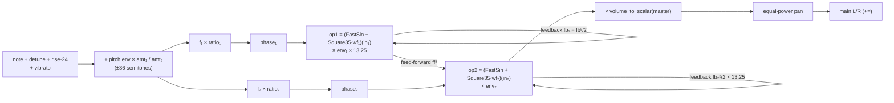

- `in₁ = 2π·phase₁/rate + out₁·fb₁`, `in₂ = 2π·phase₂/rate + out₂·fb₂·13.25 + out₁·ff`.
- Frequency ratio per operator: `1 + floor(coarse·32.99) + ((fine − 0.5)·2)³`.
- One song-rng draw at note-on sets both operator phases. Velocity is ignored.
- The voice ends when operator 2's envelope finishes.

| Index | Param | Index | Param |
|---:|---|---:|---|
| 0 | Osc1 waveform | 17 | Master |
| 1 | Osc1 ratio coarse | 18 | Voices (unison) |
| 2 | Osc1 ratio fine | 19 | Detune |
| 3 | Osc1 feedback | 20 | Spread (pan) |
| 4 | Osc1 feed-forward | 21 | Vibrato freq |
| 5–8 | Osc1 A D S R | 22 | Vibrato amount |
| 9 | Osc2 waveform | 23 | Rise |
| 10 | Osc2 ratio coarse | 24–27 | Pitch env A D S R |
| 11 | Osc2 ratio fine | 28 | Pitch env → osc1 (±36 st) |
| 12 | Osc2 feedback | 29 | Pitch env → osc2 (±36 st) |
| 13–16 | Osc2 A D S R | 30 | Voice mode |
| | | 31 | Slide |

## Slaughter (kind 1): subtractive BLIT

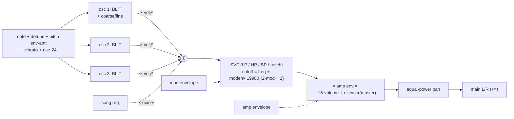

### Oscillator: integrated band-limited impulse train

Per sample, with `P = rate / (2·f)` (half period in samples):

```text
phase  = (phase + 1) mod 2P
blit1  = sinc(π(phase − P))                 # FastSin(x)/x, 1 near 0
phase2 = (phase + 2P·pw) mod 2P − P
blit2  = sinc(π·phase2)
integral = 0.998·integral + dc·(1 − waveform) + blit1 − blit2·waveform      # dc = −0.498/P
```

`waveform = 0` gives a saw (one impulse train plus DC compensation); `waveform = 1` subtracts a second, shifted train
and gives a pulse of width `pw`. Values in between blend. The leak 0.998 keeps the integrator bounded.

At load, each of the 256 voices draws its 3 start phases from the song rng (upstream voice constructors).
Phases and integrators run on across notes; `reset` restores the load-time phases. Coarse detune is
`floor(c·24.99)` semitones plus fine. Velocity is ignored.

### SVF (`svf.rs`)

Chamberlin state-variable filter, 2× oversampled by feeding the midpoint `(last + x)/2` and then `x`, averaging the two
outputs. `f = 1.5·FastSin(π·fc / 2 / rate)`; `q` is `1 − resonance`. Kind = `(int)(p·3)`: 0 LP, 1 HP, 2 BP, 3 notch.

| Index | Param | Index | Param |
|---:|---|---:|---|
| 0–4 | Osc1 waveform, pulse width, volume, coarse, fine | 24–27 | Mod env A D S R |
| 5–9 | Osc2 (same) | 28 | Master |
| 10–14 | Osc3 (same) | 29–34 | Voices, detune, spread, vib freq, vib amount, rise |
| 15 | Noise volume | 35–38 | Pitch env A D S R |
| 16 | Filter type | 39 | Pitch env amount (±36 st) |
| 17 | Filter freq | 40 | Voice mode |
| 18 | Filter resonance | 41 | Slide |
| 19 | Filter mod amount | | |
| 20–23 | Amp env A D S R | | |

## Sample instruments

### Sources and chunk layout

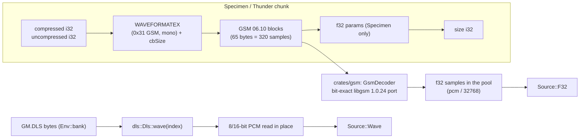

The GSM decoder handles WAV49 framing (a 33-byte and a 32-byte frame per 65-byte block). Sample length is
`min(uncompressed, blocks·320)`; a trailing partial block is ignored.

### Sample voice (`sampler.rs`, shared by Specimen and Adultery)

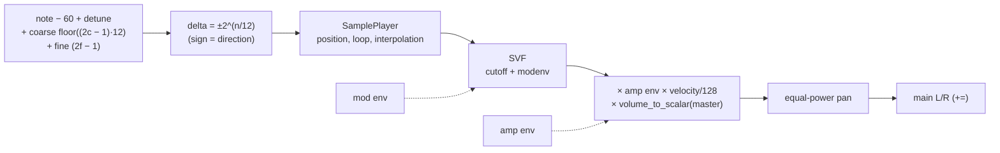

`SamplePlayer` (upstream behaviour):

| Setting | Values |
|---|---|
| Start | `sample_start·(len − 1)`, mirrored when reversed |
| Loop mode `(int)(2v)` | 0 disabled, 1 repeat, 2 ping-pong (out of range → disabled) |
| Loop bounds | From the sample (Adultery: DLS `wsmp` loop, else whole wave) or manual (`loop_start·len`, `loop_length·len`) |
| Interpolation `(int)v` | 0 nearest, 1 linear (repeat mode interpolates across the loop seam), else silence |
| End | Position outside the sample → voice off |

A voice takes the sample at note-on and keeps it until its next note-on, so a later sample change never removes
data from under a playing voice.

| Device | Param map |
|---|---|
| Specimen (26) | Amp ADSR 0–3, sample start 4, loop mode 5, loop start 6, loop length 7, reverse 8, interpolation 9, coarse 10, fine 11, filter type/freq/res/mod 12–15, mod ADSR 16–19, voices 20, detune 21, spread 22, master 23, voice mode 24, slide 25. Defaults: no loop, manual bounds |
| Adultery (28) | Sample index 0 (`(int)v − 1` into the bank's waves), then the Specimen map with "loop boundary" (from sample / manual) inserted after loop mode. Defaults: repeat loop, bounds from the sample. No bank or a missing index → silence |

### Thunder (kind 2)

Deprecated upstream. Plays its GSM sample once from the start at unity pitch, mono to both sides, no gain or envelope;
note-off does nothing. No parameters.

## Effects

All effects process main L/R in place. Smasher is the only one that reads the sidechain.

### Scissor (kind 3): waveshaper

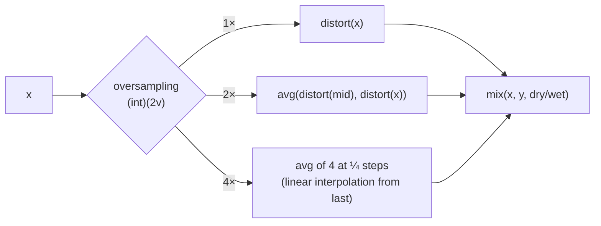

`distort(v)`: `v/threshold · drive`, then shaper `(int)(2v)`: 0 clip with foldover beyond ±1, 1 `v·π/2`, 2 `v³`; clamp to
±1 and multiply back by threshold. Drive: `< 0.2` → `1 − (0.2 − d)`, else `1 + 5·(5(d − 0.2))²`. Params: drive,
threshold, foldover, dry/wet, shaper, oversampling.

### Leveller (kind 4): 5-band EQ

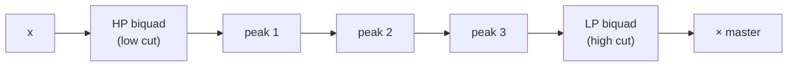

Each band is a `WsBiquad` (RBJ coefficients from FastSin/FastCos at f32 `w0`, recomputed on change, on
`synth_core::dsp::Biquad`). A peak at exactly 0 dB is skipped. Gains use `param_to_db(v, 24)`. Quirk reproduced: at
20 Hz the FastCos error exceeds `1 − cos w0`, so the lowest low cut acts near 42 Hz with Q ≈ 2.1. Params: low cut
freq/Q, peak 1–3 freq/gain/Q, high cut freq/Q, master.

### Crusher (kind 5)

Per channel: a hold phase advances by `(1 − horizontal)²`; on wrap it samples the input quantised to steps of
`1/2^((1 − vertical)·15 + 1)`. Output `mix(x, hold, dry/wet)`.

### Echo (kind 6): tempo-synced delay

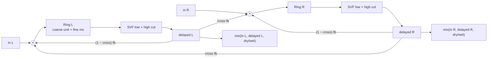

`unit = 120/tempo/8·1000` ms (a quarter beat; read from `Ctx::tempo` on every call), coarse `trunc(16v)` units, fine
`trunc(200v)` ms. Capacity is sized at load for 16 units + 200 ms at the song tempo. Params: left coarse, left fine,
right coarse, right fine, low cut, high cut, feedback, cross, dry/wet.

### Smasher (kind 7): compressor

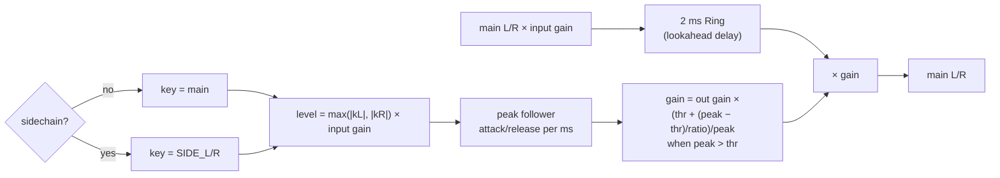

Threshold `param_to_db(v/2, 36)`, ratio `18v² + 2`, attack `env_ms(v)/5`, release `env_ms(v)`, input and output gain
`param_to_db(v, 12)`, all through the `2^(dB/6)` law. The ring is written before it is read, so the audio path is
delayed by the 2 ms buffer.

### Chamber (kind 8): delay-network reverb

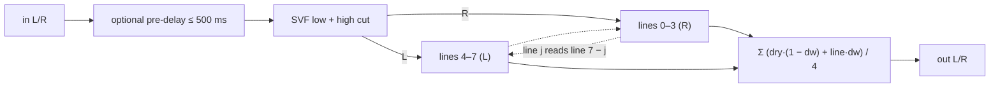

Eight `Ring` lines of 7, 21, 17, 13, 3, 11, 23, 31 ms × mode multiplier (1, 5, 10). For `j` in 0..8, line `j` is
written with `filtered + line[7 − j].oldest()·fb` (lines 0–3 feed R, 4–7 feed L), so each channel's lines are fed by the
other channel's. Feedback `0.5 + 0.5v`. Mode is clamped to 0..2 (upstream indexes the table unchecked). Params: mode,
feedback, low cut, high cut, dry/wet, pre-delay.

### Twister (kind 9): flanger / phaser

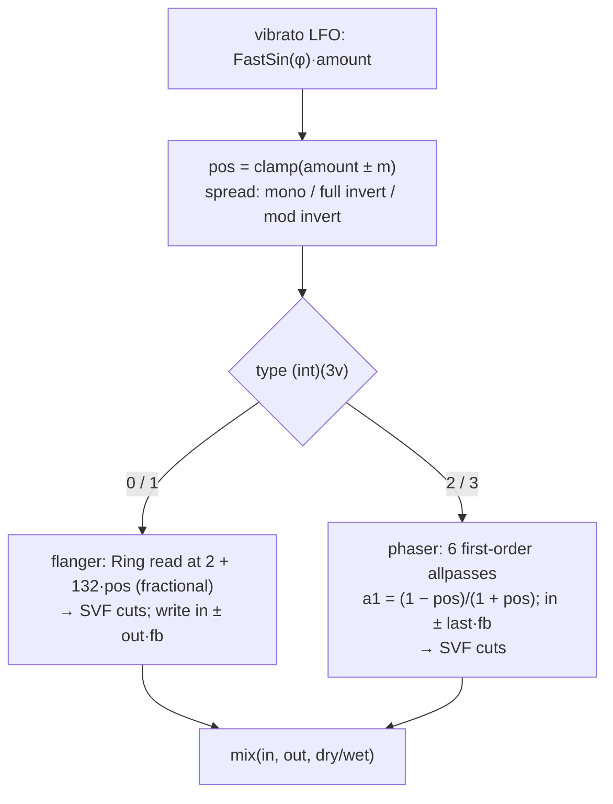

Types 0/2 use positive feedback, 1/3 negative. One-second ring per channel. Params: type, amount, feedback, spread, vib
freq, vib amount, low cut, high cut, dry/wet.

### Cathedral (kind 10): Freeverb

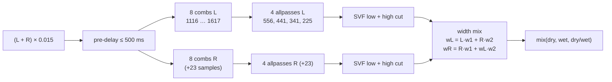

Shared `synth_core::dsp::{Comb, AllPass}` with stock 44.1 kHz tunings; allpass feedback fixed 0.5, comb feedback =
room, damp = damp. Freeze sets room 1, damp 0, input gain 0. `w1 = width/2 + 0.5`, `w2 = (1 − width)/2`. Quirk kept: the
right output uses the already-mixed left. Params: freeze, room, damp, width, low cut, high cut, dry/wet, pre-delay.

## A typical song graph

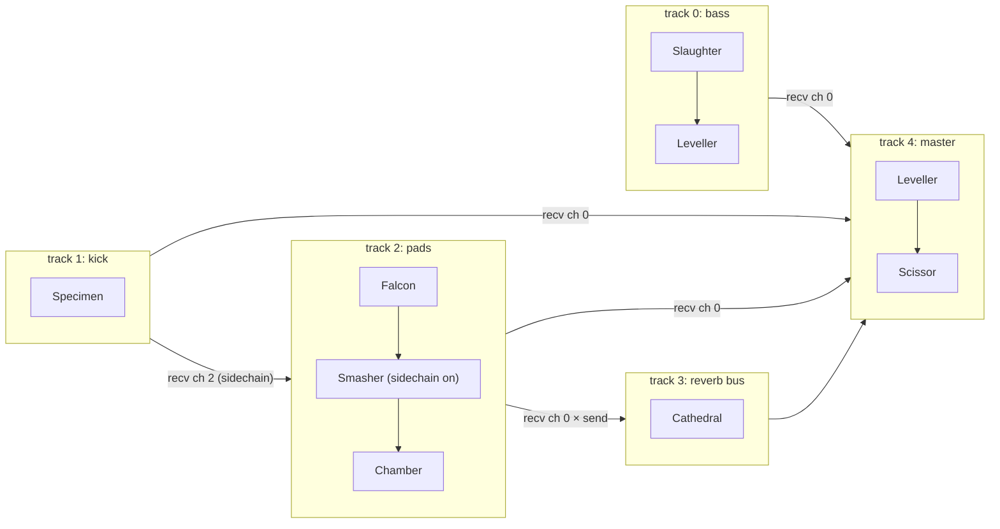

The player orders tracks so every sender renders before its receivers; the last track is the master.

## Verification

- `crates/wavesabre/tests/golden.rs`: FNV-1a hashes of synthetic songs covering every device (`tests/songs.rs`),
  rendered in odd 777-frame chunks; reset = fresh load; interleaved songs equal separate renders; pool one byte short
  → `OutOfMemory`.
- `tools/ws-parity`: native upstream build vs ours per device (SNR ≥ 60 dB).
- `tools/synth-parity`: whole songs (BS.1770 loudness, octave spectrum, onsets).
- Rendering: `cargo run -p wavesabre --example render -- <song.bin> <out.wav> [bank.dls]`.
